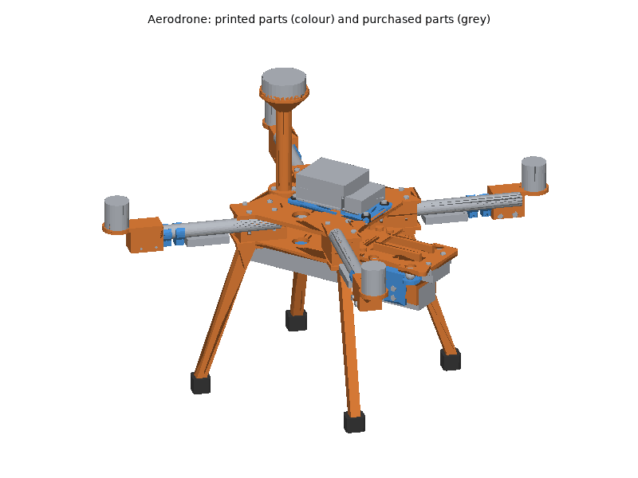
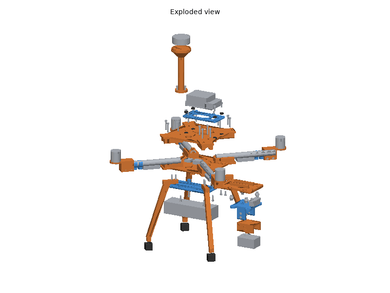
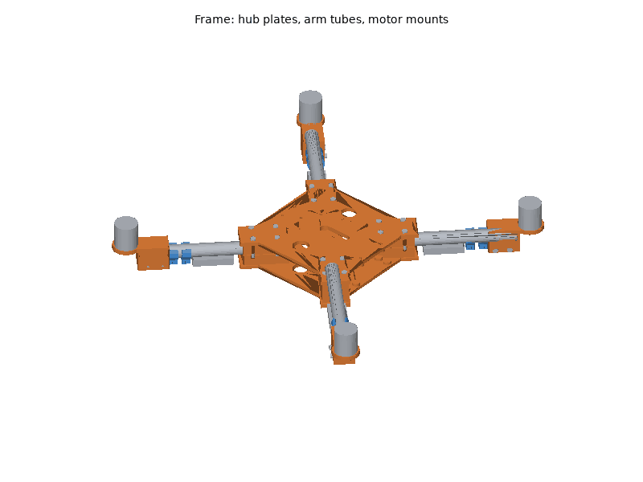
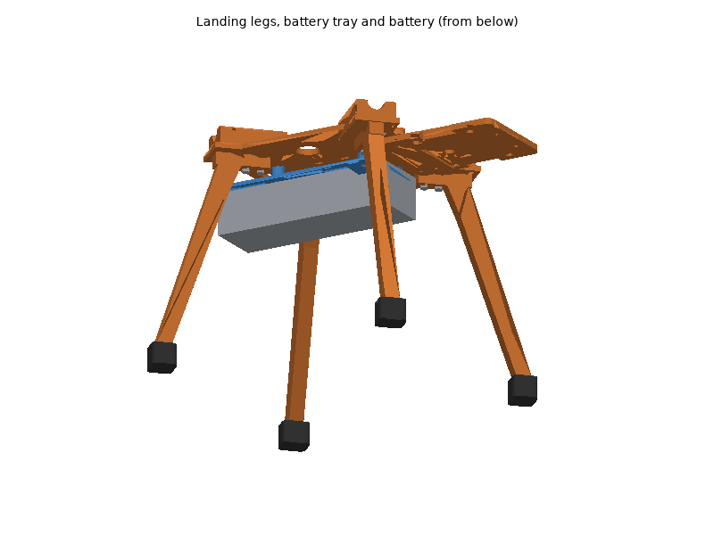
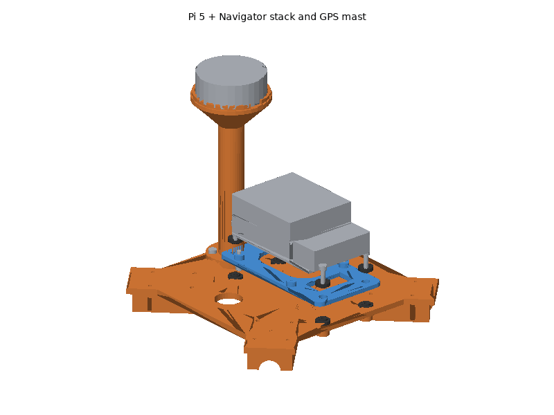
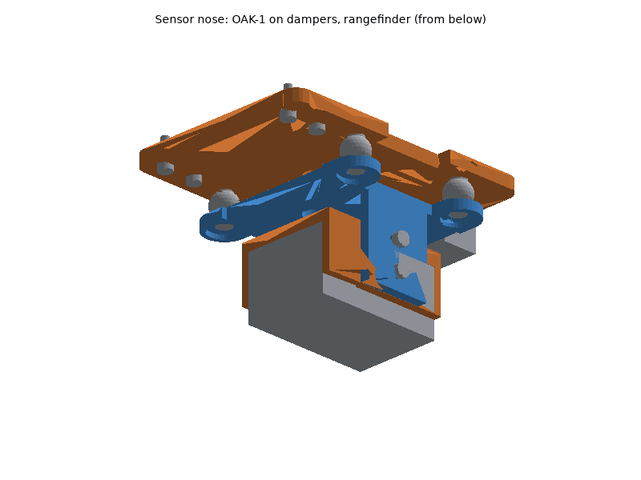

# Aerodrone printed parts

The aerodrone's frame hub, motor mounts, landing gear, payload mounts and
cable clips are printed; the arm tubes, propulsion, battery, electronics,
sensors and fasteners are bought (see the bill of materials,
[hardware/aerodrone.md](../../aerodrone.md), for what and why). The
frame is a 500 mm quad X (X500 class): four 16 mm carbon tubes clamped
between two printed hub plates, 2216-size motors on printed mounts, 10 in
propellers, a 4S pack under the hub, the Pi 5 + Navigator stack on top and
the downward OAK-1 and rangefinder on a nose under the front.

## Printing

All parts print on a Bambu Lab P1S (256 mm bed) with Bambu Studio's P1S
system profiles; set only what the plate tables list. The STLs are in
[`stl/`](stl/), already in their print orientation: import them, keep the
orientation, and arrange.

### Plates

<!-- BEGIN GENERATED: plates (tools/build_printable_parts.py) -->
#### Plate A: ASA, 0.20 mm layers

Filament **Bambu ASA**, **Textured PEI Plate**, process **0.20mm Standard**. Estimated 5 h 54 min and 188 g of filament (estimates; slice for real numbers).

| Part | Qty | Per-object settings | Orientation | File |
|---|---|---|---|---|
| `hub_bottom_plate` | 1 | 4 wall loops, 4/4 top/bottom shells, 25% gyroid, supports: none, brim: outer brim only, 5 mm | flat underside on the plate, clamp blocks up | [stl](stl/hub_bottom_plate.stl) |
| `oak1_cradle` | 1 | 4 wall loops, 5/4 top/bottom shells, 40% gyroid, supports: none, brim: auto | upside down: camera seat on the plate, walls up | [stl](stl/oak1_cradle.stl) |
| `motor_mount` | 3 | 5 wall loops, 6/6 top/bottom shells, 50% gyroid, supports: none, brim: auto | upside down: motor seat on the plate, tube clamp up (slit on top) | [stl](stl/motor_mount.stl) |

#### Plate B: ASA, 0.20 mm layers

Filament **Bambu ASA**, **Textured PEI Plate**, process **0.20mm Standard**. Estimated 3 h 53 min and 127 g of filament (estimates; slice for real numbers).

| Part | Qty | Per-object settings | Orientation | File |
|---|---|---|---|---|
| `hub_top_plate` | 1 | 4 wall loops, 4/4 top/bottom shells, 25% gyroid, supports: none, brim: outer brim only, 5 mm | upside down: flat top face on the plate, clamp blocks up | [stl](stl/hub_top_plate.stl) |
| `motor_mount` | 1 | 5 wall loops, 6/6 top/bottom shells, 50% gyroid, supports: none, brim: auto | upside down: motor seat on the plate, tube clamp up (slit on top) | [stl](stl/motor_mount.stl) |

#### Plate C: ASA, 0.20 mm layers

Filament **Bambu ASA**, **Textured PEI Plate**, process **0.20mm Standard**. Estimated 1 h 38 min and 51 g of filament (estimates; slice for real numbers).

| Part | Qty | Per-object settings | Orientation | File |
|---|---|---|---|---|
| `landing_leg` | 2 | 5 wall loops, 5/5 top/bottom shells, 40% gyroid, supports: none, brim: auto | lying flat on its side (the 12 mm thickness vertical) | [stl](stl/landing_leg.stl) |

#### Plate D: ASA, 0.20 mm layers

Filament **Bambu ASA**, **Textured PEI Plate**, process **0.20mm Standard**. Estimated 1 h 38 min and 51 g of filament (estimates; slice for real numbers).

| Part | Qty | Per-object settings | Orientation | File |
|---|---|---|---|---|
| `landing_leg` | 2 | 5 wall loops, 5/5 top/bottom shells, 40% gyroid, supports: none, brim: auto | lying flat on its side (the 12 mm thickness vertical) | [stl](stl/landing_leg.stl) |

#### Plate E: ASA, 0.20 mm layers

Filament **Bambu ASA**, **Textured PEI Plate**, process **0.20mm Standard**. Estimated 2 h 24 min and 66 g of filament (estimates; slice for real numbers).

| Part | Qty | Per-object settings | Orientation | File |
|---|---|---|---|---|
| `sensor_nose` | 1 | 4 wall loops, 5/4 top/bottom shells, 30% gyroid, supports: none, brim: auto | flat underside on the plate, ribs up | [stl](stl/sensor_nose.stl) |
| `gps_mast` | 1 | 4 wall loops, 5/4 top/bottom shells, 25% gyroid, supports: none, brim: outer brim only, 5 mm | upright: flange on the plate (the 45 deg cone under the seat needs no supports) | [stl](stl/gps_mast.stl) |

#### Plate F: PETG, 0.20 mm layers

Filament **Bambu PETG Basic**, **Textured PEI Plate**, process **0.20mm Standard**. Estimated 2 h 54 min and 88 g of filament (estimates; slice for real numbers).

| Part | Qty | Per-object settings | Orientation | File |
|---|---|---|---|---|
| `battery_tray` | 1 | 3 wall loops, 5/4 top/bottom shells, 30% gyroid, supports: none, brim: auto | flat battery face on the plate, posts and ribs up | [stl](stl/battery_tray.stl) |
| `stack_tray` | 1 | 3 wall loops, 5/4 top/bottom shells, 30% gyroid, supports: none, brim: auto | flat underside on the plate, bosses up | [stl](stl/stack_tray.stl) |
| `oak1_stage` | 1 | 4 wall loops, 5/4 top/bottom shells, 40% gyroid, supports: none, brim: auto | upside down: flat top on the plate, cheeks up | [stl](stl/oak1_stage.stl) |
| `cable_clip` | 8 | 4 wall loops, 5/4 top/bottom shells, 100% gyroid, supports: none, brim: auto | on its side: the C profile flat on the plate | [stl](stl/cable_clip.stl) |

#### Plate G: TPU95A, 0.20 mm layers

Filament **Bambu TPU 95A HF (or Bambu TPU 95A)**, **Textured PEI Plate**, process **0.20mm Standard**. Estimated 1 h 46 min and 22 g of filament (estimates; slice for real numbers).

| Part | Qty | Per-object settings | Orientation | File |
|---|---|---|---|---|
| `leg_foot` | 4 | 3 wall loops, 5/4 top/bottom shells, 30% gyroid, supports: none, brim: auto | socket opening up, flat sole on the plate | [stl](stl/leg_foot.stl) |
| `stack_grommet` | 8 | 3 wall loops, 4/4 top/bottom shells, 100% gyroid, supports: none, brim: auto | flange down, sleeve up | [stl](stl/stack_grommet.stl) |
<!-- END GENERATED: plates -->

Times and filament are estimates from each part's volume (see
[`stl/manifest.md`](stl/manifest.md)); Bambu Studio's slice is the real
number. Parts of one material and layer height can be combined on fewer
plates when Bambu Studio's auto-arrange fits them.

### Material and printer notes

- **ASA** (frame, motor mounts, legs, nose, cradle, GPS mast): door
  closed and lid on for the whole print, Textured PEI plate, no fan blast
  on the first layers (the system profile already does this). Let the
  chamber cool before opening the door, or large flat parts (the hub
  plates) can lift at the corners. Dry the spool (8 h at 80 C) if it
  crackles.
- **PETG** (stack tray, camera stage, battery tray, cable clips): Textured
  PEI plate (PETG bonds too well to smooth PEI). Dry 8 h at 65 C if it
  strings.
- **TPU 95A** (feet, stack grommets): always dry first (8 h at 70 C),
  feed from the external spool holder, not through an AMS, and keep the
  system profile's slow speeds.
- **No carbon-filled filament is needed.** If you want stiffer motor
  mounts or hub plates, PA-CF or PETG-CF work with the same files but
  need the hardened steel nozzle upgrade (the stock P1S nozzle is
  stainless steel and wears through quickly).

### Post-processing

1. **Print the fit-test parts first** and check them against the real
   parts before printing the rest. These are the parts with dimensions not
   stated in the cited datasheets:
   - `motor_mount`: your motor's base against the slots (Holybro's
     "16x16 mm" read as a cross of holes 16 mm apart), the screw depth, and
     the 8.5 mm centre hole (shaft end, circlip).
   - `sensor_nose` and `oak1_stage`: the damper-ball necks in the 6.5 mm
     holes of the 2 mm tabs (generic balls have no drawing); the TFmini-S
     or TF-Luna ear holes in the rangefinder slots.
   - `oak1_cradle`: the OAK-1 between the walls and its tripod screw
     reaching the thread.
   - `stack_tray`: the Pi 5's underside (microSD socket) clearing the tray.
2. **Supports**: none of the parts need them. Clean stringing out of the
   arm-tube half bores (hub plates) and the motor-mount bore so the tubes
   seat on their stops.
3. **Heat-set inserts** (CNC Kitchen type, hole sizes from their table; see
   the fastener table): soldering iron with an insert tip at **245-260 C
   for ASA**, 230-245 C for PETG. Press straight down, stop when the insert
   is flush, hold flat for a few seconds, let it cool before loading it.
   - `hub_bottom_plate`: 32 x M3 x 5.7: 16 from the top of the clamp
     blocks, 16 from the underside (8 landing legs, 4 battery tray, 4 nose).
   - `hub_top_plate`: 7 x M3 x 5.7 from the top face (4 stack grommets, 3
     GPS mast).
   - `motor_mount`: 2 x M3 x 5.7 each, horizontal, into the far side of
     the pinch clamp.
   - `oak1_cradle`: 4 x M3 x 3 (short), horizontal, into the side bosses,
     pressed flush from outside.
4. **Holes**: the M3 clearance holes (3.4 mm) need no reaming; if a printed
   hole is tight, run a 3.4 mm drill through by hand. Do not drill the
   insert holes.
5. **TPU feet** (`leg_foot`) press onto the leg tenons; a drop of CA glue if
   they work loose.

### Bambu Studio project files

Not provided. A Bambu Studio 3MF carries per-plate filament, process and
object settings in Bambu's own project metadata, which can only be checked
by opening it in Bambu Studio; a plain 3MF would drop those settings. Import
the STLs instead (they are already oriented) and set the per-object values
from the plate tables.

## Assembly

### Tools and consumables

- Hex keys or drivers: 2.0 mm (M2.5), 2.5 mm (M3), 5/32 in (1/4"-20
  socket head) or 4 mm/5/32 in for a button head; small Phillips (ST2.9).
- Soldering iron with a heat-set insert tip, and a fine tip for wiring.
- Fine-tooth saw or tube cutter for carbon tube, sanding block, dust mask
  (carbon dust), calipers, straight edge, small bubble level.
- Medium (blue) thread locker: only on screws into metal (motor bases).
  Never on screws into heat-set inserts in printed parts.
- Zip ties (2.5 mm), double-sided foam tape (VHB), heat-shrink tubing,
  battery straps, anti-slip pad (all in the BOM).
- Smoke stopper or a current-limited bench supply for the first power-up.

### Fasteners

Every screw, insert and strap with its quantity and use is in the
generated fastener table of the BOM:
[hardware/aerodrone.md, "Fasteners"](../../aerodrone.md#fasteners). Torque:
"snug" for every screw into an insert (about 0.5-0.8 N m, two fingers on a
short hex key); more strips the insert out of the plastic.

### Steps

Body directions: **x forward (nose), y left, z up**; motor numbers are
ArduPilot's quad X: **1 front right, 2 rear left, 3 front left, 4 rear
right**.

1. **Inserts.** Press all heat-set inserts (Post-processing, step 3) and
   let the parts cool.
   *Check:* each insert flush and square; an M3 screw turns in freely.
2. **Arm tubes.** Cut four 16 mm carbon tubes to **180.0 mm**, ends square
   (sand flat on a block), edges deburred; wear a mask.
   *Check:* all four within 0.5 mm of each other (they set the 500 mm
   motor spacing).
3. **Motor mounts on the tubes.** Slide each tube into a `motor_mount`
   until it touches the stop at the end of the bore. Fit the two M3 x 25
   pinch screws into the inserts, but leave them loose.
4. **Motors.** Bolt each motor to its `motor_mount` with four M3 x 8 (or
   the motor's own screws) from underneath, blue thread locker, snug
   (about 1 N m into the metal base). Lead wires toward the hub.
   *Check:* turn the bell by hand: no rubbing, no screw touching the
   windings.
5. **Hub.** Lay the `hub_bottom_plate` blocks up, the four nose inserts
   (underside, near one edge) at the front and the battery-lead slot at the
   rear. Lay the four tubes in its half bores, pushed in to the stops, motors
   up, motor 1 at front right. Put the `hub_top_plate` on, flat face up, the
   three GPS-mast inserts at the rear, then the 16 M3 x 25 clamp screws with
   washers. Tighten in a cross pattern in two passes, snug: the clamp blocks
   end about 1 mm apart.
   *Check:* the tubes do not turn or slide by hand.
6. **Level the motors.** Lay a straight edge across the hub top plate and
   each motor seat in turn, turn the `motor_mount` on its tube until the seat
   is parallel to the plate, then tighten the pinch screws.
   *Check:* the four motor shafts are vertical with the frame on a flat
   table (a tilted motor costs yaw authority).
7. **ESCs and arm wiring.** Zip-tie one ESC under each tube between the hub
   and the middle of the arm; snap two `cable_clip`s onto each tube
   (outer half, tab underneath) and tie the motor leads and ESC signal lead
   to their tabs. Solder or plug the motor leads; swap any two to reverse a
   motor later.
8. **Power.** Inside the hub (between the plates): the Power Sense Module,
   the power distribution (board or harness) and the 5 V supply, held with
   zip ties through the four centre slots of the `hub_bottom_plate`. The
   battery lead (XT60) comes out through the rear slot. See **Wiring**.

9. **Landing legs.** Bolt each `landing_leg` under a plate ear with two
   M3 x 16 from below, the foot end pointing outward; press a `leg_foot` onto
   each leg end.
   *Check:* the aircraft stands level on a flat table.
10. **Battery tray.** Bolt the `battery_tray` under the hub with four
    M3 x 14 (heads recessed in the posts), straps threaded through the slot
    pairs, anti-slip pad on the battery face.
11. **Stack.** Put a `stack_grommet` (flange down) over each of the four
    stack inserts on the top plate, the `stack_tray` on them, a second
    `stack_grommet` (flange up) into each tray hole, and an M3 x 12 with a
    washer through each pair: snug only, stop when the flanges start to
    bulge. Assemble the Raspberry Pi 5, Navigator heatsink and Navigator as
    in Blue Robotics' Navigator Hardware Setup, but on the tray instead of
    the kit's standoff: two M2.5 x 12 from under the tray, through the Pi,
    into the heatsink. USB/Ethernet end toward the nose, microSD toward the
    tail.
    *Check:* the tray moves slightly on the grommets and touches nothing
    else; the Pi's underside clears the tray.

12. **GPS mast.** Bolt the `gps_mast` to the rear of the top plate with
    three M3 x 10, the lip's cable notch toward the nose. Stick the GPS
    puck on the seat with foam tape, **arrow toward the nose**.
13. **Sensor nose.** Fix the rangefinder under the front of the
    `sensor_nose`, lenses down, long side across the nose (TFmini-S: two
    ST2.9 x 9.5 from above into its ears, gently, they cut their own thread;
    TF-Luna: two M2 x 12 with nuts). Snap the four damper balls into the
    nose's 6.5 mm holes from below. Bolt the nose under the bottom plate
    with four M3 x 10.

14. **OAK-1.** Screw the OAK-1 to the `oak1_cradle` with the 1/4"-20 x 1/2"
    screw, lens away from the cradle, **USB-C end toward the tail**. Put the
    cradle between the cheeks of the `oak1_stage` with M3 x 8 pivot screws
    and M3 x 8 lock screws (washers) through the arc slots, then snap the
    stage onto the damper balls. Set the pitch (see **Checks**) and tighten
    the lock screws.
    *Check:* the stage hangs free on the balls; the camera and cable touch
    nothing rigid.
15. **Wiring** as below, then the **Checks**.

### Wiring

Power path (see the BOM's "Power and wiring" for parts and budget):

- **Battery** XT60 -> **Power Sense Module** (5.5 mm bullets in, #6 spades
  out: fit an XT60 pigtail on its input) -> power distribution -> the four
  ESCs and the **5 V 6 A supply**. The supply's 0.1 in header output feeds
  the Navigator's main 5 V input; the Navigator powers the Pi 5 through the
  40-pin header. Nothing else feeds the Pi.
- **Power Sense Module** sense cable (JST-GH 6) -> Navigator **POWER**.
- **ESC signals** -> Navigator **PWM 1-4** in motor order (1 front right,
  2 rear left, 3 front left, 4 rear right). If an ESC has a BEC (red wire on
  its signal lead), pull that pin out and insulate it: it must not back-feed
  the Navigator's servo rail.
- **GPS** -> Navigator **SERIAL 5 + I2C 6** (JST-GH 6). Check the pin order
  of the cable against the Navigator's pinout before plugging in: the
  Holybro puck's standard cable is a 10-pin GH. Run it down the mast with
  two cable ties.
- **RC receiver** (SBUS out) -> Navigator **RC** header (3-pin 0.1 in;
  inverted SBUS is the default). Antennas clear of the carbon tubes.
- **Telemetry radio** -> a free Navigator **SERIAL** port (JST-GH 6), and
  the BlueOS/ArduPilot serial protocol set for MAVLink.
- **OAK-1**: a USB 3 Type-C cable with a **right-angle C plug pointing
  sideways**, up through a cable notch in the side of the nose and along the
  front of the hub to one of the Pi 5's blue USB 3 ports. Leave a loose
  service loop between the camera and the nose: a tight cable bridges the
  dampers. Keep the USB 3 cable away from the GPS mast (USB 3 radiates in
  the GNSS band).
- **Rangefinder**: its GH1.25 4-pin lead to a **3.3 V USB-UART adapter**
  (sensor TX -> adapter RX, sensor RX -> adapter TX, 5 V and GND from the
  adapter), adapter in a Pi USB 2 port; set `RANGEFINDER_DEVICE` to its
  `/dev/serial/by-id/` path (`applications/rangefinder/README.md`). Do not
  also configure it as an ArduPilot rangefinder.
- Strain relief: a zip tie at every place a lead leaves a moving or
  isolated part (stack tray, camera stage, motor mounts), heat-shrink on
  every solder joint, and no wire within reach of a propeller disc.

### Checks

Do these before the first flight, then follow the bench and flight steps in
[hardware/aerodrone.md, "Recommended assembly order"](../../aerodrone.md#recommended-assembly-order)
and the parameter and GPS-denied set-up in
[systems/aerodrone/README.md](../../../systems/aerodrone/README.md).

<!-- BEGIN GENERATED: assembly (tools/build_printable_parts.py) -->
Generated by the assembly check (`assembly.py`), from the CAD and datasheet masses:

- Battery centre for a centred CG (mm along x; negative = behind the hub centre): -23.5
- Battery within the tray: yes
- Centre of gravity with the battery there (x, y, z mm from the hub centre): -0.0; 0.0; -13.1
- Estimated take-off mass (g): 2072
- Bodies in the check: 139
- Interference between parts (screws modelled through their holes): none
- Intended press fits: 12
- Camera view clear: yes (69 x 55 deg + 2 deg margin)
- Rangefinder beam clear: yes
- Propeller discs clear: yes (5 mm radial, 3 mm below and 9 mm above the disc)
- All assembly checks passed: yes
<!-- END GENERATED: assembly -->

- **Centre of gravity.** With everything fitted and the flight battery
  strapped on, lift the aircraft by two fingers under opposite arm tubes,
  close to the hub, on both diagonals: it must hang level. Slide the
  battery fore or aft to trim; the assembly check above gives the expected
  battery position. Mark it on the tray.
- **OAK-1 nadir alignment.** Stand the aircraft level on its feet (bubble
  level on the hub top plate). Loosen the two lock screws, set the camera so
  a bubble level on the cradle's back reads level (the lens then looks
  straight down), tighten. With the USB-C end toward the tail the image top
  points to the nose, which is `CAMERA_MOUNT_YAW_DEG = 0.0` in
  `systems/aerodrone/config/topics.env`. Confirm with a still image: an
  object placed in front of the aircraft must appear at the top of the
  image; if not, find the right value as described in
  [systems/aerodrone/README.md](../../../systems/aerodrone/README.md).
- **Propeller direction.** Props off: run the ArduPilot motor test (one
  motor at a time) and check order and spin: motors 1 and 2 (front right,
  rear left) counter-clockwise, 3 and 4 (front left, rear right) clockwise
  seen from above. Fit CCW props on 1 and 2, CW props on 3 and 4.
- **Vibration isolation.** The stack tray and the camera stage must touch
  nothing but their grommets and dampers; no taut cable may bridge them.
  After the first hover, check ArduPilot's VIBE (below 30 m/s/s, no
  clipping) and set up the harmonic notch; balance the props if needed.
- **Props-off first power-up.** Smoke stopper or current-limited supply on
  the battery lead. Check the 5 V rail at the Navigator (5.0-5.35 V), the
  Navigator and Pi LEDs, BlueOS reachable, `vcgencmd get_throttled` = 0x0
  with the whole stack running, the OAK-1 on USB 3 (`lsusb -t`: 5000M) and
  the rangefinder publishing on `/aerodrone/rangefinder`.
- **Every flight**: battery straps through both slot pairs and tight, props
  tight, no cracked print (especially motor mounts, hub plates, legs).
