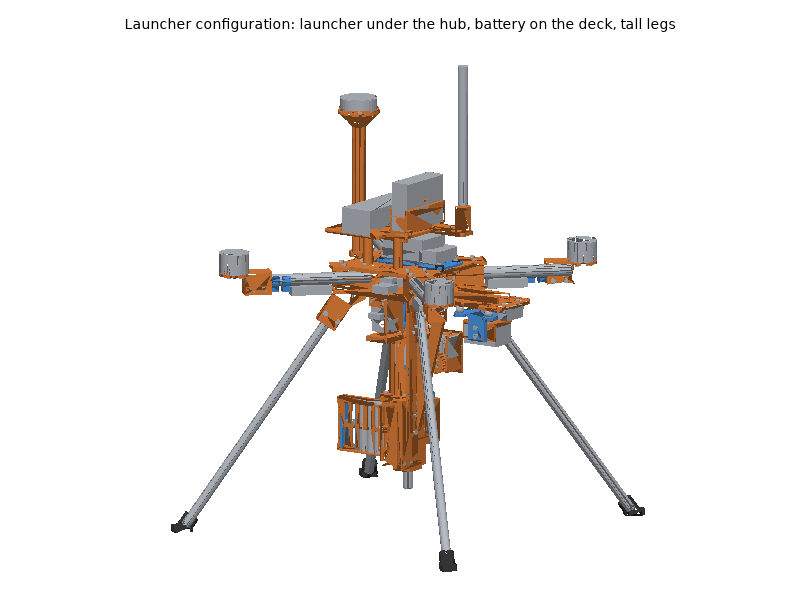
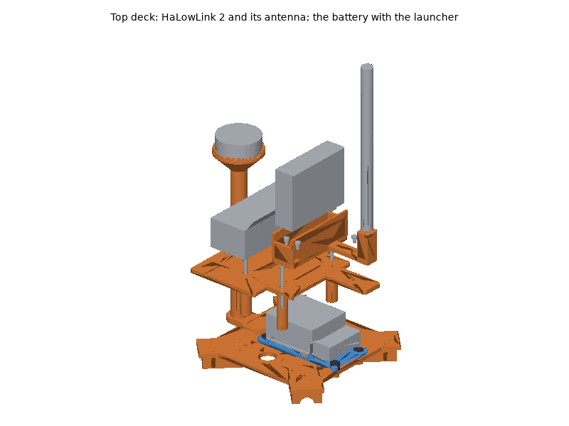
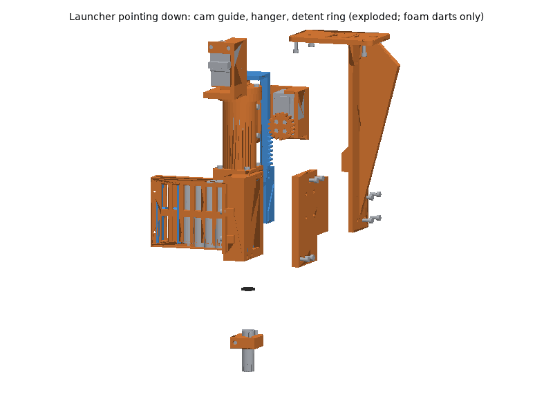
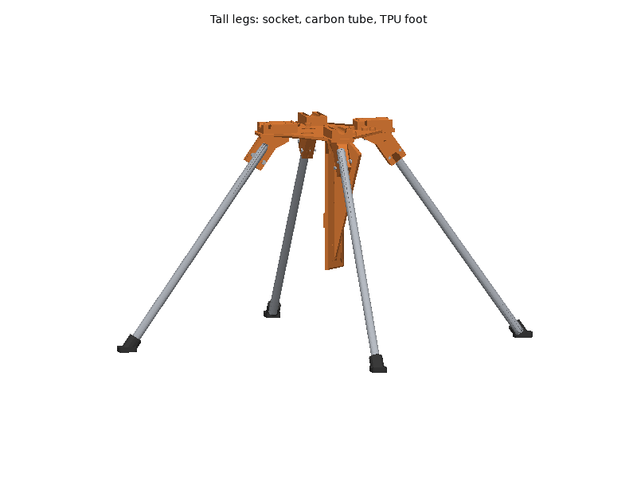

# Aerodrone printed parts

The aerodrone's frame hub, motor mounts, landing gear, payload mounts and
cable clips are printed; the arm tubes, propulsion, battery, electronics,
sensors and fasteners are bought (see the bill of materials,
[hardware/aerodrone.md](../../aerodrone.md), for what and why). The
frame is a 500 mm quad X (X500 class): four 16 mm carbon tubes clamped
between two printed hub plates, T-Motor MN3510 KV700 motors on printed
mounts, 12 in propellers, a 4S pack under the hub, the Pi 5 + Navigator
stack on top with the top deck over it (`top_deck`: the HaLowLink 2 for the ground link
in `halow_cradle`, its antenna standing up at the deck's front), and the
downward OAK-1 and rangefinder on a nose under the front.

**Optional payload: the foam dart launcher** (toy power, foam darts only;
[hardware/aerodrone.md](../../aerodrone.md#foam-dart-launcher-optional-payload)).
The turret's launcher hangs under the hub on `launcher_hanger`, pointing
straight down, its bore on the vertical axis through the hub centre and the
centre of mass. With it fitted the battery tray and the landing legs come
off: the pack rides on the `top_deck` behind the HaLowLink 2, and the tall legs
(`tall_leg_socket`, carbon tubes, `tall_leg_foot`) keep the muzzle 50 mm
above the ground and their feet outside the OAK-1's view. The launcher's
own parts are printed from the turret's STLs
([turret/README.md](../turret/README.md)), except its breech:
`launcher_breech_down` here, with `launcher_cam_guide` and
`launcher_dart_detent`.

## Printing

All parts print on a Bambu Lab P1S (256 mm bed) with Bambu Studio's P1S
system profiles; set only what the plate tables list. The STLs are in
[`stl/`](stl/), already in their print orientation: import them, keep the
orientation, and arrange.

### Plates

<!-- BEGIN GENERATED: plates (tools/build_printable_parts.py) -->
#### Plate A: ASA, 0.20 mm layers

Filament **Bambu ASA**, **Textured PEI Plate**, process **0.20mm Standard**. Estimated 6 h 21 min and 202 g of filament (estimates; slice for real numbers).

| Part | Qty | Per-object settings | Orientation | File |
|---|---|---|---|---|
| `hub_bottom_plate` | 1 | 4 wall loops, 4/4 top/bottom shells, 25% gyroid, supports: none, brim: outer brim only, 5 mm | flat underside on the plate, clamp blocks up | [stl](stl/hub_bottom_plate.stl) |
| `motor_mount` | 4 | 5 wall loops, 6/6 top/bottom shells, 50% gyroid, supports: none, brim: auto | upside down: motor seat on the plate, tube clamp up (slit on top) | [stl](stl/motor_mount.stl) |

#### Plate B: ASA, 0.20 mm layers

Filament **Bambu ASA**, **Textured PEI Plate**, process **0.20mm Standard**. Estimated 6 h 44 min and 204 g of filament (estimates; slice for real numbers).

| Part | Qty | Per-object settings | Orientation | File |
|---|---|---|---|---|
| `hub_top_plate` | 1 | 4 wall loops, 4/4 top/bottom shells, 25% gyroid, supports: none, brim: outer brim only, 5 mm | upside down: flat top face on the plate, clamp blocks up | [stl](stl/hub_top_plate.stl) |
| `oak1_cradle` | 1 | 4 wall loops, 5/4 top/bottom shells, 40% gyroid, supports: none, brim: auto | upside down: camera seat on the plate, walls up | [stl](stl/oak1_cradle.stl) |
| `tall_leg_socket` | 4 | 5 wall loops, 6/6 top/bottom shells, 40% gyroid, supports: none, brim: auto | upside down: the flange's top face on the plate (the block leans out at 36 deg, no supports) | [stl](stl/tall_leg_socket.stl) |

#### Plate C: ASA, 0.20 mm layers

Filament **Bambu ASA**, **Textured PEI Plate**, process **0.20mm Standard**. Estimated 2 h 51 min and 90 g of filament (estimates; slice for real numbers).

| Part | Qty | Per-object settings | Orientation | File |
|---|---|---|---|---|
| `top_deck` | 1 | 3 wall loops, 5/4 top/bottom shells, 20% gyroid, supports: none, brim: auto | upside down: the deck's top face on the plate, posts up | [stl](stl/top_deck.stl) |
| `landing_leg` | 1 | 5 wall loops, 5/5 top/bottom shells, 40% gyroid, supports: none, brim: auto | lying flat on its side (the 12 mm thickness vertical) | [stl](stl/landing_leg.stl) |

#### Plate D: ASA, 0.20 mm layers

Filament **Bambu ASA**, **Textured PEI Plate**, process **0.20mm Standard**. Estimated 1 h 38 min and 51 g of filament (estimates; slice for real numbers).

| Part | Qty | Per-object settings | Orientation | File |
|---|---|---|---|---|
| `landing_leg` | 2 | 5 wall loops, 5/5 top/bottom shells, 40% gyroid, supports: none, brim: auto | lying flat on its side (the 12 mm thickness vertical) | [stl](stl/landing_leg.stl) |

#### Plate E: ASA, 0.20 mm layers

Filament **Bambu ASA**, **Textured PEI Plate**, process **0.20mm Standard**. Estimated 3 h 23 min and 107 g of filament (estimates; slice for real numbers).

| Part | Qty | Per-object settings | Orientation | File |
|---|---|---|---|---|
| `landing_leg` | 1 | 5 wall loops, 5/5 top/bottom shells, 40% gyroid, supports: none, brim: auto | lying flat on its side (the 12 mm thickness vertical) | [stl](stl/landing_leg.stl) |
| `sensor_nose` | 1 | 4 wall loops, 5/4 top/bottom shells, 30% gyroid, supports: none, brim: auto | flat underside on the plate, ribs up | [stl](stl/sensor_nose.stl) |
| `launcher_breech_down` | 1 | 4 wall loops, 5/4 top/bottom shells, 25% gyroid, supports: none, brim: auto | upright: the underside (the cam guide's face) on the plate, channel open upward | [stl](stl/launcher_breech_down.stl) |

#### Plate F: ASA, 0.20 mm layers

Filament **Bambu ASA**, **Textured PEI Plate**, process **0.20mm Standard**. Estimated 7 h 18 min and 204 g of filament (estimates; slice for real numbers).

| Part | Qty | Per-object settings | Orientation | File |
|---|---|---|---|---|
| `launcher_hanger` | 1 | 4 wall loops, 5/5 top/bottom shells, 25% gyroid, supports: none, brim: outer brim only, 5 mm | upside down: the flange's top face on the plate, keel standing up (the rib's slope and the saddle's 45 deg underside need no supports) | [stl](stl/launcher_hanger.stl) |
| `launcher_cam_guide` | 1 | 4 wall loops, 5/4 top/bottom shells, 30% gyroid, supports: none, brim: auto | the keel face (front) on the plate, shelf and lip up | [stl](stl/launcher_cam_guide.stl) |
| `halow_cradle` | 1 | 3 wall loops, 5/4 top/bottom shells, 30% gyroid, supports: none, brim: auto | flat: the base on the plate, walls and antenna stay up | [stl](stl/halow_cradle.stl) |
| `gps_mast` | 1 | 4 wall loops, 5/4 top/bottom shells, 25% gyroid, supports: none, brim: outer brim only, 5 mm | upright: flange on the plate (the 45 deg cone under the seat needs no supports) | [stl](stl/gps_mast.stl) |

#### Plate G: PETG, 0.20 mm layers

Filament **Bambu PETG Basic**, **Textured PEI Plate**, process **0.20mm Standard**. Estimated 2 h 54 min and 88 g of filament (estimates; slice for real numbers).

| Part | Qty | Per-object settings | Orientation | File |
|---|---|---|---|---|
| `battery_tray` | 1 | 3 wall loops, 5/4 top/bottom shells, 30% gyroid, supports: none, brim: auto | flat battery face on the plate, posts and ribs up | [stl](stl/battery_tray.stl) |
| `stack_tray` | 1 | 3 wall loops, 5/4 top/bottom shells, 30% gyroid, supports: none, brim: auto | flat underside on the plate, bosses up | [stl](stl/stack_tray.stl) |
| `oak1_stage` | 1 | 4 wall loops, 5/4 top/bottom shells, 40% gyroid, supports: none, brim: auto | upside down: flat top on the plate, cheeks up | [stl](stl/oak1_stage.stl) |
| `cable_clip` | 8 | 4 wall loops, 5/4 top/bottom shells, 100% gyroid, supports: none, brim: auto | on its side: the C profile flat on the plate | [stl](stl/cable_clip.stl) |

#### Plate H: TPU95A, 0.20 mm layers

Filament **Bambu TPU 95A HF (or Bambu TPU 95A)**, **Textured PEI Plate**, process **0.20mm Standard**. Estimated 3 h 47 min and 48 g of filament (estimates; slice for real numbers).

| Part | Qty | Per-object settings | Orientation | File |
|---|---|---|---|---|
| `tall_leg_foot` | 4 | 3 wall loops, 5/4 top/bottom shells, 40% gyroid, supports: none, brim: auto | flat sole on the plate, socket leaning out | [stl](stl/tall_leg_foot.stl) |
| `leg_foot` | 4 | 3 wall loops, 5/4 top/bottom shells, 30% gyroid, supports: none, brim: auto | socket opening up, flat sole on the plate | [stl](stl/leg_foot.stl) |
| `launcher_dart_detent` | 1 | 2 wall loops, 5/4 top/bottom shells, 100% gyroid, supports: none, brim: auto | flat | [stl](stl/launcher_dart_detent.stl) |
| `stack_grommet` | 8 | 3 wall loops, 4/4 top/bottom shells, 100% gyroid, supports: none, brim: auto | flange down, sleeve up | [stl](stl/stack_grommet.stl) |
<!-- END GENERATED: plates -->

Times and filament are estimates from each part's volume (see
[`stl/manifest.md`](stl/manifest.md)); Bambu Studio's slice is the real
number. Parts of one material and layer height can be combined on fewer
plates when Bambu Studio's auto-arrange fits them.

### Material and printer notes

- **ASA** (frame, motor mounts, legs, nose, cradle, GPS mast; and for the
  top deck, the HaLowLink cradle; and for the launcher configuration the
  hanger, cam guide, downward breech and tall leg sockets): door closed and lid on for the whole print, Textured PEI plate, no fan blast
  on the first layers (the system profile already does this). Let the
  chamber cool before opening the door, or large flat parts (the hub
  plates) can lift at the corners. Dry the spool (8 h at 80 C) if it
  crackles.
- **PETG** (stack tray, camera stage, battery tray, cable clips): Textured
  PEI plate (PETG bonds too well to smooth PEI). Dry 8 h at 65 C if it
  strings.
- **TPU 95A** (feet, stack grommets, tall leg feet, dart detent ring):
  always dry first (8 h at 70 C),
  feed from the external spool holder, not through an AMS, and keep the
  system profile's slow speeds.
- **No carbon-filled filament is needed.** If you want stiffer motor
  mounts or hub plates, PA-CF or PETG-CF work with the same files but
  need the hardened steel nozzle upgrade (the stock P1S nozzle is
  stainless steel and wears through quickly).

### Post-processing

1. **Print the fit-test parts first** and check them against the real
   parts before printing the rest. These are the parts with dimensions not
   stated in the cited datasheets:
   - `motor_mount`: the MN3510's base on the 42 mm seat, its four M3 (a
     25 mm circle) in the slots' outer ends, the screw depth (M3 x 8 engage
     4 mm: they must stop short of the windings), and the 10 mm centre hole
     (shaft end, circlip).
   - `sensor_nose` and `oak1_stage`: the damper-ball necks in the 6.5 mm
     holes of the 2 mm tabs (generic balls have no drawing); the TFmini-S
     or TF-Luna ear holes in the rangefinder slots.
   - `oak1_cradle`: the OAK-1 between the walls and its tripod screw
     reaching the thread.
   - `stack_tray`: the Pi 5's underside (microSD socket) clearing the tray.
   - Launcher configuration: `launcher_breech_down` (the shuttle's sliding
     fit, as the turret's breech), `launcher_cam_guide` (the cam plate
     sliding on its shelf and under its lip), `launcher_dart_detent` (darts
     vary: it must hold a dart and let it go with a light push).
   - `top_deck`: the plugged Navigator leads under it (their height is a
     budget, not a drawing); `halow_cradle`: the HaLowLink 2 in its walls
     and the SMA bulkhead jack in the stay's hole.
2. **Supports**: none of the parts need them (the launcher's
   `launcher_tube` from the turret's set has its own tree supports). Clean
   stringing out of the arm-tube half bores (hub plates) and the
   motor-mount bore so the tubes seat on their stops.
3. **Heat-set inserts** (CNC Kitchen type, hole sizes from their table; see
   the fastener table): soldering iron with an insert tip at **245-260 C
   for ASA**, 230-245 C for PETG. Press straight down, stop when the insert
   is flush, hold flat for a few seconds, let it cool before loading it.
   - `hub_bottom_plate`: 32 x M3 x 5.7: 16 from the top of the clamp
     blocks, 16 from the underside (8 landing legs, 4 battery tray, 4 nose).
   - `hub_top_plate`: 11 x M3 x 5.7 from the top face (4 stack grommets, 3
     GPS mast, 4 top deck).
   - `top_deck`: 5 x M3 x 3 (short) in its top face for the HaLowLink
     cradle, through holes pressed flush.
   - `motor_mount`: 2 x M3 x 5.7 each, horizontal, into the far side of
     the pinch clamp.
   - `oak1_cradle`: 4 x M3 x 3 (short), horizontal, into the side bosses,
     pressed flush from outside.
   - `launcher_breech_down`: as the turret's breech (2 x M3 x 5.7 and 2 x
     M3 x 3 in the rear plate, 4 x M3 x 5.7 in the wall bosses, 2 x M3 x 5.7
     in the front wall) and 4 x M3 x 5.7 in its underside: two in the rear
     plate, two in the front wall.
   - `launcher_cam_guide`: 4 x M3 x 3 (short) in its front face (the keel's
     screws).
4. **Holes**: the M3 clearance holes (3.4 mm) need no reaming; if a printed
   hole is tight, run a 3.4 mm drill through by hand. Do not drill the
   insert holes.
5. **TPU feet** (`leg_foot`) press onto the leg tenons; a drop of CA glue if
   they work loose.
6. **Launcher configuration**: cut the two 1 m carbon tubes (12 x 10 mm)
   into four 386 mm legs, square (mask on); prepare the launcher's turret
   parts as their README says (tube bore, shuttle, dowel pin, barrel cut to
   45 mm).

### Bambu Studio project files

Not provided. A Bambu Studio 3MF carries per-plate filament, process and
object settings in Bambu's own project metadata, which can only be checked
by opening it in Bambu Studio; a plain 3MF would drop those settings. Import
the STLs instead (they are already oriented) and set the per-object values
from the plate tables.

## Assembly

### Tools and consumables

- Hex keys or drivers: 2.0 mm (M2.5), 2.5 mm (M3), 5/32 in (1/4"-20
  socket head) or 4 mm/5/32 in for a button head; small Phillips (ST2.9).
- Soldering iron with a heat-set insert tip, and a fine tip for wiring.
- Fine-tooth saw or tube cutter for carbon tube, sanding block, dust mask
  (carbon dust), calipers, straight edge, small bubble level.
- Medium (blue) thread locker: only on screws into metal (motor bases).
  Never on screws into heat-set inserts in printed parts.
- Zip ties (2.5 mm), double-sided foam tape (VHB), heat-shrink tubing,
  battery straps, anti-slip pad (all in the BOM).
- Smoke stopper or a current-limited bench supply for the first power-up.

### Fasteners

Every screw, insert and strap with its quantity and use is in the
generated fastener table of the BOM:
[hardware/aerodrone.md, "Fasteners"](../../aerodrone.md#fasteners). Torque:
"snug" for every screw into an insert (about 0.5-0.8 N m, two fingers on a
short hex key); more strips the insert out of the plastic.

### Steps

Body directions: **x forward (nose), y left, z up**; motor numbers are
ArduPilot's quad X: **1 front right, 2 rear left, 3 front left, 4 rear
right**.

1. **Inserts.** Press all heat-set inserts (Post-processing, step 3) and
   let the parts cool.
   *Check:* each insert flush and square; an M3 screw turns in freely.
2. **Arm tubes.** Cut four 16 mm carbon tubes to **180.0 mm**, ends square
   (sand flat on a block), edges deburred; wear a mask.
   *Check:* all four within 0.5 mm of each other (they set the 500 mm
   motor spacing).
3. **Motor mounts on the tubes.** Slide each tube into a `motor_mount`
   until it touches the stop at the end of the bore. Fit the two M3 x 25
   pinch screws into the inserts, but leave them loose.
4. **Motors.** Bolt each MN3510 to its `motor_mount` with four M3 x 8 from
   underneath, in the slots' outer ends (the 25 mm circle), blue thread
   locker, snug (about 1 N m into the metal base). Lead wires toward the
   hub, between two slots; cut them to about 200 mm (the ESC is on the arm).
   *Check:* turn the bell by hand: no rubbing, no screw touching the
   windings.
5. **Hub.** Lay the `hub_bottom_plate` blocks up, the four nose inserts
   (underside, near one edge) at the front and the battery-lead slot at the
   rear. Lay the four tubes in its half bores, pushed in to the stops, motors
   up, motor 1 at front right. Put the `hub_top_plate` on, flat face up, the
   three GPS-mast inserts at the rear, then the 16 M3 x 25 clamp screws with
   washers. Tighten in a cross pattern in two passes, snug: the clamp blocks
   end about 1 mm apart.
   *Check:* the tubes do not turn or slide by hand.
6. **Level the motors.** Lay a straight edge across the hub top plate and
   each motor seat in turn, turn the `motor_mount` on its tube until the seat
   is parallel to the plate, then tighten the pinch screws.
   *Check:* the four motor shafts are vertical with the frame on a flat
   table (a tilted motor costs yaw authority).
7. **ESCs and arm wiring.** Zip-tie one AIR 40A under each tube between the
   hub plate's ear and the inner cable clip (113-169 mm from the hub
   centre); snap two `cable_clip`s onto each tube
   (outer half, tab underneath) and tie the motor leads and ESC signal lead
   to their tabs. Solder or plug the motor leads; swap any two to reverse a
   motor later.
8. **Power.** Inside the hub (between the plates): the Power Sense Module,
   the power distribution (board or harness), the 5 V supply and, on the
   left, the HaLowLink 2's own 5 V regulator (behind a 2 A fuse), held with
   zip ties through the four centre slots of the `hub_bottom_plate`. The
   battery lead (XT90, 10 AWG) comes out through the rear slot. See
   **Wiring**.

9. **Landing legs.** Bolt each `landing_leg` under a plate ear with two
   M3 x 16 from below, the foot end pointing outward; press a `leg_foot` onto
   each leg end.
   *Check:* the aircraft stands level on a flat table.
10. **Battery tray.** Bolt the `battery_tray` under the hub with four
    M3 x 14 (heads recessed in the posts), straps threaded through the slot
    pairs, anti-slip pad on the battery face.
11. **Stack.** Put a `stack_grommet` (flange down) over each of the four
    stack inserts on the top plate, the `stack_tray` on them, a second
    `stack_grommet` (flange up) into each tray hole, and an M3 x 12 with a
    washer through each pair: snug only, stop when the flanges start to
    bulge. Assemble the Raspberry Pi 5, Navigator heatsink and Navigator as
    in Blue Robotics' Navigator Hardware Setup, but on the tray instead of
    the kit's standoff: two M2.5 x 12 from under the tray, through the Pi,
    into the heatsink. USB/Ethernet end toward the nose, microSD toward the
    tail.
    *Check:* the tray moves slightly on the grommets and touches nothing
    else; the Pi's underside clears the tray.

12. **GPS mast.** Bolt the `gps_mast` to the rear of the top plate with
    three M3 x 12, its column behind the bolts (over the plate's rear edge)
    and the lip's cable notch toward the nose. Stick the GPS
    puck on the seat with foam tape, **arrow toward the nose**.
13. **Top deck and HaLowLink 2.** Screw the `top_deck` onto the top
    plate's four deck inserts with four M3 x 50 through its posts (heads
    recessed), the notch round the GPS mast's column, the tongue toward the
    nose. Screw the `halow_cradle` onto the deck with five M3 x 5 (heads
    recessed), the stay at the tongue's end. Set the HaLowLink 2 to
    **Extender** mode and pair it with the ground station's Access Point
    (hardware/ground_station.md) on the bench first, then stand it in the
    cradle on its side, **connector side up**, and strap it round the
    walls. Screw the SMA extension's plug onto its SMA, push the bulkhead
    jack up through the stay's hole and fix it with its nut, then screw the
    antenna on, **vertical**. Its **LAN** port to the Pi 5's Ethernet with a
    short patch cable; its USB-C to the 5 V supply (Wiring).
    *Check:* the antenna stands vertical and nothing touches it; the
    plugged Navigator leads clear the deck.

14. **Sensor nose.** Fix the rangefinder under the front of the
    `sensor_nose`, lenses down, long side across the nose (TFmini-S: two
    ST2.9 x 9.5 from above into its ears, gently, they cut their own thread;
    TF-Luna: two M2 x 12 with nuts). Snap the four damper balls into the
    nose's 6.5 mm holes from below. Bolt the nose under the bottom plate
    with four M3 x 10.

15. **OAK-1.** Screw the OAK-1 to the `oak1_cradle` with the 1/4"-20 x 1/2"
    screw, lens away from the cradle, **USB-C end toward the tail**. Put the
    cradle between the cheeks of the `oak1_stage` with M3 x 8 pivot screws
    and M3 x 8 lock screws (washers) through the arc slots, then snap the
    stage onto the damper balls. Set the pitch (see **Checks**) and tighten
    the lock screws.
    *Check:* the stage hangs free on the balls; the camera and cable touch
    nothing rigid.
16. **Wiring** as below, then the **Checks**.

#### Foam dart launcher (optional payload)

Toy power, foam darts only; safety glasses on whenever the plunger spring
is fitted. Build the launcher on the bench as the turret's README says (its
steps 10-14: breech, clip, barrel, plunger tube, priming drive, trigger),
with this aircraft's breech, the safety on and no darts.

17. **Breech and detent.** Use `launcher_breech_down` instead of the
    turret's breech. Before the barrel, push the `launcher_dart_detent` ring
    into the barrel seat from the front until it is flush with the
    chamber's front face (a straight edge across the chamber); the barrel
    then goes in until it stops on the ring, and the barrel clamp holds it.
    *Check:* a dart dropped into the chamber muzzle down stays there when
    the breech is shaken, and a finger pushes it through the ring.
18. **Cam guide.** Screw the `launcher_cam_guide` to the breech's underside
    with four M3 x 10 (heads in its counterbores), the shelf and lip on the
    rack's side. Lay the rack in with the cam plate on the shelf and under
    the lip (instead of the turret's pedestal shelf), then finish the
    priming drive and the trigger. *Check:* by hand (actuator servo
    unpowered), the rack runs its 38 mm and the cam plate slides without
    catching on the lip.
19. **Hanger.** With the battery tray and the landing legs off, screw the
    `launcher_hanger` under the bottom plate with four M3 x 10 into the
    battery-tray inserts, its keel toward the nose. Offer the launcher up,
    muzzle down and clip toward the tail, the cam guide's front face
    against the keel, and fix it with four M3 x 8 through the keel. Tie the
    plunger tube into the keel's saddle with a zip tie (snug, not tight: the
    plunger runs inside), and fit the safety lanyard: the cord round the
    plunger tube above the saddle and round the hub's bottom plate, slack.
    *Check:* the launcher touches nothing but the hanger and the cam guide;
    the safety slider (at the top, behind the keel) can be reached and
    moved.

20. **Tall legs.** Bolt a `tall_leg_socket` under each plate ear with two
    M3 x 16 (heads in the counterbores), the clamp leaning outward. Push a
    386 mm carbon tube into each up to its stop, tighten the two M3 x 20
    pinch screws (nyloc nuts) until it cannot turn, and press a
    `tall_leg_foot` onto each tube's end, sole down. *Check:* on a flat
    table the aircraft stands level on its four feet, the muzzle 50 mm above
    the table.

21. **Battery on the top deck.** Thread the two battery straps through the
    `top_deck`'s slot pairs (the pair behind the pack runs beside the mast),
    put the anti-slip pad on, and strap the pack on **across** the aircraft
    behind the HaLowLink 2, its lead toward the right side, down past the
    stack through the top plate's side window to the power module.
    *Check:* the pack slides fore and aft for trimming and stays clear of
    the HaLowLink 2.
22. **Servo drive** in the hub (Wiring, "Foam dart launcher"): the Bus
    Servo Adapter (A) on the bottom plate ahead of the power module, the
    12 V regulator on the right, both on foam tape with a zip tie.

### Wiring

Power path (see the BOM's "Power and wiring" for parts and budget):

- **Battery** XT90 -> **Power Sense Module** (5.5 mm bullets in, #6 spades
  out: fit an XT90 pigtail on 10 AWG on its input) -> power distribution
  (10 AWG) -> the four ESCs (14 AWG) and the **5 V 6 A
  supply**. The supply's 0.1 in header output feeds
  the Navigator's main 5 V input; the Navigator powers the Pi 5 through the
  40-pin header. Nothing else feeds the Pi.
- **Power Sense Module** sense cable (JST-GH 6) -> Navigator **POWER**.
- **ESC signals** -> Navigator **PWM 1-4** in motor order (1 front right,
  2 rear left, 3 front left, 4 rear right). If an ESC has a BEC (red wire on
  its signal lead), pull that pin out and insulate it: it must not back-feed
  the Navigator's servo rail.
- **GPS** -> Navigator **SERIAL 5 + I2C 6** (JST-GH 6). Check the pin order
  of the cable against the Navigator's pinout before plugging in: the
  Holybro puck's standard cable is a 10-pin GH. Run it down the mast with
  two cable ties.
- **RC receiver** (SBUS out) -> Navigator **RC** header (3-pin 0.1 in;
  inverted SBUS is the default). Antennas clear of the carbon tubes.
- **HaLowLink 2** (the ground link; no SiK telemetry radio): power from
  the power distribution through an inline **2 A** fuse to its own
  **Pololu D36V28F5** 5 V regulator (in the hub, left side, on foam tape),
  its output on 20 AWG to a **USB-C plug wired as a power source** (CC to
  VBUS through 10 kOhm, no pull-down on CC; the BOM's "Radio") into the
  unit's USB-C; never a USB-A socket with a USB-A to USB-C cable or adapter
  (the HaLowLink user guide warns against it), and never from the
  Navigator's 5 V rail. Data: the unit's **LAN** port
  to the Pi 5's Ethernet. Antenna: the SMA extension to the bulkhead on the
  cradle's stay (tie the cable to the cradle's arm). BlueOS keeps eth0 at
  192.168.2.2 and its "GCS Client Link" to 192.168.2.1:14550: nothing to
  configure on the Pi. The unit itself takes the static 192.168.2.252 and
  its 2.4 GHz access point is turned off (hardware/ground_station.md,
  "Pairing a vehicle's unit"). Its region is set at the factory: buy the
  one for the country of operation.
- **OAK-1**: a USB 3 Type-C cable with a **right-angle C plug pointing
  sideways**, up through a cable notch in the side of the nose and along the
  front of the hub to one of the Pi 5's blue USB 3 ports. Leave a loose
  service loop between the camera and the nose: a tight cable bridges the
  dampers. Keep the USB 3 cable away from the GPS mast (USB 3 radiates in
  the GNSS band).
- **Rangefinder**: its GH1.25 4-pin lead to a **3.3 V USB-UART adapter**
  (sensor TX -> adapter RX, sensor RX -> adapter TX, 5 V and GND from the
  adapter), adapter in a Pi USB 2 port; set `RANGEFINDER_DEVICE` to its
  `/dev/serial/by-id/` path (`applications/rangefinder/README.md`). Do not
  also configure it as an ArduPilot rangefinder.
- Strain relief: a zip tie at every place a lead leaves a moving or
  isolated part (stack tray, camera stage, motor mounts), heat-shrink on
  every solder joint, and no wire within reach of a propeller disc.

Foam dart launcher (optional payload; parts and power budget in the BOM):

- **12 V servo rail**: power distribution (battery voltage) -> inline
  **3 A fuse** (the launcher's power disconnect: pull it to make the
  launcher's servos safe) -> **Pololu D36V50F12** VIN/GND -> its 12 V output
  -> the **Bus Servo Adapter (A)**'s DC jack (5.5 x 2.1 mm) or screw
  terminal. 20 AWG silicone wire, nothing from the Navigator's 5 V rail.
- **Servo bus**: the adapter's servo port -> actuator servo (ID 14) ->
  trigger servo (ID 15), daisy-chained on the servos' second connectors.
  The adapter's cable comes down from the hub through the hanger flange's
  cable hole, runs down the keel's front and round its left edge to the
  actuator servo's plugs (tie it at the keel's lower slot pair); the
  actuator-to-trigger cable runs up and across behind the keel (its upper
  slot pairs) to the trigger servo's plugs at the top right.
- **Data**: the adapter's USB-C, **jumper on B**, to the Pi 5's free USB 2
  port; the turret bridge's `sts` transport at 1 Mbps on its
  `/dev/serial/by-id/` path (`TURRET_ARDUINO_PORT`). Common ground through
  the USB cable and the power distribution.
- Set the servo IDs (14, 15), zero offsets, directions and torque limits
  (actuator about 55 %, trigger about 30 %) as hardware/turret.md says,
  before the launcher goes on the aircraft.

### Checks

Do these before the first flight, then follow the bench and flight steps in
[hardware/aerodrone.md, "Recommended assembly order"](../../aerodrone.md#recommended-assembly-order)
and the parameter and GPS-denied set-up in
[systems/aerodrone/README.md](../../../systems/aerodrone/README.md).

<!-- BEGIN GENERATED: assembly (tools/build_printable_parts.py) -->
Generated by the assembly check (`assembly.py`), from the CAD and datasheet masses:

- Battery centre for a centred CG (mm along x; negative = behind the hub centre): -31.2
- Battery within the tray: yes
- Centre of gravity with the battery there (x, y, z mm from the hub centre): -0.0; 0.4; 2.6
- Estimated take-off mass (g): 2520
- Bodies in the check: 153
- Interference between parts (screws modelled through their holes): none
- Intended press fits: 12
- Camera view clear: yes (69 x 55 deg + 2 deg margin)
- Rangefinder beam clear: yes
- Propeller discs clear: yes (5 mm radial, 3 mm below and 9 mm above the disc)
- prop_tip_gap_mm: 49 between adjacent 12 in propellers (354 mm between their motors; at least 30, a tenth of the diameter)
- prop_body_gap_mm: 12 from a propeller disc to the nearest other body (rear left propeller / top_deck; at least 5)
- prop_overhang: top_deck 16 mm above the rear left propeller's disc, reaching 17 mm in from its tip; top_deck 16 mm above the rear right propeller's disc, reaching 17 mm in from its tip
- prop_ground_strike_deg: a propeller tip reaches the ground at 49 deg of roll or pitch about two feet; the aircraft tips over at 27 deg (propellers 252 mm above the ground)
- launcher_battery_on_deck_mm: pack centre at x -35.8, y 0.1 for a centred CG with a full clip (the straps and the GPS mast allow x -46.2..-25.8)
- launcher_cg_mm: full clip (6 darts): (0.0, 0.0, -3.6); empty clip: (0.1, 0.0, -3.1), battery not moved; tolerance 3 mm from the hub centre
- launcher_bore_to_cg_mm: 0.00 (full clip), 0.07 (empty): the bore is the vertical line through the hub centre
- launcher_bodies: 240
- launcher_interferences: none (cocked with a full clip, primed)
- launcher_camera_view_clear: yes: launcher, hanger, tall legs and deck out of the OAK-1's 69 x 55 deg view + 2 deg, cocked and primed
- launcher_rangefinder_beam_clear: yes
- halow_antenna_clearance_mm: vertical, from the HaLowLink's SMA on the top deck: arm tubes 107, GPS mast and puck 131, launcher 131, battery 85, propeller discs 59
- launcher_propeller_clearance: yes
- launcher_prop_body_gap_mm: 12 from a propeller disc to the nearest other body (rear left propeller / top_deck; at least 5)
- launcher_prop_overhang: top_deck 16 mm above the rear left propeller's disc, reaching 17 mm in from its tip; top_deck 16 mm above the rear right propeller's disc, reaching 17 mm in from its tip
- launcher_view_margin_mm: the view's rear edge (with the margin) passes 7 mm in front of the barrel at the muzzle (227 mm below the lens)
- launcher_clearance_mm: 5.5 at the closest (launcher_collar_screw / hub_bottom_plate, primed): the launcher clears the airframe, legs, deck and sensors in both states
- launcher_mount_clearance_mm: 2.5 from the hanger and cam guide to the rest (launcher_hanger / sensor_nose)
- launcher_dart_path: clear: a 14 mm path from the muzzle straight down to the ground meets nothing
- launcher_ground_clearance_mm: muzzle 50 above the ground on the feet (lowest point launcher_barrel at 50); legs 338 mm under the hub, feet at (+-230, +-230); tip-over 33 deg (CG 353 mm above the ground); a propeller tip reaches the ground at 76 deg
- launcher_compass_to_battery_mm: 160 from the GPS/compass to the battery's centre (at least 150; run ArduPilot's compass-motor calibration)
- launcher_mass_g: launcher 415 with a full clip (printed 261, two servos 110, spring, barrel, hardware, darts); the configuration adds +644 g in all (hanger, cam guide, deck, tall legs, servo adapter, regulator, wiring; less the tray and landing legs)
- launcher_takeoff_mass_g: 3165 with a full clip, 3159 empty
- flight_impact: without the launcher 2520 g: thrust-to-weight 2.54 at 14.8 V (table maximum, 1600 g per motor; 2.97 at 16 V; the P12*4's 4 kg rating would allow 6.3), hover 53 % throttle, 18.7 A at 14.8 V, 5217 rpm (87 Hz), MOT_THST_HOVER about 0.31, about 12.8 min on 5000 mAh to 20 % left; with the launcher, full clip 3165 g: thrust-to-weight 2.02 at 14.8 V (table maximum, 1600 g per motor; 2.36 at 16 V; the P12*4's 4 kg rating would allow 5.1), hover 61 % throttle, 26.4 A at 14.8 V, 5915 rpm (99 Hz), MOT_THST_HOVER about 0.38, about 9.1 min on 5000 mAh to 20 % left
- launcher_thrust_to_weight_ok: yes: at least 2 at 14.8 V with a full clip
- launcher_passed: yes
- All assembly checks passed: yes
<!-- END GENERATED: assembly -->

- **Centre of gravity.** With everything fitted and the flight battery
  strapped on, lift the aircraft by two fingers under opposite arm tubes,
  close to the hub, on both diagonals: it must hang level. Slide the
  battery fore or aft to trim; the assembly check above gives the expected
  battery position. Mark it on the tray.
- **OAK-1 nadir alignment.** Stand the aircraft level on its feet (bubble
  level on the hub top plate). Loosen the two lock screws, set the camera so
  a bubble level on the cradle's back reads level (the lens then looks
  straight down), tighten. With the USB-C end toward the tail the image top
  points to the nose, which is `CAMERA_MOUNT_YAW_DEG = 0.0` in
  `systems/aerodrone/config/topics.env`. Confirm with a still image: an
  object placed in front of the aircraft must appear at the top of the
  image; if not, find the right value as described in
  [systems/aerodrone/README.md](../../../systems/aerodrone/README.md).
- **Propeller direction.** Props off: run the ArduPilot motor test (one
  motor at a time) and check order and spin: motors 1 and 2 (front right,
  rear left) counter-clockwise, 3 and 4 (front left, rear right) clockwise
  seen from above. Fit CCW props on 1 and 2, CW props on 3 and 4: each
  P12*4 on its motor's 12 mm prop face with T-Motor's two M3 x 12 and the
  cover plate (blue thread locker, into metal).
- **Vibration isolation.** The stack tray and the camera stage must touch
  nothing but their grommets and dampers; no taut cable may bridge them.
  After the first hover, check ArduPilot's VIBE (below 30 m/s/s, no
  clipping) and check the harmonic notch (it starts from
  `arducopter_hardware.params`, hardware/aerodrone.md "ArduPilot
  parameters") against the flight's FFT log; balance the props if needed.
- **Props-off first power-up.** Smoke stopper or current-limited supply on
  the battery lead. Load the parameters (`arducopter.params`, then
  `arducopter_hardware.params` twice with a reboot between, then
  `arducopter_gps_input.params`) and check the ESCs' throttle range. Check
  the 5 V rail at the Navigator (5.0-5.35 V), the
  Navigator and Pi LEDs, BlueOS reachable, `vcgencmd get_throttled` = 0x0
  with the whole stack running, the OAK-1 on USB 3 (`lsusb -t`: 5000M) and
  the rangefinder publishing on `/aerodrone/rangefinder`.
- **HaLow link**: with both HaLowLinks paired, from the ground laptop at
  192.168.2.1: `ping 192.168.2.2`, BlueOS at http://192.168.2.2, the
  unit's own page at https://192.168.2.252, and MAVLink in Cockpit or
  QGroundControl on UDP 14550. Then the range test
  in hardware/ground_station.md. With the link up and transmitting, check
  the GPS's satellite count and the compass (ArduPilot's compass-motor
  calibration) against the unit switched off. ArduPilot's GCS failsafe
  follows this link: set `FS_GCS_ENABLE` deliberately; the RC link keeps
  manual control.
- **Every flight**: battery straps through both slot pairs and tight, props
  tight, no cracked print (especially motor mounts, hub plates, legs), the
  HaLow antenna vertical and tight. The top deck's rear corners and strap
  slots sit over the rear propellers' tips (16 mm above them, the assembly
  check): the straps tight under the deck and their tails on top of the
  pack.

Launcher configuration (toy power, foam darts only; safety glasses for
everyone nearby):

- **Launcher bring-up on the bench** as hardware/turret.md and the turret
  README's Checks say: servo zero and direction, torque limits, dry cycle
  (prime, catch, chamber, fire; the safety blocks the shot), the feed of
  six darts muzzle down, and the **chronograph**: ten shots, every one under
  30 m/s, with the detent ring fitted.
- **Centre of gravity** with the launcher, a full clip and the pack on the
  deck: lift the aircraft by two fingers under opposite arm tubes on both
  diagonals; slide the pack fore or aft (and sideways) on the deck until it
  hangs level. The assembly check above gives the expected pack position;
  mark it on the deck.
- **Stiffness**: tap the launcher's muzzle sideways and fore and aft: it
  must not ring for more than a moment. After the first hover check
  ArduPilot's VIBE and the harmonic notch with the launcher fitted.
- **Compass**: with the pack on the deck, run ArduPilot's compass-motor
  calibration (`COMPASS_MOT`); interference above 30 % means the pack or its
  lead is too close to the mast.
- **Hover throttle**: let ArduPilot relearn `MOT_THST_HOVER`
  (`MOT_HOVER_LEARN 2`) in the first hovers with the launcher (start from
  0.38 instead of the overlay's 0.31), and again after taking it off; copy
  the learned value to `INS_HNTCH_REF`; re-run AutoTune.
- **Before every flight with the launcher**: safety on and muzzle cap on
  until the aircraft is on its take-off spot, the hanger, cam guide and leg
  sockets free of cracks and their screws tight, the safety lanyard fitted;
  then muzzle cap off, safety to FIRE, nobody under or near the aircraft.
  After landing: safety on first. The launcher fires only at objects, never
  at people (the fire-control software refuses whenever a person is in the
  camera's view), and dropping or firing objects from a drone is regulated
  (FAA Part 107.23, operations over people): the operator must comply.
