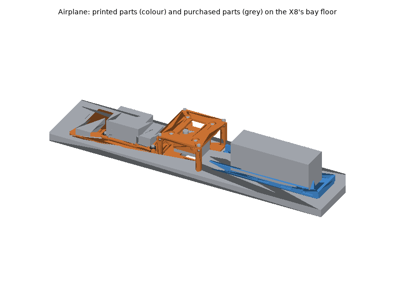
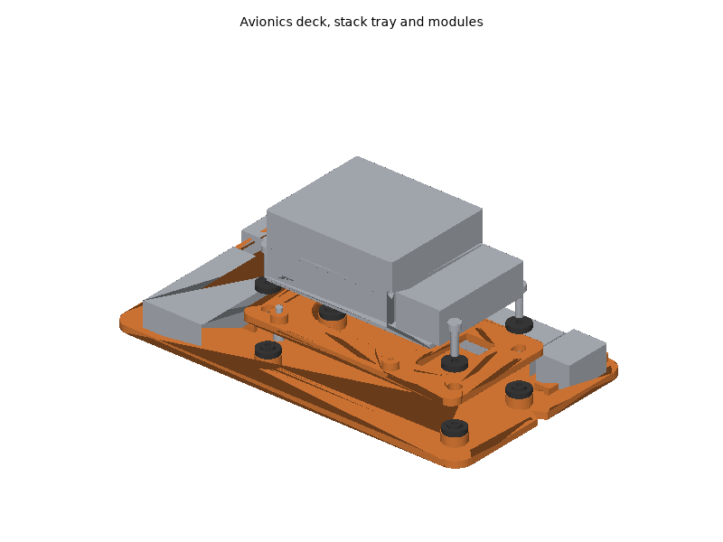
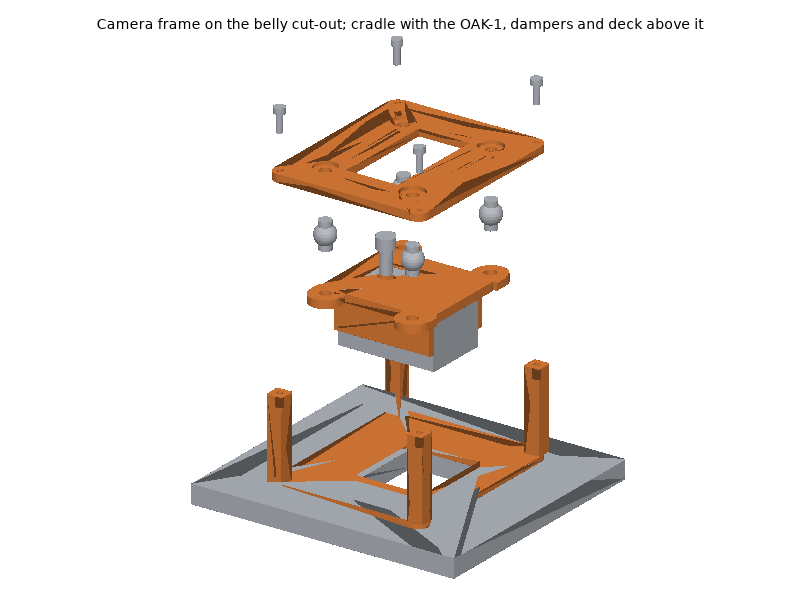
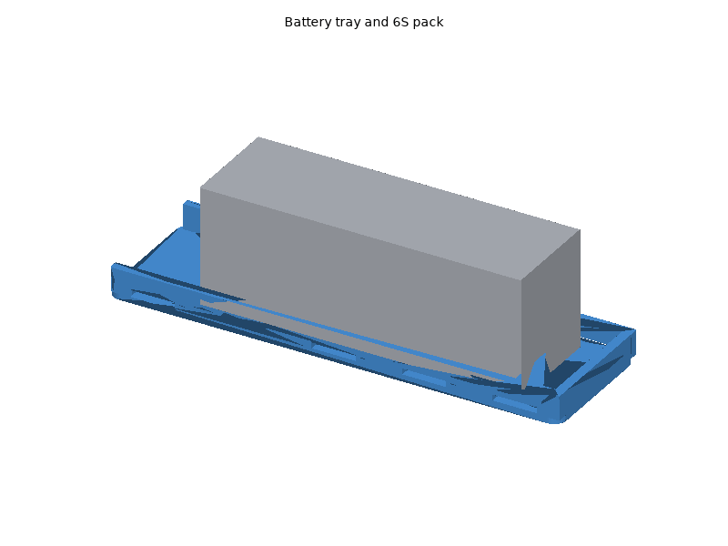
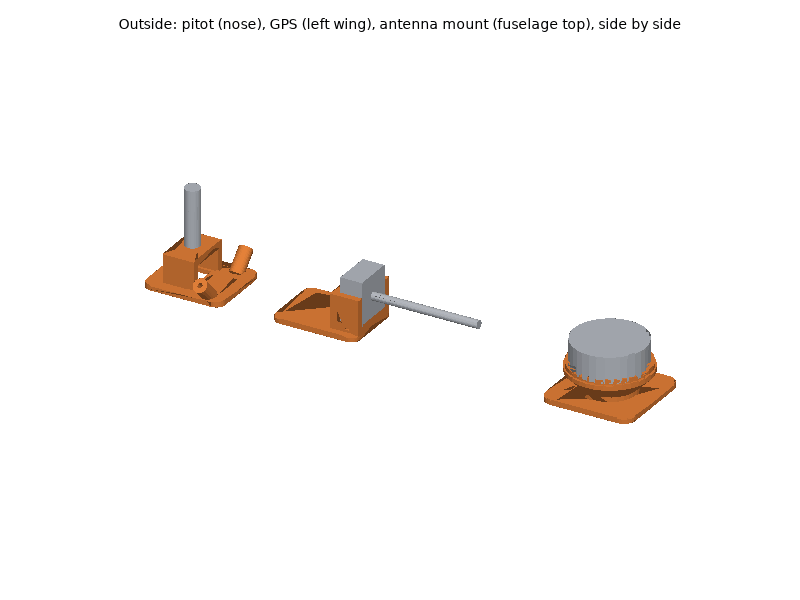

# Airplane printed parts

The airplane's airframe is a purchased EPO foam flying wing (reference:
Skywalker X8); the parts that carry the avionics inside it and on its skin
are printed: the avionics deck with the Pi 5 + Navigator stack tray on TPU
grommets, the OAK-1 camera frame bonded around a cut-out in the belly with
its deck and damped cradle, the battery tray, and the GPS, antenna and
pitot mounts and cable clips. The airframe, propulsion, servos, battery,
electronics, sensors and fasteners are bought (see the bill of materials,
[hardware/airplane.md](../../airplane.md), for what and why). The parts are
bonded to the foam: the X8's bay is not dimensioned by Skywalker, so the
bonded parts are fit-test parts, held in the real bay before any glue.

## Printing

All parts print on a Bambu Lab P1S (256 mm bed) with Bambu Studio's P1S
system profiles; set only what the plate tables list. The STLs are in
[`stl/`](stl/), already in their print orientation: import them, keep the
orientation, and arrange.

### Plates

<!-- BEGIN GENERATED: plates (tools/build_printable_parts.py) -->
#### Plate A: ASA, 0.20 mm layers

Filament **Bambu ASA**, **Textured PEI Plate**, process **0.20mm Standard**. Estimated 3 h 35 min and 112 g of filament (estimates; slice for real numbers).

| Part | Qty | Per-object settings | Orientation | File |
|---|---|---|---|---|
| `avionics_deck` | 1 | 3 wall loops, 5/4 top/bottom shells, 20% gyroid, supports: none, brim: outer brim only, 5 mm | flat underside (the bonding face) on the plate, bosses up | [stl](stl/avionics_deck.stl) |
| `camera_deck` | 1 | 4 wall loops, 5/4 top/bottom shells, 30% gyroid, supports: none, brim: auto | flat underside on the plate | [stl](stl/camera_deck.stl) |
| `camera_frame` | 1 | 4 wall loops, 5/4 top/bottom shells, 30% gyroid, supports: none, brim: auto | flange (bonding face) on the plate, pillars up | [stl](stl/camera_frame.stl) |
| `pitot_mount` | 1 | 4 wall loops, 5/4 top/bottom shells, 30% gyroid, supports: none, brim: auto | upright: bonding pad on the plate, channel open to the top | [stl](stl/pitot_mount.stl) |

#### Plate B: ASA, 0.20 mm layers

Filament **Bambu ASA**, **Textured PEI Plate**, process **0.20mm Standard**. Estimated 2 h 21 min and 70 g of filament (estimates; slice for real numbers).

| Part | Qty | Per-object settings | Orientation | File |
|---|---|---|---|---|
| `stack_tray` | 1 | 3 wall loops, 5/4 top/bottom shells, 30% gyroid, supports: none, brim: auto | flat underside on the plate, bosses up | [stl](stl/stack_tray.stl) |
| `oak1_cradle` | 1 | 4 wall loops, 5/4 top/bottom shells, 40% gyroid, supports: none, brim: auto | upside down: flat top on the plate, walls up | [stl](stl/oak1_cradle.stl) |
| `gps_mount` | 1 | 4 wall loops, 5/4 top/bottom shells, 25% gyroid, supports: none, brim: auto | upright: base on the plate (the 45 deg cone under the seat needs no supports) | [stl](stl/gps_mount.stl) |
| `antenna_mount` | 1 | 4 wall loops, 5/4 top/bottom shells, 30% gyroid, supports: none, brim: auto | upright: pad on the plate; the sleeves lean at 45 deg and need no supports | [stl](stl/antenna_mount.stl) |

#### Plate C: PETG, 0.20 mm layers

Filament **Bambu PETG Basic**, **Textured PEI Plate**, process **0.20mm Standard**. Estimated 2 h 08 min and 68 g of filament (estimates; slice for real numbers).

| Part | Qty | Per-object settings | Orientation | File |
|---|---|---|---|---|
| `battery_tray` | 1 | 3 wall loops, 5/4 top/bottom shells, 25% gyroid, supports: none, brim: outer brim only, 5 mm | flat underside (the bonding face) on the plate, rails up; the strap tunnels bridge | [stl](stl/battery_tray.stl) |
| `cable_clip` | 8 | 3 wall loops, 5/4 top/bottom shells, 100% gyroid, supports: none, brim: auto | pad on the plate, bridge up | [stl](stl/cable_clip.stl) |

#### Plate D: TPU95A, 0.20 mm layers

Filament **Bambu TPU 95A HF (or Bambu TPU 95A)**, **Textured PEI Plate**, process **0.20mm Standard**. Estimated 14 min and 2 g of filament (estimates; slice for real numbers).

| Part | Qty | Per-object settings | Orientation | File |
|---|---|---|---|---|
| `stack_grommet` | 8 | 3 wall loops, 4/4 top/bottom shells, 100% gyroid, supports: none, brim: auto | flange down, sleeve up | [stl](stl/stack_grommet.stl) |
<!-- END GENERATED: plates -->

Times and filament are estimates from each part's volume (see
[`stl/manifest.md`](stl/manifest.md)); Bambu Studio's slice is the real
number. Parts of one material and layer height can share fewer plates when
Bambu Studio's auto-arrange fits them.

### Material and printer notes

- **ASA** (deck, stack tray, camera frame, deck and cradle, GPS, antenna
  and pitot mounts): door closed and lid on for the whole print, Textured
  PEI plate. The deck is a large flat part: let the chamber cool before
  opening the door or its corners lift. ASA is chosen because the closed
  foam bay with a Pi 5 running, and the skin in the sun, get hotter than
  PETG likes. Dry the spool (8 h at 80 C) if it crackles.
- **PETG** (battery tray, cable clips): Textured PEI plate; dry 8 h at
  65 C if it strings. PETG is tougher than ASA in a nose-in landing.
- **TPU 95A** (stack grommets): always dry first (8 h at 70 C), feed from
  the external spool holder, not through an AMS.
- **No carbon-filled filament is needed**; the stock stainless steel
  nozzle prints everything.

### Post-processing

1. **Print the fit-test parts first** and check them before printing the
   rest:
   - `avionics_deck`, `camera_frame`, `battery_tray`: hold each in the X8's
     bay where the layout puts it (deck behind the CG mark, camera frame on
     it, battery tray ahead of it) with the hatch closed. The parts need a
     flat floor about 110 mm wide and 60-65 mm of height; if the floor is
     curved, a thicker glue line fills it, but the parts must not rock.
   - `camera_deck`, `oak1_cradle`: the damper-ball necks in the 6.5 mm
     holes of the 2 mm tabs (generic balls have no drawing); the OAK-1
     between the cradle walls and its tripod screw reaching the thread.
   - `stack_tray`: the Pi 5's underside (microSD socket) clearing the tray.
   - `gps_mount`, `antenna_mount`, `pitot_mount`: the base on the wing,
     the fuselage top and the nose (their curvature is not published); the
     PT60's base in the pitot channel; the receiver antenna tubes in their
     sleeves and the RP-SMA bulkhead through the 4 mm plate.
2. **Supports**: none. The battery tray's strap tunnels and the deck's tie
   bridges are short bridges; clean any sag out of them with a file so the
   straps and ties slide.
3. **Heat-set inserts** (CNC Kitchen type, see the fastener table):
   soldering iron with an insert tip at **245-260 C** (ASA). Press straight
   down until flush, hold flat for a few seconds, let cool.
   - `avionics_deck`: 4 x M3 x 5.7 into the grommet bosses.
   - `camera_frame`: 4 x M3 x 5.7 into the pillar tops.
4. **Holes**: the M3 clearance holes need no reaming; run a 3.4 mm drill
   through by hand if one is tight. Do not drill the insert holes.
5. **Bonding faces**: scuff the underside of every bonded part and the
   foam's skin with 120-grit paper, wipe with isopropyl alcohol.

### Bambu Studio project files

Not provided. A Bambu Studio 3MF carries per-plate filament, process and
object settings in Bambu's own project metadata, which can only be checked
by opening it in Bambu Studio; a plain 3MF would drop those settings.
Import the STLs instead (already oriented) and set the per-object values
from the plate tables.

## Assembly

### Tools and consumables

- Hex keys: 2.0 mm (M2.5), 2.5 mm (M3), 5/32 in (1/4"-20 socket head).
- Soldering iron with a heat-set insert tip, and a fine tip for wiring.
- Sharp hobby knife with new blades, metal ruler, 120-grit paper,
  isopropyl alcohol, masking tape, a balance stand or two fingertips for
  the CG.
- Foam-safe adhesives: **5-minute epoxy** (structural bonds: deck, camera
  frame, battery tray, pitot mount) and **UHU Por** or hot glue (GPS and
  antenna mounts, cable clips, which may need to come off). Never plain
  cyanoacrylate on EPO without foam-safe kicker: it dissolves the foam.
- Zip ties, double-sided foam tape (VHB), heat-shrink tubing, battery
  straps, anti-slip pad (all in the BOM).
- Smoke stopper or a current-limited supply for the first power-up.

### Fasteners

Every screw, insert, strap and tie with its quantity and use is in the
generated fastener table of the BOM:
[hardware/airplane.md, "Fasteners"](../../airplane.md#fasteners). Torque:
"snug" for every screw into an insert (about 0.5-0.8 N m); more strips the
insert out of the plastic.

### Steps

Body directions: **x forward (nose), y left, z up**; the origin is the X8's
CG mark (430-440 mm behind the nose) on the bay floor's centre line. Build
the X8 kit first (wings, spars, elevon servos and linkages, motor and ESC
at the tail) as its manual describes.

1. **Inserts.** Press the heat-set inserts (Post-processing, step 3).
   *Check:* each insert flush and square.
2. **Mark the bay.** Mark the CG line across the bay floor (435 mm behind
   the nose) and the centre line. Dry-fit the `battery_tray` (front stop
   toward the nose), the `camera_frame` (centred on the CG line) and the
   `avionics_deck` (V-notch toward the nose) on them with masking tape.
   *Check:* the hatch closes over the camera frame (52 mm) and the
   stack (49 mm); the battery (62 mm) fits under it ahead of the CG.
3. **Camera cut-out.** Tape the `camera_frame` in place, cut the belly foam
   along the inside of its flange with a sharp blade held vertical, then
   bond the flange around the hole with 5-minute epoxy.
   *Check:* the opening's long side runs across the fuselage; daylight
   through the whole opening.
4. **Avionics deck and battery tray.** Scuff and bond the `avionics_deck`
   and the `battery_tray` with 5-minute epoxy, weighted flat until cured.
5. **Stack.** A `stack_grommet` (flange down) over each deck insert, the
   `stack_tray` on them, a second `stack_grommet` (flange up) in each tray
   hole, an M3 x 12 with a washer through each pair: snug, stop when the
   flanges start to bulge. Assemble the Pi 5, Navigator heatsink and
   Navigator as in Blue Robotics' Navigator Hardware Setup, but on the
   tray: two M2.5 x 12 from under the tray through the Pi into the
   heatsink. USB/Ethernet end toward the nose.
   *Check:* the tray moves slightly on the grommets and touches nothing
   else.
6. **Modules.** Zip-tie the Power Sense Module, the 5 V supply, the servo
   BEC, the airspeed module and the RC receiver along the deck's left
   strip and the telemetry radio across its rear, each with one tie through
   the two tie bridges beside it.

7. **OAK-1.** Screw the OAK-1 to the `oak1_cradle` with the 1/4"-20 x 1/2"
   screw, lens away from the cradle, **USB-C end toward the tail**. Snap
   the four damper balls into the `camera_deck` from below, then the
   cradle onto the balls. Lower the camera through the frame, plug the
   right-angle USB-C cable, and screw the deck onto the pillars with four
   M3 x 10.
   *Check:* the camera hangs free on the balls with no part touching the
   frame; the lens is above the belly line; looking up through the hole
   from below, nothing crosses the opening.

8. **Battery.** Two straps through two tunnel pairs that lie under the
   pack (each at least 15 mm in from the pack's ends), anti-slip pad on the
   tray. Final position after balancing (Checks).

9. **GPS.** Bond the `gps_mount` to the top of the left wing, 250 mm out
   from the centre line, with UHU Por; drill an 8 mm hole through the skin
   at the base's cable hole and run the GPS cable inside the wing to the
   bay. Stick the puck in the lip with foam tape, **arrow toward the
   nose**, cable notch toward the tail.
10. **Antennas.** Bond the `antenna_mount` on the fuselage top behind the
    hatch; drill the skin under the bridge and under each sleeve. RP-SMA
    bulkhead through the bridge's top plate, antenna on it; the receiver's
    two antenna tubes into the two sleeves (heat-shrink a thin tube to fit).
11. **Pitot.** Bond the `pitot_mount` on the nose, on the centre line, the
    channel parallel to the bay floor; the PT60 in the channel with its
    probe forward, one zip tie through the floor tunnel over its base. Run
    the two silicone tubes to the airspeed module.
12. **Cable clips.** Bond `cable_clip`s along the harness routes: one within
    50 mm of the camera frame for the USB cable (leave a loose loop to the
    camera), and along the bay walls for the servo leads and pitot tubes.
13. **Wiring** as below, then the **Checks**.

### Wiring

Power path (see the BOM's "Power and wiring" for parts and budget):

- **Battery** XT90 -> **Power Sense Module** (5.5 mm bullets in, #6
  spades out) -> the ESC, the **5 V 6 A supply** and the **servo BEC**.
  The supply's 0.1 in header output feeds the Navigator's main 5 V input;
  the Navigator powers the Pi 5. The servo BEC feeds the Navigator's
  **AUX 5V** input, which powers the servo rail only.
- **Power Sense Module** sense cable (JST-GH 6) -> Navigator **POWER**.
- **Elevon servos** -> Navigator **PWM 1** (left) and **PWM 2** (right),
  **ESC signal** -> **PWM 3** (`SERVO1_FUNCTION 77`, `SERVO2_FUNCTION 78`,
  `SERVO3_FUNCTION 70`). Remove the red wire of an ESC with a BEC.
- **GPS** -> Navigator **SERIAL 5 + I2C 6** (JST-GH 6): check the cable's
  pin order against the Navigator's pinout first.
- **Airspeed sensor** (GH 4-pin I2C) -> Navigator **I2C 6** port.
- **RC receiver** (SBUS) -> Navigator **RC** header.
- **Telemetry radio** -> a free Navigator **SERIAL** port (JST-GH 6), its
  antenna on the RP-SMA bulkhead extension.
- **OAK-1**: right-angle USB-C cable to one of the Pi 5's blue USB 3
  ports, through a cable clip near the camera with a loose loop between
  clip and camera (a taut cable bridges the dampers). Keep it at least
  150 mm from the GPS cable route.
- Strain relief: a zip tie wherever a lead leaves the isolated stack tray
  or camera cradle; heat-shrink on every solder joint; nothing near the
  propeller arc at the tail.

### Checks

Do these before the first flight, then the bench and flight steps in
[hardware/airplane.md, "Recommended assembly order"](../../airplane.md#recommended-assembly-order)
and the system notes in
[systems/airplane/README.md](../../../systems/airplane/README.md).

<!-- BEGIN GENERATED: assembly (tools/build_printable_parts.py) -->
Generated by the assembly check (`assembly.py`), from the CAD and datasheet masses:

- battery_centre_ahead_of_cg_mark_mm: 173.9
- Battery within the tray: yes
- cg_trim_authority_mm: +-10 mm of CG for the pack's 61 mm travel at 2750 g
- printed_mass_g: 252
- payload_mass_g: 1586 (avionics, printed parts, wiring and the 6S pack; the X8 listing allows 1000-2000)
- Bodies in the check: 49
- Interference between parts (screws modelled through their holes): none
- Camera view clear: yes (69 x 55 deg + 2 deg margin, through a 14 mm belly)
- lens_recess_mm: 15 above the belly skin (10 mm belly)
- gps_separation_mm: 261 from the USB 3 cable, 229 from the battery leads, 320 from the ESC/motor (need 150)
- heights_above_floor_mm: stack 49, camera deck 52, battery 62 (the bay must clear these with the hatch shut)
- All assembly checks passed: yes
<!-- END GENERATED: assembly -->

- **Centre of gravity.** With everything fitted and the flight battery on
  the tray, support the wing at 430-440 mm behind the nose (Skywalker's
  CG): it must balance level or slightly nose-down. Slide the pack to
  trim; the assembly check above gives the expected pack position and how
  much CG the tray's travel can move. If the pack runs out of travel, add
  nose weight rather than flying tail-heavy. Mark the pack's place.
- **Control surfaces.** Props off, in MANUAL: stick right -> left elevon
  down, right elevon up; stick back -> both up. Then in FBWA, roll the
  aircraft right by hand: the elevons must oppose it.
- **OAK-1 nadir alignment.** With the bay floor level, the cradle's back
  is level and the lens looks straight down. Image top toward the nose is
  `CAMERA_MOUNT_YAW_DEG=0.0` in `systems/airplane/config/blueos.env`;
  confirm with a still image (an object ahead of the nose appears at the
  top of the image).
- **Airspeed.** Calibrate in BlueOS with the pitot covered from wind; blow
  gently into the probe tip: the reading must rise.
- **Props-off first power-up.** Smoke stopper on the battery lead. Check
  the 5 V rail at the Navigator (5.0-5.35 V), the servo rail voltage at
  AUX 5V, BlueOS reachable, `vcgencmd get_throttled` = 0x0 with the whole
  stack running, and the OAK-1 on USB 3 (`lsusb -t`: 5000M).
- **Every flight**: battery straps tight, prop secure, no cracked bond on
  the camera frame, pitot clear, lens clean.
