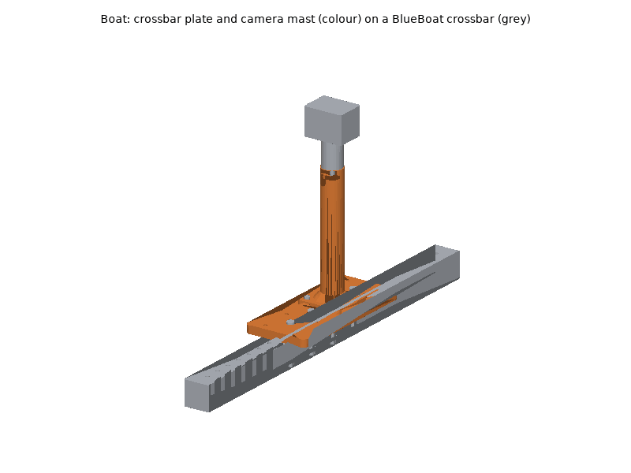
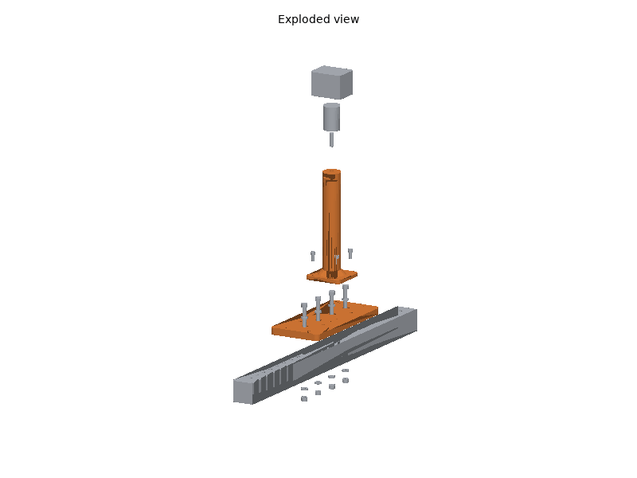

# Boat printed parts

The boat is a purchased Blue Robotics BlueBoat; its hulls, hatch lids and
seals, motor mounts, electronics trays and crossbars stay as Blue Robotics
makes them (see the bill of materials, [hardware/boat.md](../../boat.md),
for why). What is printed are top-side accessories that bolt to the
documented 25 mm hole pattern of a crossbar: an accessory deck with a 50 mm
grid of M4 inserts, and a 200 mm mast with a 1/4"-20 stud for a camera or
an all-round light.

## Printing

Both parts print on a Bambu Lab P1S with Bambu Studio's P1S system
profiles; set only what the plate tables list. The STLs are in
[`stl/`](stl/), already in their print orientation.

### Plates

<!-- BEGIN GENERATED: plates (tools/build_printable_parts.py) -->
#### Plate A: ASA, 0.20 mm layers

Filament **Bambu ASA**, **Textured PEI Plate**, process **0.20mm Standard**. Estimated 6 h 38 min and 206 g of filament (estimates; slice for real numbers).

| Part | Qty | Per-object settings | Orientation | File |
|---|---|---|---|---|
| `crossbar_plate` | 1 | 4 wall loops, 5/4 top/bottom shells, 25% gyroid, supports: none, brim: outer brim only, 5 mm | flat underside on the plate | [stl](stl/crossbar_plate.stl) |
| `camera_mast` | 1 | 4 wall loops, 5/4 top/bottom shells, 30% gyroid, supports: none, brim: outer brim only, 5 mm | upright: flange on the plate; the nut slot roof bridges 11 mm | [stl](stl/camera_mast.stl) |
<!-- END GENERATED: plates -->

Times and filament are estimates (see [`stl/manifest.md`](stl/manifest.md));
Bambu Studio's slice is the real number.

### Material and printer notes

- **ASA** for both: UV-stable in the sun and salt spray, where PETG chalks
  and PLA softens. Door closed and lid on for the whole print, Textured PEI
  plate; let the chamber cool before opening the door so the 225 mm plate
  does not lift at the corners. Dry the spool (8 h at 80 C) if it crackles.
- The mast is a tall, narrow print: keep the brim, and print it alone or
  with the plate rather than beside small parts that tall travel moves can
  knock over.
- No carbon-filled filament is needed.

### Post-processing

1. **Fit-test part**: `crossbar_plate`. Before printing, measure your
   crossbar's height (Blue Robotics does not publish it) and the spacing
   of its holes: the plate's four screws sit every second 25 mm hole
   (50 mm apart). Screw length = bar height + 20 mm.
2. **Supports**: none. The mast's nut slot roof bridges 11 mm; clean it so
   the 1/4"-20 nut slides in.
3. **Heat-set inserts**: `crossbar_plate`, 10 x M4 x 8.1 into the top face
   (the 50 mm grid), soldering iron at **245-260 C**. Press straight,
   flush, hold, cool. Install only the ones you need if you like; the mast
   uses four.
4. **Holes**: the M6 clearance holes (6.6 mm) and M4 holes (4.5 mm) need
   no reaming; run a drill through by hand if one is tight.

### Bambu Studio project files

Not provided: Bambu Studio's per-object settings live in its own 3MF
metadata, which cannot be checked without Bambu Studio. Import the STLs
(already oriented) and set the per-object values from the plate table.

## Assembly

### Tools and consumables

- Hex keys 3 mm (M4), 5 mm (M6), 10 mm wrench (M6 nyloc), 1/8 in hex or
  pliers for the stud.
- Soldering iron with an M4 heat-set insert tip.
- Medium (blue) thread locker for the stud in its nut (metal on metal
  only), anti-seize or dielectric grease on the stainless threads in salt
  water.
- Zip ties (UV-resistant black), fresh water for rinsing.

### Fasteners

Every screw, nut and washer with its quantity is in the generated fastener
table of the BOM: [hardware/boat.md, "Fasteners"](../../boat.md#fasteners).
Torque: "snug" for the M4 screws into inserts; the M6 crossbar screws firm
enough to keep the plate from turning, not enough to crush the frame
bushings.

### Steps

Boat directions: **x forward, y left, z up**; the crossbars run across the
boat.

1. **Inserts.** Press the M4 inserts into the `crossbar_plate`.
   *Check:* each flush; an M4 screw turns in freely.
2. **Crossbar plate.** Choose a crossbar (either works; keep the mast
   clear of the starboard lid's antenna). Fit Blue Robotics' frame
   bushings in four crossbar holes 50 mm apart, centred on the boat. Lay
   the `crossbar_plate` on top, long side along the bar, and fit four
   M6 x 60 (or bar height + 20 mm) with a washer under each head (in the
   counterbores) and a washer and nyloc nut under the bar. Firm.
   *Check:* the plate does not rock or turn; the screw ends show at least
   one thread past the nuts.
3. **Mast.** Slide the 1/4"-20 nut into the slot at the top of the
   `camera_mast`, screw the 1/4"-20 x 1" stud down through the top into it
   (a drop of thread locker on the nut side), then bolt the mast onto four
   grid inserts with M4 x 12, the base slot facing aft.
   *Check:* the stud stands vertical and does not turn.
4. **Camera or light.** Ball head onto the stud, the camera or light onto
   the ball head; aim it and lock the ball.
5. **Wiring**, then the **Checks**.

### Wiring

- A camera cable goes into the hole under the mast head, down the tube and
  out of the slot at its base, then along the crossbar to the starboard
  hatch lid, zip-tied through the crossbar holes every 100-150 mm.
- It enters the hatch only through a penetrator in one of the lid's M10
  holes (a blank or a cable penetrator from Blue Robotics), never past the
  O-ring. Leave a drip loop below the penetrator.
- USB cameras plug into the Pi 5 (USB current: see the BOM); powered
  devices take the electronics tray's payload power (battery voltage or
  5 V, fused on the fuse board).

### Checks

Before the first run, then the steps in
[hardware/boat.md, "Recommended assembly order"](../../boat.md#recommended-assembly-order)
and [systems/boat/README.md](../../../systems/boat/README.md).

<!-- BEGIN GENERATED: assembly (tools/build_printable_parts.py) -->
Generated by the assembly check (`assembly.py`), from the CAD and datasheet masses:

- Bodies in the check: 26
- Interference between parts (screws modelled through their holes): none
- crossbar_screws: M6 x 60 passes 2.8 mm through the nyloc nut on a 40 mm crossbar (assumed height: measure yours)
- camera_height_mm: 257 from the crossbar top to the top of the ball head
- All assembly checks passed: yes
<!-- END GENERATED: assembly -->

- **Folding**: if you fold the BlueBoat for transport, check that the mast
  and its payload clear the other hull when folded, or take the mast off.
- **Trim**: with the payload on, the boat floats level side to side (a
  small level on the crossbar plate).
- **After salt water**: rinse the plate, mast and all stainless hardware
  with fresh water; check the M6 nuts are still tight.
