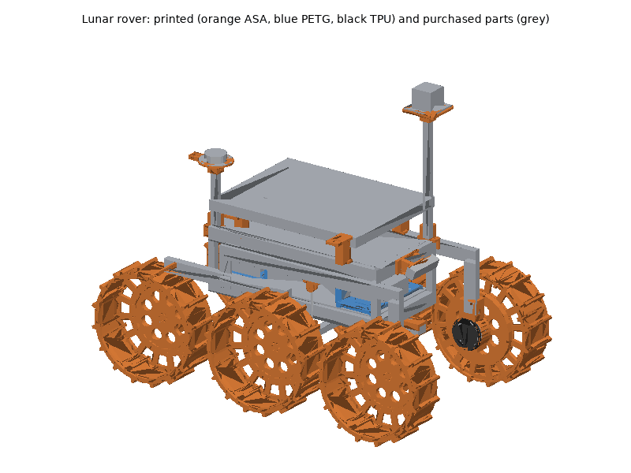
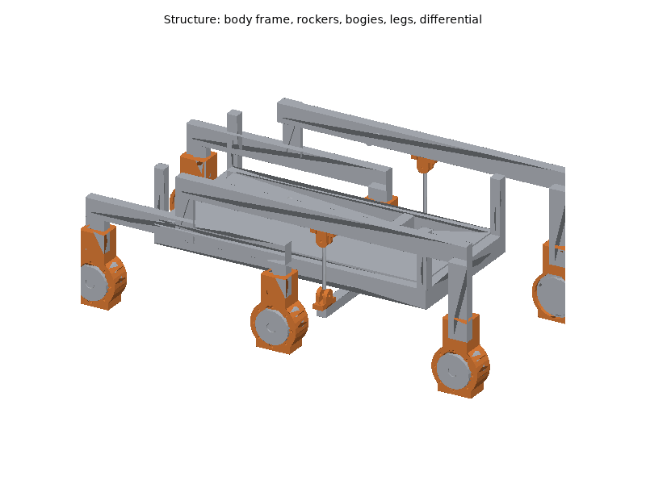
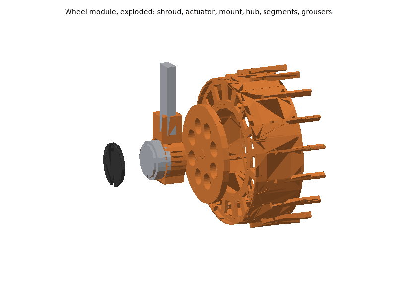
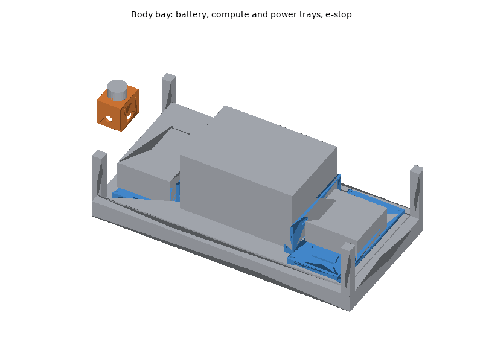
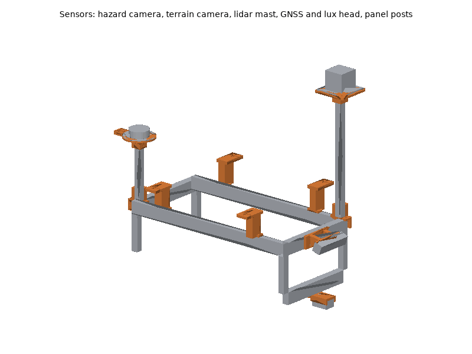

# Lunar rover printed parts

The lunar rover's wheels (hubs, rim segments, grousers), actuator mounts and
dust caps, electronics trays, battery end blocks, sensor mounts (hazard
camera, terrain camera, lidar, GNSS and lux head), mast feet, solar panel
posts, differential clevises, e-stop housing and cable clips are printed. The
2040/2020 aluminium structure, pivots, CubeMars AK70-10 actuators, battery,
power and safety electronics, computer and sensors are bought: see the bill
of materials, [hardware/lunar_rover.md](../../lunar_rover.md), for what and
why. The rover follows the simulator: six 360 mm wheels (0.18 m radius at
the grouser tips), skid steer, a rocker-bogie suspension with a
differential under the body.

## Printing

All parts print on a Bambu Lab P1S (256 mm bed) with Bambu Studio's P1S
system profiles; set only what the plate tables list. The STLs are in
[`stl/`](stl/), already in their print orientation: import them, keep the
orientation, and arrange. "flight-critical" in the BOM's table means a part
whose failure disables the rover.

### Plates

<!-- BEGIN GENERATED: plates (tools/build_printable_parts.py) -->
#### Plate A: ASA, 0.20 mm layers

Filament **Bambu ASA**, **Textured PEI Plate**, process **0.20mm Standard**. Estimated 6 h 13 min and 210 g of filament (estimates; slice for real numbers).

| Part | Qty | Per-object settings | Orientation | File |
|---|---|---|---|---|
| `wheel_hub` | 1 | 5 wall loops, 5/5 top/bottom shells, 25% gyroid, supports: none, brim: outer brim only, 5 mm | outboard face on the plate, spigot up | [stl](stl/wheel_hub.stl) |

#### Plate B: ASA, 0.20 mm layers

Filament **Bambu ASA**, **Textured PEI Plate**, process **0.20mm Standard**. Estimated 6 h 13 min and 210 g of filament (estimates; slice for real numbers).

| Part | Qty | Per-object settings | Orientation | File |
|---|---|---|---|---|
| `wheel_hub` | 1 | 5 wall loops, 5/5 top/bottom shells, 25% gyroid, supports: none, brim: outer brim only, 5 mm | outboard face on the plate, spigot up | [stl](stl/wheel_hub.stl) |

#### Plate C: ASA, 0.20 mm layers

Filament **Bambu ASA**, **Textured PEI Plate**, process **0.20mm Standard**. Estimated 6 h 13 min and 210 g of filament (estimates; slice for real numbers).

| Part | Qty | Per-object settings | Orientation | File |
|---|---|---|---|---|
| `wheel_hub` | 1 | 5 wall loops, 5/5 top/bottom shells, 25% gyroid, supports: none, brim: outer brim only, 5 mm | outboard face on the plate, spigot up | [stl](stl/wheel_hub.stl) |

#### Plate D: ASA, 0.20 mm layers

Filament **Bambu ASA**, **Textured PEI Plate**, process **0.20mm Standard**. Estimated 6 h 13 min and 210 g of filament (estimates; slice for real numbers).

| Part | Qty | Per-object settings | Orientation | File |
|---|---|---|---|---|
| `wheel_hub` | 1 | 5 wall loops, 5/5 top/bottom shells, 25% gyroid, supports: none, brim: outer brim only, 5 mm | outboard face on the plate, spigot up | [stl](stl/wheel_hub.stl) |

#### Plate E: ASA, 0.20 mm layers

Filament **Bambu ASA**, **Textured PEI Plate**, process **0.20mm Standard**. Estimated 6 h 13 min and 210 g of filament (estimates; slice for real numbers).

| Part | Qty | Per-object settings | Orientation | File |
|---|---|---|---|---|
| `wheel_hub` | 1 | 5 wall loops, 5/5 top/bottom shells, 25% gyroid, supports: none, brim: outer brim only, 5 mm | outboard face on the plate, spigot up | [stl](stl/wheel_hub.stl) |

#### Plate F: ASA, 0.20 mm layers

Filament **Bambu ASA**, **Textured PEI Plate**, process **0.20mm Standard**. Estimated 6 h 13 min and 210 g of filament (estimates; slice for real numbers).

| Part | Qty | Per-object settings | Orientation | File |
|---|---|---|---|---|
| `wheel_hub` | 1 | 5 wall loops, 5/5 top/bottom shells, 25% gyroid, supports: none, brim: outer brim only, 5 mm | outboard face on the plate, spigot up | [stl](stl/wheel_hub.stl) |

#### Plate G: ASA, 0.20 mm layers

Filament **Bambu ASA**, **Textured PEI Plate**, process **0.20mm Standard**. Estimated 8 h 28 min and 264 g of filament (estimates; slice for real numbers).

| Part | Qty | Per-object settings | Orientation | File |
|---|---|---|---|---|
| `gnss_head` | 1 | 4 wall loops, 5/4 top/bottom shells, 30% gyroid, supports: none, brim: auto | upside down: the disc's top face on the plate, cone and socket up | [stl](stl/gnss_head.stl) |
| `lidar_mount` | 1 | 5 wall loops, 5/4 top/bottom shells, 40% gyroid, supports: none, brim: auto | upside down: the plate's top face on the plate, socket up | [stl](stl/lidar_mount.stl) |
| `wheel_segment` | 1 | 4 wall loops, 5/4 top/bottom shells, 25% gyroid, supports: none, brim: auto | on one end wall: the rim arcs up to 45 deg, no supports | [stl](stl/wheel_segment.stl) |
| `terrain_cam_mount` | 1 | 4 wall loops, 5/4 top/bottom shells, 40% gyroid, supports: none, brim: auto | upside down: the flange on the plate, cradle walls up | [stl](stl/terrain_cam_mount.stl) |
| `grouser` | 2 | 4 wall loops, 5/4 top/bottom shells, 60% gyroid, supports: none, brim: auto | base on the plate | [stl](stl/grouser.stl) |
| `diff_clevis` | 1 | 5 wall loops, 5/4 top/bottom shells, 50% gyroid, supports: none, brim: auto | base on the plate, cheeks up | [stl](stl/diff_clevis.stl) |

#### Plate H: ASA, 0.20 mm layers

Filament **Bambu ASA**, **Textured PEI Plate**, process **0.20mm Standard**. Estimated 17 h 33 min and 538 g of filament (estimates; slice for real numbers).

| Part | Qty | Per-object settings | Orientation | File |
|---|---|---|---|---|
| `wheel_segment` | 4 | 4 wall loops, 5/4 top/bottom shells, 25% gyroid, supports: none, brim: auto | on one end wall: the rim arcs up to 45 deg, no supports | [stl](stl/wheel_segment.stl) |
| `panel_clamp` | 3 | 5 wall loops, 5/4 top/bottom shells, 40% gyroid, supports: none, brim: auto | on its side: the post's profile flat on the plate | [stl](stl/panel_clamp.stl) |

#### Plate I: ASA, 0.20 mm layers

Filament **Bambu ASA**, **Textured PEI Plate**, process **0.20mm Standard**. Estimated 16 h 29 min and 498 g of filament (estimates; slice for real numbers).

| Part | Qty | Per-object settings | Orientation | File |
|---|---|---|---|---|
| `wheel_segment` | 4 | 4 wall loops, 5/4 top/bottom shells, 25% gyroid, supports: none, brim: auto | on one end wall: the rim arcs up to 45 deg, no supports | [stl](stl/wheel_segment.stl) |
| `panel_clamp` | 1 | 5 wall loops, 5/4 top/bottom shells, 40% gyroid, supports: none, brim: auto | on its side: the post's profile flat on the plate | [stl](stl/panel_clamp.stl) |
| `hazcam_mount` | 1 | 5 wall loops, 5/4 top/bottom shells, 40% gyroid, supports: none, brim: auto | on its side: the profile flat on the plate | [stl](stl/hazcam_mount.stl) |
| `diff_clevis` | 2 | 5 wall loops, 5/4 top/bottom shells, 50% gyroid, supports: none, brim: auto | base on the plate, cheeks up | [stl](stl/diff_clevis.stl) |

#### Plate J: ASA, 0.20 mm layers

Filament **Bambu ASA**, **Textured PEI Plate**, process **0.20mm Standard**. Estimated 13 h 10 min and 402 g of filament (estimates; slice for real numbers).

| Part | Qty | Per-object settings | Orientation | File |
|---|---|---|---|---|
| `wheel_segment` | 4 | 4 wall loops, 5/4 top/bottom shells, 25% gyroid, supports: none, brim: auto | on one end wall: the rim arcs up to 45 deg, no supports | [stl](stl/wheel_segment.stl) |
| `grouser` | 4 | 4 wall loops, 5/4 top/bottom shells, 60% gyroid, supports: none, brim: auto | base on the plate | [stl](stl/grouser.stl) |

#### Plate K: ASA, 0.20 mm layers

Filament **Bambu ASA**, **Textured PEI Plate**, process **0.20mm Standard**. Estimated 13 h 10 min and 402 g of filament (estimates; slice for real numbers).

| Part | Qty | Per-object settings | Orientation | File |
|---|---|---|---|---|
| `wheel_segment` | 4 | 4 wall loops, 5/4 top/bottom shells, 25% gyroid, supports: none, brim: auto | on one end wall: the rim arcs up to 45 deg, no supports | [stl](stl/wheel_segment.stl) |
| `grouser` | 4 | 4 wall loops, 5/4 top/bottom shells, 60% gyroid, supports: none, brim: auto | base on the plate | [stl](stl/grouser.stl) |

#### Plate L: ASA, 0.20 mm layers

Filament **Bambu ASA**, **Textured PEI Plate**, process **0.20mm Standard**. Estimated 13 h 10 min and 402 g of filament (estimates; slice for real numbers).

| Part | Qty | Per-object settings | Orientation | File |
|---|---|---|---|---|
| `wheel_segment` | 4 | 4 wall loops, 5/4 top/bottom shells, 25% gyroid, supports: none, brim: auto | on one end wall: the rim arcs up to 45 deg, no supports | [stl](stl/wheel_segment.stl) |
| `grouser` | 4 | 4 wall loops, 5/4 top/bottom shells, 60% gyroid, supports: none, brim: auto | base on the plate | [stl](stl/grouser.stl) |

#### Plate M: ASA, 0.20 mm layers

Filament **Bambu ASA**, **Textured PEI Plate**, process **0.20mm Standard**. Estimated 13 h 10 min and 402 g of filament (estimates; slice for real numbers).

| Part | Qty | Per-object settings | Orientation | File |
|---|---|---|---|---|
| `wheel_segment` | 4 | 4 wall loops, 5/4 top/bottom shells, 25% gyroid, supports: none, brim: auto | on one end wall: the rim arcs up to 45 deg, no supports | [stl](stl/wheel_segment.stl) |
| `grouser` | 4 | 4 wall loops, 5/4 top/bottom shells, 60% gyroid, supports: none, brim: auto | base on the plate | [stl](stl/grouser.stl) |

#### Plate N: ASA, 0.20 mm layers

Filament **Bambu ASA**, **Textured PEI Plate**, process **0.20mm Standard**. Estimated 13 h 10 min and 402 g of filament (estimates; slice for real numbers).

| Part | Qty | Per-object settings | Orientation | File |
|---|---|---|---|---|
| `wheel_segment` | 4 | 4 wall loops, 5/4 top/bottom shells, 25% gyroid, supports: none, brim: auto | on one end wall: the rim arcs up to 45 deg, no supports | [stl](stl/wheel_segment.stl) |
| `grouser` | 4 | 4 wall loops, 5/4 top/bottom shells, 60% gyroid, supports: none, brim: auto | base on the plate | [stl](stl/grouser.stl) |

#### Plate O: ASA, 0.20 mm layers

Filament **Bambu ASA**, **Textured PEI Plate**, process **0.20mm Standard**. Estimated 13 h 10 min and 402 g of filament (estimates; slice for real numbers).

| Part | Qty | Per-object settings | Orientation | File |
|---|---|---|---|---|
| `wheel_segment` | 4 | 4 wall loops, 5/4 top/bottom shells, 25% gyroid, supports: none, brim: auto | on one end wall: the rim arcs up to 45 deg, no supports | [stl](stl/wheel_segment.stl) |
| `grouser` | 4 | 4 wall loops, 5/4 top/bottom shells, 60% gyroid, supports: none, brim: auto | base on the plate | [stl](stl/grouser.stl) |

#### Plate P: ASA, 0.20 mm layers

Filament **Bambu ASA**, **Textured PEI Plate**, process **0.20mm Standard**. Estimated 13 h 10 min and 402 g of filament (estimates; slice for real numbers).

| Part | Qty | Per-object settings | Orientation | File |
|---|---|---|---|---|
| `wheel_segment` | 4 | 4 wall loops, 5/4 top/bottom shells, 25% gyroid, supports: none, brim: auto | on one end wall: the rim arcs up to 45 deg, no supports | [stl](stl/wheel_segment.stl) |
| `grouser` | 4 | 4 wall loops, 5/4 top/bottom shells, 60% gyroid, supports: none, brim: auto | base on the plate | [stl](stl/grouser.stl) |

#### Plate Q: ASA, 0.20 mm layers

Filament **Bambu ASA**, **Textured PEI Plate**, process **0.20mm Standard**. Estimated 13 h 10 min and 402 g of filament (estimates; slice for real numbers).

| Part | Qty | Per-object settings | Orientation | File |
|---|---|---|---|---|
| `wheel_segment` | 4 | 4 wall loops, 5/4 top/bottom shells, 25% gyroid, supports: none, brim: auto | on one end wall: the rim arcs up to 45 deg, no supports | [stl](stl/wheel_segment.stl) |
| `grouser` | 4 | 4 wall loops, 5/4 top/bottom shells, 60% gyroid, supports: none, brim: auto | base on the plate | [stl](stl/grouser.stl) |

#### Plate R: ASA, 0.20 mm layers

Filament **Bambu ASA**, **Textured PEI Plate**, process **0.20mm Standard**. Estimated 13 h 10 min and 402 g of filament (estimates; slice for real numbers).

| Part | Qty | Per-object settings | Orientation | File |
|---|---|---|---|---|
| `wheel_segment` | 4 | 4 wall loops, 5/4 top/bottom shells, 25% gyroid, supports: none, brim: auto | on one end wall: the rim arcs up to 45 deg, no supports | [stl](stl/wheel_segment.stl) |
| `grouser` | 4 | 4 wall loops, 5/4 top/bottom shells, 60% gyroid, supports: none, brim: auto | base on the plate | [stl](stl/grouser.stl) |

#### Plate S: ASA, 0.20 mm layers

Filament **Bambu ASA**, **Textured PEI Plate**, process **0.20mm Standard**. Estimated 15 h 43 min and 486 g of filament (estimates; slice for real numbers).

| Part | Qty | Per-object settings | Orientation | File |
|---|---|---|---|---|
| `wheel_segment` | 3 | 4 wall loops, 5/4 top/bottom shells, 25% gyroid, supports: none, brim: auto | on one end wall: the rim arcs up to 45 deg, no supports | [stl](stl/wheel_segment.stl) |
| `actuator_mount` | 1 | 6 wall loops, 6/6 top/bottom shells, 50% gyroid, supports: none, brim: auto | upright, as on the rover: keel on the plate, leg socket up (teardrop bores, no supports) | [stl](stl/actuator_mount.stl) |
| `grouser` | 4 | 4 wall loops, 5/4 top/bottom shells, 60% gyroid, supports: none, brim: auto | base on the plate | [stl](stl/grouser.stl) |
| `cable_clip` | 1 | 4 wall loops, 5/4 top/bottom shells, 100% gyroid, supports: none, brim: auto | on its side: the clip profile flat on the plate | [stl](stl/cable_clip.stl) |

#### Plate T: ASA, 0.20 mm layers

Filament **Bambu ASA**, **Textured PEI Plate**, process **0.20mm Standard**. Estimated 32 h 25 min and 1024 g of filament (estimates; slice for real numbers).

| Part | Qty | Per-object settings | Orientation | File |
|---|---|---|---|---|
| `actuator_mount` | 5 | 6 wall loops, 6/6 top/bottom shells, 50% gyroid, supports: none, brim: auto | upright, as on the rover: keel on the plate, leg socket up (teardrop bores, no supports) | [stl](stl/actuator_mount.stl) |
| `mast_foot` | 2 | 5 wall loops, 5/4 top/bottom shells, 40% gyroid, supports: none, brim: auto | on its back: the apron's outer face on the plate | [stl](stl/mast_foot.stl) |
| `estop_housing` | 1 | 4 wall loops, 5/4 top/bottom shells, 30% gyroid, supports: none, brim: auto | upside down: the top (button) face on the plate | [stl](stl/estop_housing.stl) |
| `grouser` | 3 | 4 wall loops, 5/4 top/bottom shells, 60% gyroid, supports: none, brim: auto | base on the plate | [stl](stl/grouser.stl) |
| `cable_clip` | 4 | 4 wall loops, 5/4 top/bottom shells, 100% gyroid, supports: none, brim: auto | on its side: the clip profile flat on the plate | [stl](stl/cable_clip.stl) |

#### Plate U: ASA, 0.20 mm layers

Filament **Bambu ASA**, **Textured PEI Plate**, process **0.20mm Standard**. Estimated 11 h 06 min and 345 g of filament (estimates; slice for real numbers).

| Part | Qty | Per-object settings | Orientation | File |
|---|---|---|---|---|
| `grouser` | 30 | 4 wall loops, 5/4 top/bottom shells, 60% gyroid, supports: none, brim: auto | base on the plate | [stl](stl/grouser.stl) |

#### Plate V: ASA, 0.20 mm layers

Filament **Bambu ASA**, **Textured PEI Plate**, process **0.20mm Standard**. Estimated 9 h 51 min and 283 g of filament (estimates; slice for real numbers).

| Part | Qty | Per-object settings | Orientation | File |
|---|---|---|---|---|
| `grouser` | 21 | 4 wall loops, 5/4 top/bottom shells, 60% gyroid, supports: none, brim: auto | base on the plate | [stl](stl/grouser.stl) |
| `diff_clevis` | 1 | 5 wall loops, 5/4 top/bottom shells, 50% gyroid, supports: none, brim: auto | base on the plate, cheeks up | [stl](stl/diff_clevis.stl) |
| `cable_clip` | 19 | 4 wall loops, 5/4 top/bottom shells, 100% gyroid, supports: none, brim: auto | on its side: the clip profile flat on the plate | [stl](stl/cable_clip.stl) |

#### Plate W: PETG, 0.20 mm layers

Filament **Bambu PETG Basic**, **Textured PEI Plate**, process **0.20mm Standard**. Estimated 9 h 46 min and 337 g of filament (estimates; slice for real numbers).

| Part | Qty | Per-object settings | Orientation | File |
|---|---|---|---|---|
| `compute_tray` | 1 | 3 wall loops, 5/4 top/bottom shells, 25% gyroid, supports: none, brim: auto | upside down: the top face on the plate, feet up | [stl](stl/compute_tray.stl) |
| `battery_end` | 2 | 4 wall loops, 5/4 top/bottom shells, 40% gyroid, supports: none, brim: auto | base on the plate | [stl](stl/battery_end.stl) |

#### Plate X: PETG, 0.20 mm layers

Filament **Bambu PETG Basic**, **Textured PEI Plate**, process **0.20mm Standard**. Estimated 3 h 36 min and 127 g of filament (estimates; slice for real numbers).

| Part | Qty | Per-object settings | Orientation | File |
|---|---|---|---|---|
| `power_tray` | 1 | 3 wall loops, 5/4 top/bottom shells, 25% gyroid, supports: none, brim: auto | upside down: the top face on the plate, feet up | [stl](stl/power_tray.stl) |

#### Plate Y: TPU95A, 0.20 mm layers

Filament **Bambu TPU 95A HF (or Bambu TPU 95A)**, **Textured PEI Plate**, process **0.20mm Standard**. Estimated 7 h 06 min and 106 g of filament (estimates; slice for real numbers).

| Part | Qty | Per-object settings | Orientation | File |
|---|---|---|---|---|
| `actuator_shroud` | 4 | 3 wall loops, 5/4 top/bottom shells, 30% gyroid, supports: none, brim: auto | cap face on the plate, plug up | [stl](stl/actuator_shroud.stl) |

#### Plate Z: TPU95A, 0.20 mm layers

Filament **Bambu TPU 95A HF (or Bambu TPU 95A)**, **Textured PEI Plate**, process **0.20mm Standard**. Estimated 3 h 36 min and 53 g of filament (estimates; slice for real numbers).

| Part | Qty | Per-object settings | Orientation | File |
|---|---|---|---|---|
| `actuator_shroud` | 2 | 3 wall loops, 5/4 top/bottom shells, 30% gyroid, supports: none, brim: auto | cap face on the plate, plug up | [stl](stl/actuator_shroud.stl) |
<!-- END GENERATED: plates -->

Times and filament are estimates from each part's volume (see
[`stl/manifest.md`](stl/manifest.md)); Bambu Studio's slice is the real
number. Parts of one material and layer height can be combined on fewer
plates when Bambu Studio's auto-arrange fits them; the 48 wheel segments go
two to a plate.

### Material and printer notes

- **ASA** (everything outside the body: wheels, actuator mounts, sensor
  mounts, masts' feet, panel posts, clevises, e-stop housing, cable clips):
  the rover works outdoors in the sun and the AK70-10s run warm. Door closed
  and lid on for the whole print, Textured PEI plate; let the chamber cool
  before opening, or the hubs (226 mm) lift at the edge. Dry the spool
  (8 h at 80 C) if it crackles.
- **PETG** (compute tray, power tray, battery end blocks: inside the closed
  body). Textured PEI plate; dry 8 h at 65 C if it strings.
- **TPU 95A** (actuator shrouds): dry 8 h at 70 C first, feed from the
  external spool holder, keep the system profile's slow speeds.
- **Wheel segments** print standing on one end wall, so their layers run
  across the rim's width and the rim's bending stays in the layers. The rim
  arcs up to 45 deg from vertical: no supports, but keep the part cooling
  fan at the profile's setting.
- No carbon-filled filament is needed. PA-CF actuator mounts and hubs would
  be stiffer and take more heat, but need the hardened steel nozzle.

### Post-processing

1. **Print the fit-test parts first** and check them against the real
   parts before printing the rest:
   - `actuator_mount` and `wheel_hub`: on an AK70-10, check which flange
     turns (power it on CAN and command a slow speed): the hub bolts to the
     central 6 x M3 flange, the mount to the 8 x M3 ring on the body's front
     face. The drawing does not label them, nor the angle of the 8 x M3 ring
     (the mount assumes holes at 0, 45, 90 ... deg from the rover's x). The
     actuator must slide into the cup and seat on the ring.
   - `hazcam_mount`: the D455's two M4 on the back; the holes are slotted
     1 mm up and down because the pair's height is not dimensioned.
   - `terrain_cam_mount`: the OAK-1 between the walls and its tripod screw
     reaching the thread.
   - `lidar_mount`: the Mid-360's 4 x M3 on 48 x 36 mm, drawn but not
     dimensioned from its centre.
   - `estop_housing`: the e-stop's 22.5 mm hole and its contact block inside
     the box.
   - `panel_clamp`: your panel's frame-flange holes in the four cross slots.
   - `gnss_head`: the VEML7700 board in its pocket.
   - `diff_clevis`: your M6 rod end's ball width in the 9.5 mm gap.
2. **Supports**: none of the parts need them. Clean stringing out of the
   cup bore of the actuator mounts.
3. **Heat-set inserts** (CNC Kitchen type, see the fastener table): soldering
   iron at **245-260 C for ASA**, 230-245 C for PETG; press straight, stop
   flush, hold a few seconds, cool before loading.
   - `wheel_hub`: 16 x M4 into the outboard face (segment bolts).
   - `grouser`: 2 x M3 into the base.
   - `power_tray`: 10 x M4 into the top face (DIN rails).
4. **Holes**: the M3, M4 and M5 clearance holes need no reaming; if one is
   tight, run a 3.4, 4.5 or 5.5 mm drill through by hand. Do not drill the
   insert holes. Use `lidar_mount` as the drilling template for the
   aluminium heat-sink plate (4 x 3.4 mm, 4 x 4.5 mm).
5. **Actuator shrouds**: trim the TPU flash so the cap presses in evenly.

### Bambu Studio project files

Not provided. A Bambu Studio 3MF carries per-plate filament, process and
object settings in Bambu's own project metadata, which can only be checked
by opening it in Bambu Studio; a plain 3MF would drop those settings. Import
the STLs instead (they are already oriented) and set the per-object values
from the plate tables.

## Assembly

### Tools and consumables

- Hex keys 2.5 mm (M3), 3 mm (M4 and M5 button heads), 4 mm (M5 socket
  heads), 5 mm (M6), 10 mm spanner (M6 nyloc); torque screwdriver (0.4-3 N m).
- Soldering iron with a heat-set insert tip; crimp tools for ferrules and
  XT30 connectors.
- Saw and square for the extrusions, deburring tool, calipers, tape
  measure, spirit level.
- Medium (blue) thread locker: on screws into the actuators (metal threads
  only); never on screws into inserts.
- Zip ties, foam gasket tape, closed-cell foam pads, double-sided foam tape.

### Fasteners

Every screw, insert and T-nut of the printed parts, with its quantity and
use, is in the generated fastener table of the BOM:
[hardware/lunar_rover.md, "Fasteners"](../../lunar_rover.md#fasteners); the
structure's corner brackets and T-nuts are listed under its Structure
section. Torque: "snug" (0.5-0.8 N m) for screws into inserts and printed
parts; **1.2 N m** for the 12.9 M3 screws into the actuators (with thread
locker); 0.4 N m for the D455's M4 (Intel); M5 into T-nuts 2.5 N m.

### Steps

Rover frame: **x forward, y left, z up**, origin on the ground under the
body centre. Wheel names follow the simulator: front, middle, rear; left,
right.

1. **Structure.** Cut the extrusions (BOM, Structure). Build the body frame
   with corner brackets: bottom and top rectangles (600 x 300 mm outside)
   joined by the four posts, the differential cross rail under the floor
   100 mm ahead of the centre. Fit the floor panel. Build each rocker (640 mm
   beam with the 160 mm front leg) and bogie (440 mm beam with two 70 mm
   legs) with corner brackets, legs square to the beams.
   *Check:* the frame is square (equal diagonals) and the legs are vertical.
2. **Pivots.** Fit the rocker pivots (SHF12 on the body's top side rails,
   at x = 0, two KFL001 on each rocker beam) and the bogie pivots (aluminium
   plate on the rocker's rear end, at x = -200 mm). Fit the differential:
   pillow block under the cross rail, the 410 mm 2020 bar across under the
   body, a `diff_clevis` on each bar end (turned 90 deg, base along the bar),
   a `diff_clevis` under each rocker beam 100 mm ahead of the pivot, and the
   M6 rod-end links between them, adjusted so the body sits level with the
   rockers level.
   *Check:* with the rover on stands, each rocker turns freely and lifting
   one rocker tilts the other the opposite way.

3. **Actuator mounts.** Slide each AK70-10 into an `actuator_mount` from the
   rear, connectors at the bottom, front face against the ring; eight
   12.9 M3 x 10 with thread locker through the ring, 1.2 N m. Push the mount's
   socket onto the bottom of its leg and fix it with four M5 x 10 into T-nuts
   in the leg's inboard face. Press an `actuator_shroud` into the back of the
   cup, its cable slot at the bottom, the actuator cable through it.
   *Check:* the actuator's output turns freely by hand; the shroud seats all
   round.
4. **Wheel hubs.** Press the 16 M4 inserts into each `wheel_hub`. Bolt the
   hub to the actuator's central output flange: the spigot in the 20 mm
   recess, six 12.9 M3 x 16 with thread locker, 1.2 N m.
5. **Wheel segments and grousers.** Press 2 M3 inserts into each `grouser`
   and screw two grousers onto each `wheel_segment` from inside the rim
   (M3 x 8). Bolt the eight segments of a wheel to its hub (two M4 x 14 with
   washers each, into the hub's inserts), then bolt each pair of neighbouring
   end walls together (two M4 x 16 with nyloc nuts).
   *Check:* the wheel runs true (a pointer at the grouser tips moves less
   than 2 mm per turn); the tip radius is 180 mm.

6. **Body bay.** Bolt the `power_tray` (rear) and the `compute_tray` (front)
   to the floor with M4 x 25 and nyloc nuts. Screw two TS35 rails onto the
   power tray (M4 x 8 into the inserts) and mount the DIN electronics: main
   fuse, contactor, DC-DC converters, switch, safety controller, terminals.
   Mount the mini PC on the compute tray (VESA, M4 x 10 from below) with a
   strap. Bolt the two `battery_end` blocks to the floor 260 mm apart, lay
   the two 6 mm foam pads, set the pack in, pad its ends and strap it through
   both blocks (two straps, each over the top of the pack through a slot in
   each block).
   *Check:* the pack cannot slide; nothing touches the lid's line.
7. **E-stop.** Screw the e-stop into the `estop_housing` (button up, contact
   block inside), fix the housing to the rear top cross rail's rear face
   (two M5 x 12 into T-nuts, from inside the open bottom) and bring its cable
   into the body through the gland.

8. **Cameras.** Screw the D455 to the `hazcam_mount` (M4 x 8, 0.4 N m) and fix
   the mount to the front top cross rail's front face (four M5 x 12 into
   T-nuts). Screw the OAK-1 into the `terrain_cam_mount` (1/4"-20 x 3/8",
   lens down, USB-C end toward the rear) and fix it under the front bottom
   cross rail (two M5 x 10).
9. **Masts.** Fix a `mast_foot` on the left top side rail at x = 280 mm (front)
   and one on the right top side rail at x = -280 mm (rear), aprons outboard;
   stand the 400 mm (front) and 200 mm (rear) 2020 masts in them. On the
   front mast: the `lidar_mount` with the aluminium plate (four M4 x 12 and
   nyloc nuts) and the Mid-360 on it (four M3 x 10 from below), its M12
   connector to the rear. On the rear mast: the `gnss_head`, the steel disc on
   foam tape, the antenna on the disc (arrow forward), the VEML7700 in the
   rear pocket under its clear cover (silicone around the edge).
10. **Solar panel.** Fix the four `panel_clamp` posts on the top side rails
    at x = +-180 mm, tops outboard, and bolt the panel's frame flange to each
    post through the cross slots (M5 x 16, washers, nyloc). Connect the panel
    to the MPPT.
11. **Cable clips.** Clip the actuator cables along the rocker and bogie beams
    with `cable_clip` (M5 x 10 into T-nuts), with a slack loop at every
    pivot; clip the camera and lidar cables to the masts.
12. **Wiring** as below, then the **Checks**.

### Wiring

- **Power**: battery -> service disconnect -> 40 A main fuse -> SmartShunt
  (on the negative) -> 24 V bus on the power tray. From the bus: (a) the
  contactor -> six 10 A fuses -> the six actuators (XT30 power); (b) always
  on: DC-DC 24-12 V (lidar, switch, radio, safety controller), DC-DC 24-19 V
  (mini PC). The MPPT charges the battery through its own fuse, before the
  service disconnect's load side.
- **E-stop loop**: 24 V -> e-stop (NC) -> remote e-stop relay (NC) -> the
  safety controller's relay (closed only while ROS heartbeats arrive) ->
  contactor coil. Any of the three opens the actuators' power. Unpowered
  actuators can be back-driven: on a slope the rover can roll after an
  e-stop, so command zero speed (the actuators hold) before cutting power in
  normal stops, and chock the wheels on slopes.
- **CAN**: USB-CAN adapter -> front left -> middle left -> rear left ->
  rear right -> middle right -> front right, 120 ohm terminators at both
  ends, 1 Mbit/s; CAN IDs 1-6 in the order of the BOM.
- **Ethernet**: Mid-360 and radio to the switch, switch to the mini PC.
- **USB**: D455 and OAK-1 on separate USB 3 ports of the mini PC; SmartShunt
  (VE.Direct USB), USB-CAN, safety controller.
- **Sensors**: IMU at the body centre, x forward; DS18B20 probes on the
  battery, the power tray, one actuator and the body's outside; the VEML7700
  over I2C to the safety controller.
- Strain relief: a slack loop and a clip at every pivot and at every
  actuator; cable glands or grommets wherever a cable enters the body; foam
  gasket tape on the panel joints against regolith dust.

### Checks

Before driving, then follow
[hardware/lunar_rover.md, "Recommended assembly order"](../../lunar_rover.md#recommended-assembly-order)
and the system notes in
[systems/lunar_rover/README.md](../../../systems/lunar_rover/README.md).

<!-- BEGIN GENERATED: assembly (tools/build_printable_parts.py) -->
Generated by the assembly check (`assembly.py`), from the CAD and datasheet masses:

- Bodies in the check: 234
- Interference between parts (screws modelled through their holes): none (screws are not modelled on the rover)
- Intended press fits: 6
- Wheel radius at the grouser tips (mm): 180.0
- Gaps between neighbouring wheels (mm): 40.0; 40.0
- Ground clearance under the body (mm, lowest part): 220 (diff_bar)
- Estimated mass (kg): 38.0 + 10 payload on the deck
- Centre of gravity (x, y, z mm; z above the ground): 0; 1; 392
- Static tip-over angles (deg): sideways 36, nose down 46, nose up 46
- Wheel torque (N m per wheel): 7.0 needed on 21 deg in loose regolith (rolling resistance 0.15), 8.3 rated, 24.8 peak
- Largest payload on the steepest slope at rated torque (kg): 18.6
- Wheel speed: 58 at 0.38 m/s and 0.65 slip; 148 rated at 24 V
- Battery energy (Wh): 640 (650 in the simulator)
- Hazard camera's depth view clear of the rover: yes (87 x 58 deg depth view, pitched 20 deg down); the tops of the front_left and front_right wheels show in the lower corners: mask them
- Terrain camera's view clear of the rover: yes (69 x 55 deg, straight down)
- Lidar's field of view clear of the rover: yes (nothing above the Mid-360's -7 deg lowest ray)
- Lux sensor's view of the sky: clear above 30 deg (the GNSS antenna beside it excepted)
- All assembly checks passed: yes
<!-- END GENERATED: assembly -->

- **E-stop.** With the wheels off the ground and spinning slowly: the e-stop,
  the remote e-stop and a stopped heartbeat each cut the actuators' power.
- **Directions.** On stands, command a slow forward `cmd_vel`: all six wheels
  turn forward, and `/lunar_rover/wheel_states` shows the simulator's names
  with the same signs. Then a slow left turn: left wheels slower.
- **Suspension.** Put one front wheel on a 150 mm block: all six wheels stay
  on the ground and the body pitches by about half the rocker's angle
  (the differential).
- **Wheel radius.** Measure the grouser tip radius (180 mm) and the distance
  per turn on firm ground; use the measured radius in the drive driver.
- **Temperatures.** After 20 min of driving, the actuators' NTC readings stay
  below 50 C (their rated maximum); otherwise slow down or shade them.
- **Every run**: wheels and segment bolts tight, no cracked segment or mount,
  shrouds in place, battery strap tight, e-stop works.
