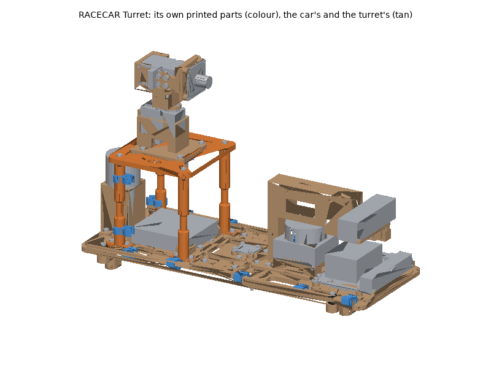
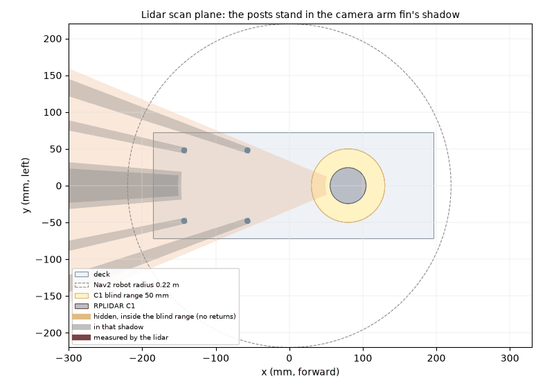
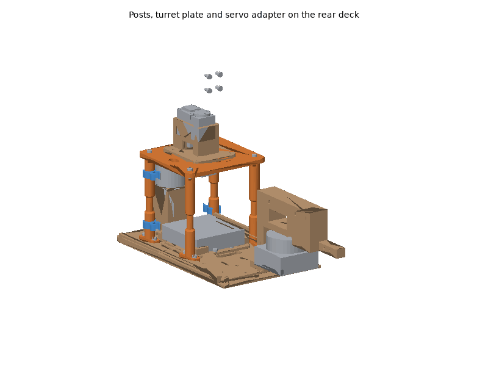

# RACECAR Turret printed parts

The RACECAR Turret is the RACECAR Neo with the pan/tilt turret on a raised
plate behind the lidar, so its printed parts are the two other platforms'
plus three of its own: the turret plate (the URDF's `turret/base_link`, with
the mount for the Waveshare Bus Servo Adapter (A) underneath), its four
posts and the post cable clips. Print and assemble:

- the RACECAR Neo's deck and mounts, all of
  [`racecarneo/`](../racecarneo/README.md) (its rear deck already has the
  eight inserts for the posts);
- the turret mechanism from [`turret/`](../turret/README.md): `pan_base`,
  `pan_hub`, `tilt_bracket`, `camera_yoke` and `camera_plate_b0385` (not the
  turret's base plate or tripod camera plate);
- the parts below.

The servos, camera, adapter, regulator, emergency stop, wiring and
fasteners are bought: [hardware/racecar_turret.md](../../racecar_turret.md).
Frames: `systems/racecar_turret/urdf/racecar_turret.urdf.xacro`.

The posts cross the lidar's scan plane 141-232 mm behind the lidar, at
bearings of +-159 to +-169 deg, inside the rear sector of about +-23 deg
that the RACECAR's camera arm fin already hides from the lidar (the fin is
inside the C1's 50 mm blind range and returns nothing). With the arm in
place the posts return nothing either; `systems/racecar_turret/config/scan_filter.yaml`
masks them as well, and the assembly check confirms they lie inside its
box. They narrow to 8 mm at the scan plane anyway.

## Printing

All parts print on a Bambu Lab P1S (256 mm bed) with Bambu Studio's P1S
system profiles; set only what the plate tables list. The STLs are in
[`stl/`](stl/), already in their print orientation. The RACECAR Neo's and
the turret's plates are in their own READMEs.

### Plates

<!-- BEGIN GENERATED: plates (tools/build_printable_parts.py) -->
#### Plate A: ASA, 0.20 mm layers

Filament **Bambu ASA**, **Textured PEI Plate**, process **0.20mm Standard**. Estimated 3 h 57 min and 91 g of filament (estimates; slice for real numbers).

| Part | Qty | Per-object settings | Orientation | File |
|---|---|---|---|---|
| `turret_plate` | 1 | 4 wall loops, 5/4 top/bottom shells, 40% gyroid, supports: none, brim: auto | upside down: the top face on the plate, adapter standoffs up | [stl](stl/turret_plate.stl) |
| `plate_post` | 4 | 5 wall loops, 5/4 top/bottom shells, 60% gyroid, supports: none, brim: auto | upright: the flange on the plate | [stl](stl/plate_post.stl) |

#### Plate B: PETG, 0.20 mm layers

Filament **Bambu PETG Basic**, **Textured PEI Plate**, process **0.20mm Standard**. Estimated 18 min and 4 g of filament (estimates; slice for real numbers).

| Part | Qty | Per-object settings | Orientation | File |
|---|---|---|---|---|
| `post_clip` | 4 | 4 wall loops, 5/4 top/bottom shells, 100% gyroid, supports: none, brim: auto | flat: the clip profile on the plate | [stl](stl/post_clip.stl) |
<!-- END GENERATED: plates -->

Times and filament are estimates from each part's volume (see
[`stl/manifest.md`](stl/manifest.md)); Bambu Studio's slice is the real
number.

### Material and printer notes

- **ASA** (turret plate, posts): on top of the car in the sun. Door closed
  and lid on, Textured PEI plate; dry the spool if it crackles. The posts
  print upright with five walls and 60 % infill: tall and thin, they need
  the chamber warm to keep their layers bonded.
- **PETG** (post clips): they flex to snap on.
- **No carbon-filled filament is needed.** Stiffer posts: PETG-CF or PA-CF
  from the same file (hardened nozzle), or aluminium standoffs (BOM).

### Post-processing

1. **Fit-test parts:** none of these three. Print the turret's fit-test
   parts first (its README).
2. **Supports**: none.
3. **Heat-set inserts** (CNC Kitchen type; see the fastener table):
   245-260 C for ASA.
   - `turret_plate`: 4 x M3 x 3 (short) for the pan base, from the top,
     through holes pressed flush; 4 x M2 in the adapter standoffs underneath.
   - `plate_post`: 1 x M3 x 5.7 in each post's top end.
4. **Holes**: clean the cable pass-throughs in the plate of stringing.

### Bambu Studio project files

Not provided. A Bambu Studio 3MF carries per-plate filament, process and
object settings in Bambu's own project metadata, which can only be checked
by opening it in Bambu Studio; a plain 3MF would drop those settings.
Import the STLs instead (they are already oriented) and set the per-object
values from the plate tables.

## Assembly

### Tools and consumables

As for the RACECAR Neo and the turret (their READMEs), plus a long 2.5 mm
hex key and 10 mm spiral wrap for the camera cable and servo bus.

### Fasteners

Every screw, insert and clip of these three parts is in the generated
fastener table of the BOM:
[hardware/racecar_turret.md, "Fasteners"](../../racecar_turret.md#fasteners);
the car's and the turret's are in theirs. Torque: "snug" into inserts.

### Steps

Vehicle directions: **x forward, y left, z up** from `base_link`.

1. **Car.** Build the RACECAR Neo deck as its README says, with the rear
   deck's eight post inserts pressed in, and check it drives.
2. **Turret.** Assemble the turret mechanism on its pan base as the turret's
   README says (steps 1-3 and 5-9), with the B0385 camera plate, but do not
   bolt the pan base to anything yet.
3. **Posts.** Screw each `plate_post` to the rear deck with two M3 x 8 into
   the inserts, flange along the car: at x = -57 and -143 mm, y = +-48 mm.
4. **Adapter.** Set the Bus Servo Adapter (A)'s jumper to A (UART), then
   screw it under the `turret_plate` onto the four standoffs with M2 x 5, its
   components facing down and its UART header toward the left (+y) post.
5. **Plate.** Lay the `turret_plate` on the posts, the bus slot on the right
   (-y) and the camera slot at the rear, and screw it down with four M3 x 10
   and washers into the posts' top inserts.
6. **Turret on the plate.** Bolt the turret's pan base onto the plate's
   centre with four M3 x 10 into the inserts, its shaft end forward.
   *Check:* by hand, pan +-90 deg and tilt -37 to +43 deg: nothing touches
   the plate or the posts.
7. **Cables** as below, with two `post_clip`s on each rear post (above and
   below the waist), then the checks.

### Wiring

- **Servo bus:** from the pan servo (out of the pan base's -y window) down
  through the plate's bus slot to the adapter's servo port; the tilt servo's
  cable on the turret's own loop (turret README).
- **Turret camera:** from the camera plate along the turret's cable loop
  (pan base rear hook to tilt bracket rear hook, about 120 mm of slack), down
  the plate's rear slot and the right rear post in the post clips, then
  forward along the deck rim clips to a Jetson USB port. About 0.8 m in all:
  the B0385's own 1 m cable reaches.
- **UART:** three jumper wires (pins 8 TX, 10 RX, 6 GND of the Jetson's
  40-pin header, on its left edge) along the left deck rim and up the left
  front post to the adapter's UART header: about 0.4 m.
- **12 V servo rail:** from the regulator on the right power tray through the
  e-stop relay and the fuse up the right front post to the adapter's DC jack.
- Keep every lead behind the lidar inside the rear sector the camera arm
  hides (along the rear posts and the deck), never across the lidar's view.

### Checks

Then the bring-up of [systems/racecar_turret/README.md](../../../systems/racecar_turret/README.md)
(lidar mask, UART loopback, servo IDs, the stop engaged first).

<!-- BEGIN GENERATED: assembly (tools/build_printable_parts.py) -->
Generated by the assembly check (`assembly.py`), from the CAD and datasheet masses:

- Bodies in the check: 166
- Interference between parts (screws modelled through their holes): none
- Intended press fits: 14
- scan_plane_blind_sectors: camera_arm: 157.2 to -157.2 deg (45.5 deg wide), 31-46 mm (inside the C1's blind range)
- post_sectors: plate_post_0: 159.1 to 162.3 deg (3.2 deg wide), 141-149 mm from the lidar axis, in the fin's shadow; plate_post_1: -162.3 to -159.1 deg (3.2 deg wide), 141-149 mm from the lidar axis, in the fin's shadow; plate_post_2: 166.8 to 168.9 deg (2.0 deg wide), 224-232 mm from the lidar axis, in the fin's shadow; plate_post_3: -168.9 to -166.8 deg (2.0 deg wide), 224-232 mm from the lidar axis, in the fin's shadow
- scan_plane_measured: none
- posts_in_scan_filter_box: yes: box x -170..-30, y -70..70 mm; posts at (-57, 48), (-57, -48), (-143, 48), (-143, -48)
- pan_sweep: clear over +-90 deg; smallest gap 0.6 mm (hub_screw_0_7 / turret_pan_servo_case at -90 deg)
- turret_camera_view: at pan 0 the car enters the view below about -3 deg of tilt (realsense)
- turret_camera_view_clear_level: yes
- cable_runs_mm: UART jumpers Jetson header to adapter about 375; turret camera USB about 815 (with 120 mm of pan loop and 150 mm on the tilt stage)
- added_mass_g: 370
- All assembly checks passed: yes
<!-- END GENERATED: assembly -->

- **Lidar.** With the plate and posts mounted, `/scan_raw` reads no return
  from the posts (they are in the camera arm's blind sector), and `/scan`
  after the box filter shows nothing within 0.3 m of the car.
- **Range by hand.** Servos unpowered: pan +-90 deg and tilt the full range
  with all cables connected; nothing pulls tight, no cable reaches the
  lidar.
- **Turret camera.** At pan 0 and level the car's front sensors stay out of
  the image; tilting down a few degrees brings the RealSense into view (the
  assembly check above gives the angle).
