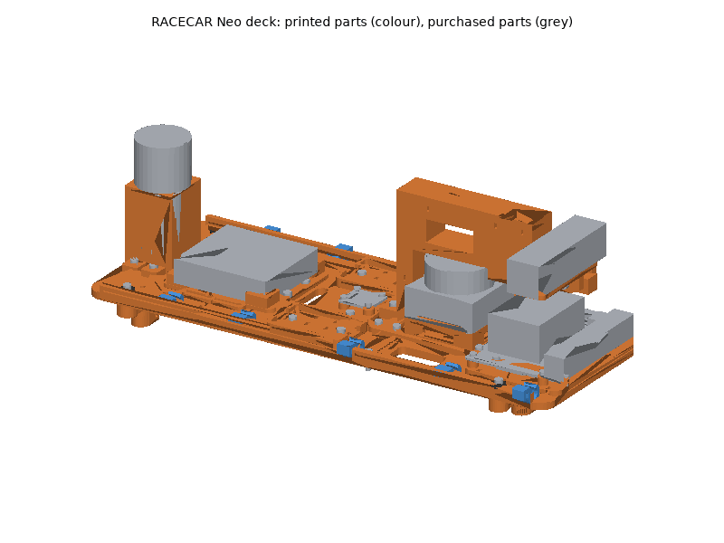
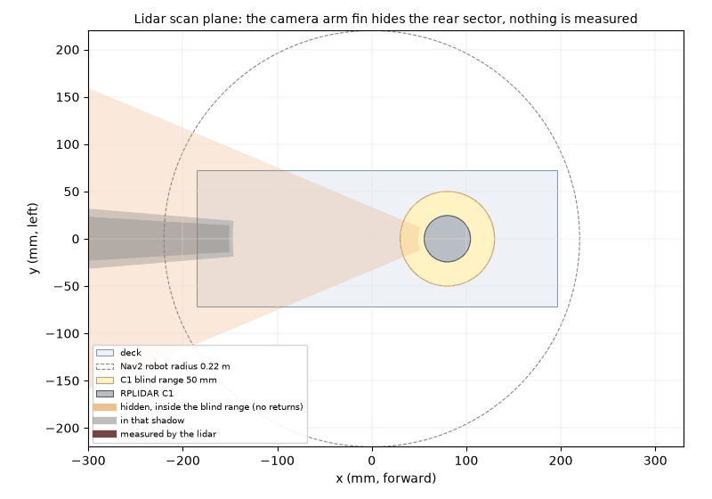
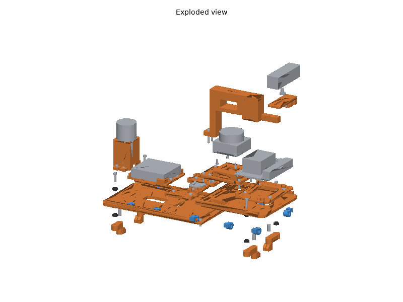
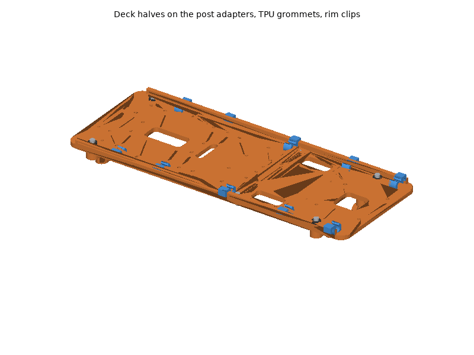
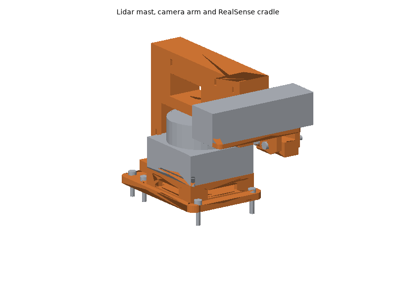
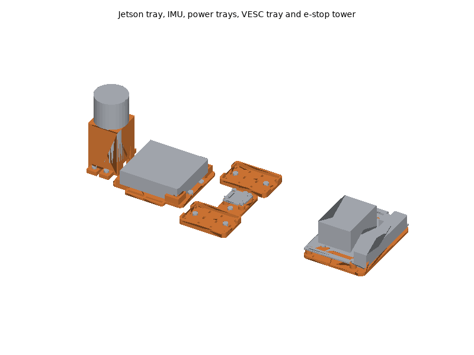

# RACECAR Neo printed parts

The RACECAR Neo's deck and everything that holds its electronics are
printed: a two-piece deck on four TPU-isolated post adapters, the lidar
mast, the camera arm and pitch-adjustable cradle that hold the RealSense
over the lidar, the Jetson tray, the IMU mount, the VESC tray, two power
trays, the e-stop tower and cable clips. The chassis, battery hold-down,
electronics, sensors, emergency stop and power switching, wiring and
fasteners are bought (see the bill of materials,
[hardware/racecarneo.md](../../racecarneo.md), for what and why). The
sensors sit where the URDF puts them: the C1's scan plane at (80, 0, 180) mm
and the RealSense's `camera_link` at (180, 0, 220) mm from `base_link`.

The camera is 100 mm ahead of and 40 mm above the lidar, so whatever holds
it must cross the lidar's scan plane. A support in front of the lidar would
be measured about 0.1 m away, inside Nav2's 0.22 m robot radius, and stop
the car through the collision monitor. The camera arm crosses the plane
only behind the lidar, 31-46 mm from its axis, inside the C1's 50 mm blind
range: the lidar gets no return from it and sees nothing printed anywhere
else. The arm hides a rear sector of about +-23 deg, which also covers the
e-stop and the RACECAR Turret's plate posts.

## Printing

All parts print on a Bambu Lab P1S (256 mm bed) with Bambu Studio's P1S
system profiles; set only what the plate tables list. The STLs are in
[`stl/`](stl/), already in their print orientation: import them, keep the
orientation, and arrange.

### Plates

<!-- BEGIN GENERATED: plates (tools/build_printable_parts.py) -->
#### Plate A: ASA, 0.20 mm layers

Filament **Bambu ASA**, **Textured PEI Plate**, process **0.20mm Standard**. Estimated 5 h 44 min and 186 g of filament (estimates; slice for real numbers).

| Part | Qty | Per-object settings | Orientation | File |
|---|---|---|---|---|
| `deck_rear` | 1 | 3 wall loops, 5/4 top/bottom shells, 25% gyroid, supports: none, brim: outer brim only, 5 mm | flat: underside on the plate, rims up | [stl](stl/deck_rear.stl) |
| `jetson_tray` | 1 | 3 wall loops, 5/4 top/bottom shells, 30% gyroid, supports: none, brim: auto | flat: plate on the build plate, bosses up | [stl](stl/jetson_tray.stl) |
| `lidar_mast` | 1 | 4 wall loops, 5/4 top/bottom shells, 40% gyroid, supports: none, brim: auto | flange down on the plate, seat up | [stl](stl/lidar_mast.stl) |
| `estop_tower` | 1 | 4 wall loops, 5/4 top/bottom shells, 40% gyroid, supports: none, brim: auto | upright: ears on the plate, panel on top (bridged) | [stl](stl/estop_tower.stl) |

#### Plate B: ASA, 0.20 mm layers

Filament **Bambu ASA**, **Textured PEI Plate**, process **0.20mm Standard**. Estimated 4 h 01 min and 121 g of filament (estimates; slice for real numbers).

| Part | Qty | Per-object settings | Orientation | File |
|---|---|---|---|---|
| `deck_front` | 1 | 3 wall loops, 5/4 top/bottom shells, 25% gyroid, supports: none, brim: outer brim only, 5 mm | flat: underside on the plate, rims up | [stl](stl/deck_front.stl) |
| `power_tray` | 2 | 3 wall loops, 5/4 top/bottom shells, 25% gyroid, supports: none, brim: auto | flat: plate on the build plate, lip up | [stl](stl/power_tray.stl) |
| `camera_cradle` | 1 | 4 wall loops, 5/4 top/bottom shells, 40% gyroid, supports: none, brim: auto | upside down: the camera seat on the plate, cheeks up | [stl](stl/camera_cradle.stl) |
| `imu_mount` | 1 | 3 wall loops, 5/4 top/bottom shells, 40% gyroid, supports: none, brim: auto | flat: plate on the build plate, bosses up | [stl](stl/imu_mount.stl) |
| `post_adapter_front` | 2 | 5 wall loops, 5/4 top/bottom shells, 50% gyroid, supports: none, brim: auto | upside down: the seat face on the plate, sleeve up | [stl](stl/post_adapter_front.stl) |
| `post_adapter_rear` | 2 | 5 wall loops, 5/4 top/bottom shells, 50% gyroid, supports: none, brim: auto | upside down: the seat face on the plate, sleeve up | [stl](stl/post_adapter_rear.stl) |

#### Plate C: ASA, 0.20 mm layers

Filament **Bambu ASA**, **Textured PEI Plate**, process **0.20mm Standard**. Estimated 3 h 16 min and 107 g of filament (estimates; slice for real numbers).

| Part | Qty | Per-object settings | Orientation | File |
|---|---|---|---|---|
| `camera_arm` | 1 | 5 wall loops, 5/4 top/bottom shells, 40% gyroid, supports: none, brim: auto | on its side: the flat +y face (the tongue side) on the plate | [stl](stl/camera_arm.stl) |
| `vesc_tray` | 1 | 3 wall loops, 5/4 top/bottom shells, 30% gyroid, supports: none, brim: auto | flat: plate on the build plate, guides up | [stl](stl/vesc_tray.stl) |

#### Plate D: PETG, 0.20 mm layers

Filament **Bambu PETG Basic**, **Textured PEI Plate**, process **0.20mm Standard**. Estimated 46 min and 11 g of filament (estimates; slice for real numbers).

| Part | Qty | Per-object settings | Orientation | File |
|---|---|---|---|---|
| `rim_clip` | 10 | 4 wall loops, 5/4 top/bottom shells, 100% gyroid, supports: none, brim: auto | on its side: the clip profile flat on the plate | [stl](stl/rim_clip.stl) |

#### Plate E: TPU95A, 0.20 mm layers

Filament **Bambu TPU 95A HF (or Bambu TPU 95A)**, **Textured PEI Plate**, process **0.20mm Standard**. Estimated 22 min and 2 g of filament (estimates; slice for real numbers).

| Part | Qty | Per-object settings | Orientation | File |
|---|---|---|---|---|
| `deck_grommet` | 8 | 3 wall loops, 4/4 top/bottom shells, 100% gyroid, supports: none, brim: auto | flange down, sleeve up | [stl](stl/deck_grommet.stl) |
<!-- END GENERATED: plates -->

Times and filament are estimates from each part's volume (see
[`stl/manifest.md`](stl/manifest.md)); Bambu Studio's slice is the real
number. Parts of one material and layer height can be combined on fewer
plates when Bambu Studio's auto-arrange fits them.

### Material and printer notes

- **ASA** (deck halves, adapters, mast, arm, cradle, trays, e-stop tower):
  the car runs outdoors and the Jetson, the VESC and the RealSense warm
  their mounts. Door closed and lid on for the whole print, Textured PEI
  plate. The deck halves are large flat parts: keep the 5 mm outer brim,
  let the chamber cool before opening the door, and dry the spool (8 h at
  80 C) if it crackles.
- **PETG** (rim clips): they flex to snap on. Textured PEI plate; dry 8 h
  at 65 C if it strings.
- **TPU 95A** (deck grommets): always dry first (8 h at 70 C), feed from
  the external spool holder, not through an AMS, and keep the system
  profile's slow speeds.
- **No carbon-filled filament is needed.** For a stiffer camera arm, PETG-CF
  or PA-CF prints from the same file but needs the hardened steel nozzle.

### Post-processing

1. **Print the fit-test parts first** and check them against the real
   parts before printing the rest. These are the parts with dimensions not
   stated in the cited datasheets:
   - `post_adapter_front`, `post_adapter_rear`: Traxxas publishes neither
     the body posts' positions nor their diameter. Measure your posts
     (centre positions from the chassis centre, diameter) and set `POSTS`
     and `POST_D` in `_frame.py`, then rebuild
     (`tools/build_printable_parts.py racecarneo`); the adapters reach from
     the posts to the deck's fixed mounting points. The current clipless
     Slash 4x4 kits have latching mounts instead of round posts: adapt the
     sleeve to them.
   - `jetson_tray`: the carrier's four holes, read from NVIDIA's drawing as
     the 86 x 58 mm Jetson Nano pattern (not dimensioned there).
   - `camera_cradle`: the D435i's 1/4"-20 position along its depth (from
     realsense-ros, not the datasheet).
   - `imu_mount`: the BNO085 breakout's hole diameter (M2.5 assumed).
   - `estop_tower`: the switch body's length under the panel (the datasheet
     gives only the 82 mm overall depth).
2. **Supports**: none of the parts need them. The e-stop tower's top panel
   is a 32 mm bridge.
3. **Heat-set inserts** (CNC Kitchen type, hole sizes from their table; see
   the fastener table): soldering iron with an insert tip at **245-260 C for
   ASA**. Press straight down, stop when the insert is flush, hold flat for
   a few seconds, let it cool before loading it.
   - `deck_front`: 4 x M3 x 3 (short), Jetson tray; `deck_rear`: 22 x M3 x 3
     (IMU 2, power trays 4, VESC tray 4, e-stop tower 4, and 8 for the
     RACECAR Turret's posts). They go into through holes in the 5 mm deck:
     press them flush with the top face.
   - `post_adapter_front`, `post_adapter_rear`: 1 x M3 x 5.7 each, in the seat.
   - `jetson_tray`: 4 x M2.5, in the bosses; `imu_mount`: 4 x M2.5.
4. **Holes**: the M3 clearance holes (3.4 mm) need no reaming; if a printed
   hole is tight, run a 3.4 mm drill through by hand. Do not drill the
   insert holes. Clean the 7.0 mm camera screw slot and the 3.4 mm pivot
   holes so the cradle turns smoothly.

### Bambu Studio project files

Not provided. A Bambu Studio 3MF carries per-plate filament, process and
object settings in Bambu's own project metadata, which can only be checked
by opening it in Bambu Studio; a plain 3MF would drop those settings.
Import the STLs instead (they are already oriented) and set the per-object
values from the plate tables.

## Assembly

### Tools and consumables

- Hex keys or drivers: 2.0 mm (M2.5), 2.5 mm (M3), 5/32 in (1/4"-20 button
  head); 5.5 mm nut driver or spanner for M3 nyloc nuts.
- Soldering iron with a heat-set insert tip, and a fine tip for wiring;
  crimp tool for the power connectors.
- Calipers, a ruler or height gauge for the deck height, a small bubble
  level.
- Medium (blue) thread locker: only on screws into metal. Never on screws
  into heat-set inserts.
- Zip ties (2.5 mm), hook-and-loop straps, double-sided foam tape,
  heat-shrink tubing (in the BOM).
- Current-limited bench supply or a smoke stopper for the first power-up.

### Fasteners

Every screw, insert, nut and strap with its quantity and use is in the
generated fastener table of the BOM:
[hardware/racecarneo.md, "Fasteners"](../../racecarneo.md#fasteners).
Torque: "snug" for every screw into an insert (about 0.5-0.8 N m, two
fingers on a short hex key); more strips the insert out of the plastic.

### Steps

Vehicle directions: **x forward, y left, z up**, from `base_link` on the
ground under the chassis centre.

1. **Inserts.** Press all heat-set inserts (Post-processing, step 3) and let
   the parts cool.
   *Check:* each insert flush and square; a screw turns in freely.
2. **Post adapters.** Remove the truck's body. Slide a `post_adapter_front`
   over each front body post and a `post_adapter_rear` over each rear post,
   the seats (with their inserts) facing out to the sides; put an M3 x 20
   and a nyloc nut through each pinch clamp, loose.
3. **Deck.** Lay the `deck_rear` on the rear adapters and the `deck_front`
   on the front ones, the front half's lap on top of the rear half's at
   x = 36-50 mm. At each of the four mounting points put a `deck_grommet`
   (flange down) between the adapter seat and the deck, a second
   `deck_grommet` (flange up) into the deck hole, then an M3 x 16 with a
   washer through both into the adapter's insert: snug only, stop when the
   flanges start to bulge. Put the two M3 x 12 rim screws and nyloc nuts
   through the lap at x = 43 mm, y = +-62 mm.
4. **Deck height.** With the car on its wheels on a flat floor, slide the
   adapters on their posts until the deck's top face is **132 mm** above
   the floor all round, then tighten the pinch screws.
   *Check:* the deck touches nothing but the grommets: no chassis part,
   shock tower or wire under it. If something touches, the posts are not
   where `_frame.py` assumes (Post-processing, step 1).
5. **Rim clips.** Snap the ten `rim_clip`s over the deck's side rims, ring
   inboard, at x = -120, -60, 30, 110 and 175 mm on both sides.

6. **Lidar.** Screw the RPLIDAR C1 onto the `lidar_mast` seat from below
   with four M2.5 x 8 through the flange's access holes (they enter the
   lidar 3.5 mm; its limit is 4 mm). Turn the lidar so its 0 deg mark faces
   forward and its cable leaves toward a side window.
7. **Mast and arm.** Stand the `lidar_mast` on the deck, its flange over the
   lap joint, and the `camera_arm`'s foot on the rear of the flange behind
   the lidar. Six M3 x 16 through the mast flange and the deck, and two
   M3 x 25 through the arm foot, flange and deck, with washers and nyloc
   nuts underneath. These also clamp the deck's lap joint.
   *Check:* the arm's boom clears the lidar's top by about 4 mm and its fin
   clears the lidar's base by about 3 mm; spin the lidar's motor by
   powering it: nothing touches.
8. **Camera.** Screw the RealSense to the `camera_cradle` with the
   1/4"-20 x 3/8" button head: **D435i** at the slot's inner end, 17.5 mm
   right of the centre line, **D455** at the outer end, 47.5 mm right; its
   back face toward the arm. Put the cradle's cheeks over the arm's tongue
   and fit the pivot (front) and lock (rear, in the arc slot) M3 x 30 with
   washers and nyloc nuts. Set the camera level (Checks) and tighten.
   *Check:* the camera's left imager, behind the left lens, is on the car's
   centre line, and the cradle moves only when the lock is loose.

9. **Jetson.** Take the developer kit's carrier off its plastic stand. Screw
   the `jetson_tray` to the front deck (four M3 x 6), then the carrier onto
   the tray's bosses (four M2.5 x 6), its I/O edge (USB, Ethernet, DC
   jack) forward and the 40-pin header on the left.
   *Check:* the fan's top is under the lidar's scan plane (the assembly
   check gives 9 mm); nothing is stacked on the Jetson.
10. **IMU.** Screw the BNO085 breakout onto the `imu_mount` (four M2.5 x 6),
    its silkscreen x axis along the mount's arrow, then the mount to the
    rear deck at the car's centre (two M3 x 6), arrow forward.
11. **Power trays.** Screw the two `power_tray`s beside the IMU (two M3 x 6
    each): the 19 V converter on the left one, the 6 V BEC, the contactor and
    the fuses on the right one, held with zip ties through the slots or
    foam tape.
12. **VESC.** Screw the `vesc_tray` to the rear deck (four M3 x 6), put a
    pad and the VESC between its corner guides, and strap it with two
    hook-and-loop straps through the tray's slots. Battery leads toward the
    power tray, motor leads down through the deck's wire window ahead of the
    tray.
13. **E-stop.** Mount the emergency stop in the `estop_tower`'s 22 mm panel
    hole first, its ring nut tightened from below through the tower's open
    bottom, leads out through the slot at the bottom of the front wall.
    Then screw the tower to the rear of the deck (four M3 x 8 through its
    ears).
14. **Wiring** as below, then the **Checks**.

### Wiring

Power path (see the BOM's "Power and wiring" for parts and budget):

- **Motor branch:** battery -> 60 A main fuse -> contactor (or anti-spark
  switch) -> VESC battery input. The contactor's coil (or the switch's
  control loop) runs from the battery through the e-stop's NC contact and,
  if fitted, the RC relay: pressing the e-stop or losing the radio opens it.
  VESC motor leads to the motor through the deck's wire window, and the
  hall sensor cable if the motor is sensored.
- **Electronics branch:** battery -> 10 A fuse -> main switch -> 19 V
  converter -> Jetson DC jack (5.5/2.5 mm, centre positive); the same
  branch feeds the 6 V BEC for the steering servo. It stays on when the
  e-stop opens, so the Jetson keeps logging.
- **Steering servo:** signal from the VESC's servo port (enable the servo
  output in VESC Tool), power from the 6 V BEC, ground common.
- **USB to the Jetson:** RealSense on a blue USB 3 port of its own (cable
  down the arm's ties and the fin, then along the tray), lidar through its
  USB adapter, VESC on USB, and the BNO085 on the 40-pin header's I2C
  (3.3 V, pins 1, 3, 5, 6) or UART.
- **Routing:** leads along the deck rims in the rim clips and the deck's tie
  slots; nothing may cross the lidar's scan plane in front of or beside the
  lidar: the camera cable goes down the back of the arm's fin, inside its
  blind sector. Keep signal and USB leads away from the motor leads.
- Strain relief: a zip tie at every connector, heat-shrink on every solder
  joint, and a loose loop where a lead runs from the isolated deck down to
  the chassis (motor, battery, servo leads): a taut lead bridges the
  grommets.

### Checks

Do these before the first drive, then follow the bring-up in
[hardware/racecarneo.md, "Recommended assembly order"](../../racecarneo.md#recommended-assembly-order)
and the runtime notes in
[systems/racecarneo/README.md](../../../systems/racecarneo/README.md).

<!-- BEGIN GENERATED: assembly (tools/build_printable_parts.py) -->
Generated by the assembly check (`assembly.py`), from the CAD and datasheet masses:

- Bodies in the check: 96
- Interference between parts (screws modelled through their holes): none
- Intended press fits: 10
- scan_plane_blind_sectors: camera_arm: 157.2 to -157.2 deg (45.5 deg wide), 31-46 mm from the lidar axis (inside the 50 mm blind range: no returns)
- scan_plane_in_the_fin_shadow: estop_tower: 175.2 to -175.2 deg (9.6 deg wide), 227 mm from the lidar axis; estop_body: 176.5 to -176.5 deg (7.0 deg wide), 231 mm from the lidar axis
- scan_plane_measured: none
- fin_shadow_deg: +-22.8 about the rear (180 deg)
- Camera view clear: yes (D455 colour 90 x 65 deg + 2 deg margin, at pitch -10, 0, +10 deg)
- lidar_link_mm: (80, 0, 180.0); URDF (80, 0, 180)
- camera_link_mm: D435i (179.7, 0.0, 220.0), D455 (180.2, 0.0, 222.0); URDF (180, 0, 220)
- imu_link_mm: (0, 0, 142); URDF (0, 0, 80)
- jetson_fan_top_mm: 170.9 (9.1 mm under the scan plane)
- added_mass_g: 1350
- All assembly checks passed: yes
<!-- END GENERATED: assembly -->

- **Sensor positions.** Measure the scan plane (the C1's base face +
  29.8 mm) and the camera's left imager against the URDF; update
  `systems/racecarneo/urdf/racecarneo.urdf.xacro` if your build differs (the
  D455 sits 2 mm higher than the D435i, and the IMU is on the deck at
  z = 0.142 m).
- **Camera pitch.** Car on a flat floor: loosen the lock screw, set a bubble
  level on the camera's top face (level = the URDF's rpy 0), tighten.
- **Lidar.** `ros2 topic echo /scan` with an object 0.5 m in front of the
  car: it must appear at angle 0; the rear sector of about +-23 deg reads
  no returns (`inf`), and nothing else within 0.3 m does.
- **E-stop.** Wheels off the ground, motor spinning slowly: pressing the
  e-stop must stop the motor at once and leave the Jetson running; turning
  it to release must not restart the motor until commanded.
- **Vibration.** The deck touches only its grommets; no taut cable runs from
  the deck to the chassis.
- **Every drive:** battery hold-down latched, deck screws tight, no cracked
  print (adapters, camera arm), e-stop tested.
