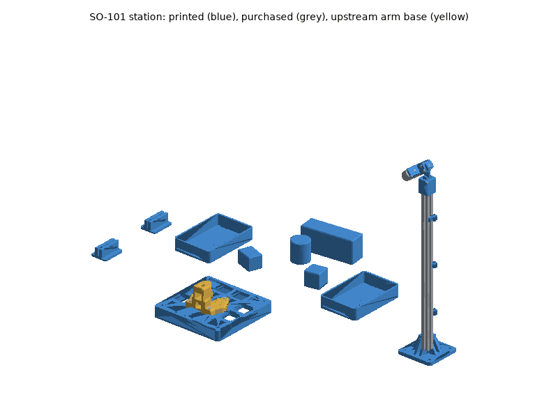
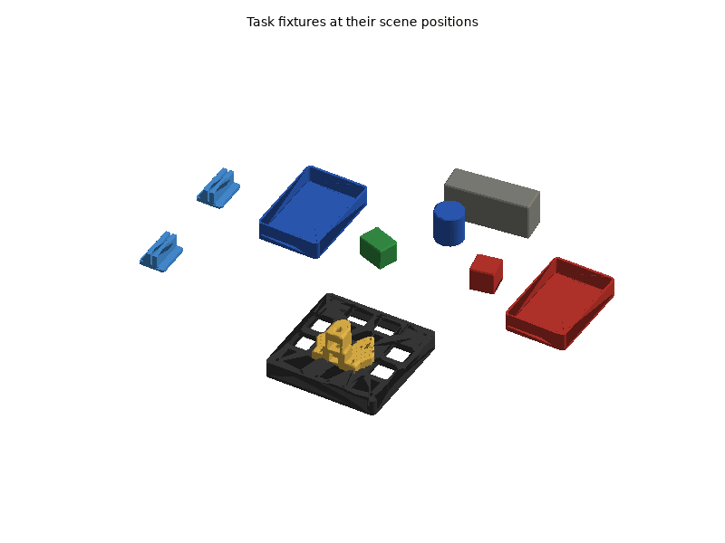
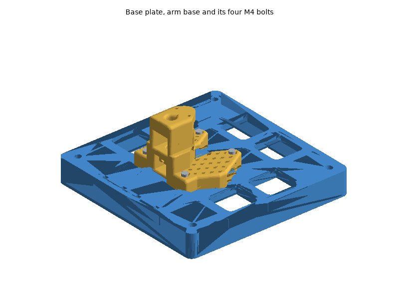
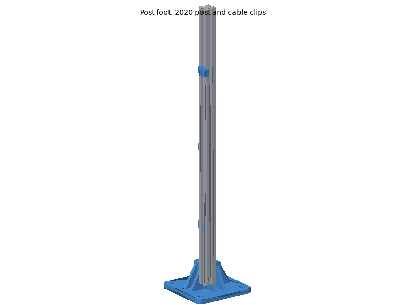
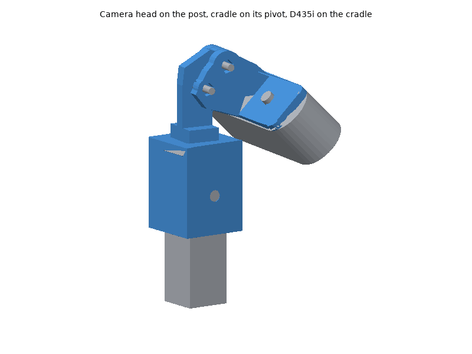

# SO-101 station printed parts

The SO-101 arms (follower and leader) are TheRobotStudio's open design:
their printed parts (`*_so101`, and the two STS3215 fit gauges) are the
upstream STLs, vendored unchanged from the SO-ARM100 repository (Apache-2.0,
commit `a758567`, SHA-256 pinned in each module, licence in
[`upstream/LICENSE`](upstream/LICENSE)) and only turned to a print
orientation. The station around the follower is designed here: a 31 mm
riser (`station_base_plate`), the RealSense D435i on a 2020 post
(`post_foot`, `camera_head`, `camera_cradle`, `cable_clip`), the scene's
bins and objects and the calibration board feet. Servos, boards, camera,
post, screws and the station board are bought; see the bill of materials,
[hardware/so101.md](../../so101.md), for what and why.

## Printing

All parts print on a Bambu Lab P1S (256 mm bed) with Bambu Studio's P1S
system profiles; set only what the plate tables list. The STLs are in
[`stl/`](stl/), already in their print orientation: import them, keep the
orientation, and arrange.

### Plates

<!-- BEGIN GENERATED: plates (tools/build_printable_parts.py) -->
#### Plate A: PETG, 0.20 mm layers

Filament **Bambu PETG Basic**, **Textured PEI Plate**, process **0.20mm Standard**. Estimated 7 h 13 min and 253 g of filament (estimates; slice for real numbers).

| Part | Qty | Per-object settings | Orientation | File |
|---|---|---|---|---|
| `station_base_plate` | 1 | 3 wall loops, 5/4 top/bottom shells, 15% gyroid, supports: none, brim: outer brim only, 5 mm | upside down: the top face on the plate, ribs up | [stl](stl/station_base_plate.stl) |
| `cable_clip` | 3 | 4 wall loops, 5/4 top/bottom shells, 100% gyroid, supports: none, brim: auto | on its side: the clip profile flat on the plate | [stl](stl/cable_clip.stl) |

#### Plate B: PETG, 0.20 mm layers

Filament **Bambu PETG Basic**, **Textured PEI Plate**, process **0.20mm Standard**. Estimated 7 h 18 min and 246 g of filament (estimates; slice for real numbers).

| Part | Qty | Per-object settings | Orientation | File |
|---|---|---|---|---|
| `task_bin` | 2 | 2 wall loops, 5/4 top/bottom shells, 15% gyroid, supports: none, brim: auto | upright: the floor on the plate | [stl](stl/task_bin.stl) |
| `wrist_roll_follower_so101` | 1 | 3 wall loops, 5/4 top/bottom shells, 15% gyroid, supports: tree(auto), everywhere, brim: auto | on its side: the flat face on the plate | [stl](stl/wrist_roll_follower_so101.stl) |
| `handle_so101` | 1 | 3 wall loops, 5/4 top/bottom shells, 15% gyroid, supports: tree(auto), everywhere, brim: auto | lying flat: the flat side on the plate | [stl](stl/handle_so101.stl) |

#### Plate C: PETG, 0.20 mm layers

Filament **Bambu PETG Basic**, **Textured PEI Plate**, process **0.20mm Standard**. Estimated 11 h 32 min and 388 g of filament (estimates; slice for real numbers).

| Part | Qty | Per-object settings | Orientation | File |
|---|---|---|---|---|
| `post_foot` | 1 | 4 wall loops, 5/4 top/bottom shells, 40% gyroid, supports: none, brim: auto | upright: the base plate on the plate, socket up | [stl](stl/post_foot.stl) |
| `upper_arm_so101` | 1 | 3 wall loops, 5/4 top/bottom shells, 15% gyroid, supports: tree(auto), everywhere, brim: auto | lying flat: the large flat face on the plate | [stl](stl/upper_arm_so101.stl) |
| `under_arm_so101` | 1 | 3 wall loops, 5/4 top/bottom shells, 15% gyroid, supports: tree(auto), everywhere, brim: auto | lying flat: the large flat face on the plate | [stl](stl/under_arm_so101.stl) |
| `occluder_box` | 1 | 2 wall loops, 5/4 top/bottom shells, 8% gyroid, supports: none, brim: auto | flat on its 50 x 160 mm face | [stl](stl/occluder_box.stl) |
| `rotation_pitch_so101` | 2 | 3 wall loops, 5/4 top/bottom shells, 15% gyroid, supports: tree(auto), everywhere, brim: auto | on its side: the large flat face on the plate | [stl](stl/rotation_pitch_so101.stl) |

#### Plate D: PETG, 0.20 mm layers

Filament **Bambu PETG Basic**, **Textured PEI Plate**, process **0.20mm Standard**. Estimated 10 h 14 min and 336 g of filament (estimates; slice for real numbers).

| Part | Qty | Per-object settings | Orientation | File |
|---|---|---|---|---|
| `upper_arm_so101` | 1 | 3 wall loops, 5/4 top/bottom shells, 15% gyroid, supports: tree(auto), everywhere, brim: auto | lying flat: the large flat face on the plate | [stl](stl/upper_arm_so101.stl) |
| `under_arm_so101` | 1 | 3 wall loops, 5/4 top/bottom shells, 15% gyroid, supports: tree(auto), everywhere, brim: auto | lying flat: the large flat face on the plate | [stl](stl/under_arm_so101.stl) |
| `base_so101` | 2 | 3 wall loops, 5/4 top/bottom shells, 15% gyroid, supports: tree(auto), everywhere, brim: auto | as published: standing on its rear face, the two lattice clamp lobes upright (their teardrop screw holes need no support) | [stl](stl/base_so101.stl) |
| `base_motor_holder_so101` | 2 | 3 wall loops, 5/4 top/bottom shells, 15% gyroid, supports: tree(auto), everywhere, brim: auto | on its back: the large flat face on the plate | [stl](stl/base_motor_holder_so101.stl) |
| `moving_jaw_so101` | 1 | 3 wall loops, 5/4 top/bottom shells, 15% gyroid, supports: tree(auto), everywhere, brim: auto | upside down: the published top face on the plate (supports under the curved finger) | [stl](stl/moving_jaw_so101.stl) |

#### Plate E: PETG, 0.20 mm layers

Filament **Bambu PETG Basic**, **Textured PEI Plate**, process **0.20mm Standard**. Estimated 11 h 34 min and 356 g of filament (estimates; slice for real numbers).

| Part | Qty | Per-object settings | Orientation | File |
|---|---|---|---|---|
| `calib_board_foot` | 2 | 3 wall loops, 5/4 top/bottom shells, 20% gyroid, supports: none, brim: auto | upright: the base on the plate | [stl](stl/calib_board_foot.stl) |
| `cylinder_blue` | 1 | 2 wall loops, 5/4 top/bottom shells, 12% gyroid, supports: none, brim: auto | standing on an end face | [stl](stl/cylinder_blue.stl) |
| `wrist_roll_pitch_so101` | 2 | 3 wall loops, 5/4 top/bottom shells, 15% gyroid, supports: tree(auto), everywhere, brim: auto | on its side: the flat face on the plate | [stl](stl/wrist_roll_pitch_so101.stl) |
| `camera_cradle` | 1 | 4 wall loops, 5/4 top/bottom shells, 40% gyroid, supports: none, brim: auto | camera face on the plate, ears up | [stl](stl/camera_cradle.stl) |
| `trigger_so101` | 1 | 3 wall loops, 5/4 top/bottom shells, 15% gyroid, supports: tree(auto), everywhere, brim: auto | upside down: the published top face on the plate | [stl](stl/trigger_so101.stl) |
| `wrist_roll_so101` | 1 | 3 wall loops, 5/4 top/bottom shells, 15% gyroid, supports: tree(auto), everywhere, brim: auto | on its side: the flat face on the plate | [stl](stl/wrist_roll_so101.stl) |
| `block_green` | 1 | 3 wall loops, 5/4 top/bottom shells, 25% gyroid, supports: none, brim: auto | flat on a 40 x 55 mm face | [stl](stl/block_green.stl) |
| `waveshare_mounting_plate_so101` | 2 | 3 wall loops, 5/4 top/bottom shells, 15% gyroid, supports: tree(auto), everywhere, brim: auto | as published: flat on the plate | [stl](stl/waveshare_mounting_plate_so101.stl) |
| `motor_holder_so101_base` | 2 | 3 wall loops, 5/4 top/bottom shells, 15% gyroid, supports: tree(auto), everywhere, brim: auto | on its side: the flat end face on the plate | [stl](stl/motor_holder_so101_base.stl) |
| `motor_holder_so101_wrist` | 2 | 3 wall loops, 5/4 top/bottom shells, 15% gyroid, supports: tree(auto), everywhere, brim: auto | on its side: the flat end face on the plate | [stl](stl/motor_holder_so101_wrist.stl) |
| `gauge_0` | 1 | 3 wall loops, 5/4 top/bottom shells, 15% gyroid, supports: none, brim: auto | as published: flat on the plate | [stl](stl/gauge_0.stl) |
| `gauge_tight_1` | 1 | 3 wall loops, 5/4 top/bottom shells, 15% gyroid, supports: none, brim: auto | as published: flat on the plate | [stl](stl/gauge_tight_1.stl) |
| `camera_head` | 1 | 4 wall loops, 5/4 top/bottom shells, 40% gyroid, supports: none, brim: auto | upright: the open end of the sleeve on the plate, tongue up | [stl](stl/camera_head.stl) |

#### Plate F: PETG, 0.20 mm layers

Filament **Bambu PETG Basic**, **Textured PEI Plate**, process **0.20mm Standard**. Estimated 1 h 30 min and 46 g of filament (estimates; slice for real numbers).

| Part | Qty | Per-object settings | Orientation | File |
|---|---|---|---|---|
| `block_red` | 1 | 3 wall loops, 5/4 top/bottom shells, 30% gyroid, supports: none, brim: auto | flat on one face | [stl](stl/block_red.stl) |
<!-- END GENERATED: plates -->

Times and filament are estimates from each part's volume (see
[`stl/manifest.md`](stl/manifest.md)); Bambu Studio's slice is the real
number, and for the upstream parts the slicer's supports add to it. Parts of
one material and layer height can be combined on fewer plates when Bambu
Studio's auto-arrange fits them.

### Material and printer notes

- **PETG** (Bambu PETG Basic) for everything, on the Textured PEI plate.
  Upstream prints the arm in PLA+; PETG is used here because the servos
  run warm under load and PLA softens from about 55-60 C. Dry the spool
  (8 h at 65 C) if it strings: stringing in the servo pockets spoils the fit.
- **Colours**: the bins, blocks and cylinder take the scene's colours (left
  bin and cylinder blue, right bin and red block red, green block green,
  occluder matte grey); matte filament reflects the D435i's infrared
  projector less. Print the riser in black (the scene's mount is black
  anodised aluminium).
- **Upstream parts need supports**: tree (auto), everywhere, with the
  **threshold angle at 45 deg**, and **support blockers painted in the
  horizontal screw holes** (upstream's instruction). Their plate tables say
  "tree(auto), everywhere"; the threshold and blockers are set in Bambu
  Studio by hand.
- **Mass of the task objects**: the blocks and the cylinder are printed at
  the infill that brings their estimated mass to the scene's (45, 40 and
  35 g). Weigh them; anything within 0.75-1.35x is inside the scene's
  randomised range.
- No carbon-filled filament is needed; the stock 0.4 mm nozzle prints
  everything.

### Post-processing

1. **Print the fit-test parts first** and check them against the real
   parts before printing the rest:
   - `gauge_0` and `gauge_tight_1`: an STS3215 should slide into
     `gauge_0` with light friction and be clearly tighter in
     `gauge_tight_1` (upstream README, step 3). If it is loose or will not
     enter, tune the flow ratio or Bambu Studio's X-Y hole and contour
     compensation and reprint the gauges before printing the arm.
   - `station_base_plate`: its four M4 inserts sit under the arm base's
     wing holes, which were measured on the vendored mesh: put the printed
     `base_so101` on the plate and check the four bolts drop in.
   - `camera_cradle`: the D435i's M3 pair is drawn centred on the case but
     not dimensioned; the holes are slotted 0.8 mm up and down. Check the
     camera sits square on the plate.
2. **Supports**: remove them from the upstream parts with a small
   screwdriver or flush cutters, especially from the servo pockets and the
   horn seats; a servo must slide in without force.
3. **Heat-set inserts** (CNC Kitchen type, M4 x 8.1, 5.7 mm hole): 4 into the
   top face of `station_base_plate`, iron at **230-245 C** for PETG, pressed
   flush and square. Let the plate cool before bolting the arm.
4. **Holes**: the M3 and M5 clearance holes need no reaming; if one is
   tight, run a 3.4 or 5.5 mm drill through by hand.
5. Chamfer edges of the blocks lightly with a deburring tool if the first
   layer flared (elephant's foot): the gripper closes on them.

### Bambu Studio project files

Not provided. A Bambu Studio 3MF carries per-plate filament, process and
object settings in Bambu's own project metadata, which can only be checked by
opening it in Bambu Studio; a plain 3MF would drop those settings, and the
upstream parts' support blockers are painted by hand anyway. Import the STLs
instead (they are already oriented) and set the per-object values from the
plate tables.

## Assembly

### Tools and consumables

- Phillips screwdrivers #0 and #1 (servo screws), hex keys 2.5 mm (M3),
  3 mm (M4), 3 mm or 2.5 mm for M5 button heads, a Phillips bit for the wood
  screws.
- Soldering iron with a heat-set insert tip.
- Calipers, tape measure, square, a small bubble level, a protractor or a
  phone inclinometer (camera pitch).
- Double-sided tape pads, zip ties (3.6 mm), Velcro straps.
- No thread locker: every screw goes into plastic, an insert or the camera.

### Fasteners

Every screw, insert and T-nut with its quantity and use is in the generated
fastener table of the BOM:
[hardware/so101.md, "Fasteners"](../../so101.md#fasteners). Torque:
"snug" for every screw into plastic or an insert (about 0.5 N m), **0.4 N m
for the camera's M3 screws** (Intel), and the servo screws as in the
Hugging Face guide.

### Steps

Station frame: the arm's base_link, **x toward the bins, y left, z up**,
origin on the shoulder-pan axis; the camera post stands to the arm's right
(-y).

1. **Fit gauges.** Print `gauge_0` and `gauge_tight_1` and check the fit
   on an STS3215 (Post-processing, step 1).
2. **Arms.** Build the follower and the leader as in the
   [Hugging Face SO-101 guide](https://huggingface.co/docs/lerobot/so101),
   with these printed parts (one set each, plus the follower's or leader's
   own): `base_so101`, `base_motor_holder_so101` (joint 1);
   `motor_holder_so101_base`, `rotation_pitch_so101` (shoulder, joint 2);
   `upper_arm_so101` (joint 3); `under_arm_so101`,
   `motor_holder_so101_wrist` (joint 4); `wrist_roll_pitch_so101` (joint
   5); follower: `wrist_roll_follower_so101` and `moving_jaw_so101`
   (gripper); leader: `wrist_roll_so101`, `handle_so101` and
   `trigger_so101`. Fix each Waveshare board on a
   `waveshare_mounting_plate_so101` on the back of its base. Set the motor
   IDs (`lerobot-setup-motors`) before closing each joint, as the guide says.
   *Check:* every joint turns through its range without rubbing; no servo
   cable is pinched.
3. **Station board.** Place the board on the table; mark the arm's pan axis
   250 mm from the back edge and 640 mm from the right edge, and the x axis
   (toward the front edge).

4. **Riser.** Press the four M4 inserts into `station_base_plate`
   (Post-processing, step 3). Screw it to the board with four 4 x 25 mm
   pan-head wood screws in the corner wells, the zip-tie slots at the rear
   (-x), its centre on the pan-axis mark.
5. **Follower on the riser.** Stand the follower's `base_so101` on the
   riser, its front (the shoulder) toward +x, and bolt it with four
   M4 x 25 through the wing holes into the inserts, snug.
   *Check:* the base does not rock; the pan axis is over the riser's centre.

6. **Post foot.** Screw `post_foot` to the board with four 4 x 16 mm wood
   screws, centred 197 mm in front of and 567 mm to the right of the pan
   axis (x 197, y -567 in the station frame; the build prints the exact
   values in `_station.py`, `POST_XY`), its sides square to the board.
7. **Post.** Slide two M5 drop-in T-nuts into the post's slots near the
   bottom and two near the top (on the faces toward +x and +y), stand the
   500 mm 2020 post in the foot's socket and fix it with two M5 x 10 button
   heads through the socket into the bottom T-nuts.
   *Check:* the post is vertical (level on two faces).
8. **Cable clips.** Three `cable_clip` on the post's -y face (away from the
   arm) at about 120, 260 and 400 mm above the board, each with an M5 x 10
   into a drop-in T-nut, the keys in the slot.

9. **Camera head.** Push `camera_head` onto the top of the post, its tongue
   pointing toward the bins, and fix it with two M5 x 10 into the top
   T-nuts (faces +x and +y). The head's tongue is turned 83 deg from the
   arm's x axis, the scene camera's heading.
10. **Camera on the cradle.** Screw the D435i to `camera_cradle` with two
    M3 x 6 through the cradle's slots into the camera's back, **0.4 N m**,
    lens away from the cradle, USB-C on the camera's left end (seen from
    behind).
11. **Cradle on the head.** Put the cradle's clevis over the head's
    tongue, the camera facing the bins: an M3 x 20 with a washer through the
    pivot holes and a nyloc nut in the hex pocket, firm enough that the
    cradle holds its angle; an M3 x 20 with a washer through the lower ear
    holes and the tongue's arc slot, nut in the pocket. Set the pitch (see
    **Checks**) and tighten the lock screw.
12. **Task fixtures.** Put the two `task_bin` (blue left, red right), the
    `block_red`, `block_green`, `cylinder_blue` and the `occluder_box` at
    their scene positions (table below), standing on the board as they
    stand on the table in the scene, the bins and the occluder on
    double-sided tape pads. Stand the calibration board in the two
    `calib_board_foot`, about 200 mm apart, when calibrating.

Scene positions (centres, station frame, mm; from
`systems/so101/scenarios/picking_table.json`):

| Item | x | y | Yaw |
|---|---|---|---|
| Left bin (blue), 180 x 120 mm | 300 | 250 | 0 |
| Right bin (red), 180 x 120 mm | 300 | -250 | 0 |
| Red block (target), 45 mm | 300 | -100 | 10.3 deg |
| Green block, 40 x 55 mm | 270 | 100 | -20.1 deg |
| Blue cylinder, 54 mm | 380 | 20 | |
| Occluder, 50 x 160 mm | 460 | -20 | 6.9 deg |
| Calibration board centre (upright, facing -y) | 180 | 430 | |

### Wiring

- **Follower**: its Waveshare board on the back of the base; the servo chain
  from the board to the shoulder-pan servo (ID 1) and on up the arm, as
  upstream routes it. The board's 5 V supply and USB-C cable leave the base
  at the rear and are tied to the riser's zip-tie slots (two pairs at -x),
  with a loop of slack so the cables never pull on the board.
- **Leader**: the same, its base clamped to the table edge with two table
  clamps; keep its USB and power leads off the follower's workspace.
- **Camera**: the D435i's USB-C cable leaves the camera's left end, loops
  once (slack for the pitch adjustment) and runs down the post in the three
  `cable_clip` to the host's USB 3 port, directly, not through the hub.
- Both arm boards to the host (a powered hub is fine). Each arm on its own
  5 V supply; never connect the two arms' supplies together.
- Device names: the arms enumerate as `/dev/ttyACM*`; find which is which
  with `lerobot-find-port` and use `/dev/serial/by-id/` paths in the driver.

### Checks

Do these before collecting data, then follow
[hardware/so101.md, "Recommended assembly order"](../../so101.md#recommended-assembly-order)
and the calibration in [systems/so101/README.md](../../../systems/so101/README.md).

<!-- BEGIN GENERATED: assembly (tools/build_printable_parts.py) -->
Generated by the assembly check (`assembly.py`), from the CAD and datasheet masses:

- Bodies in the check: 31
- Interference between parts (screws modelled through their holes): none
- Intended press fits: 2
- Camera cradle swept through its pitch range against the head: clear from 38 to 57 deg
- Scene camera models the D435i's colour stream: yes (640 x 360, 69.4 x 42.6 deg; D435i colour 69.4 x 42.5 deg)
- Bins and objects in the D435i's image at the scene's pitch: yes at 48.5 deg (worst 0.88)
- Recommended camera pitch (deg down): 48.5
- Scene camera pitched at the recommended pitch: yes (48.5 deg in systems/so101/scenarios/picking_table.json)
- Bins and objects in the image at the recommended pitch: yes (worst 0.88 of the half-image; nearest item 504 mm, min-Z 195 mm)
- Camera's view clear of the station's own parts: yes (cradle, head, post, foot and clips out of the image)
- Camera, head and post out of the arm's reach: yes (nearest: post_foot, 543 mm from the shoulder-lift axis; reach 450 mm)
- Everything on the station board: yes (1200 x 800 mm board, arm 250 mm from its back edge, 640 mm from its right edge)
- RGB optical centre at the recommended pitch (x, y, z mm from base_link): 169.8; -522.0; 464.6
- All assembly checks passed: yes
<!-- END GENERATED: assembly -->

- **Camera pitch.** With the cradle on the head, set the camera to the
  recommended pitch above, which is also the scene camera's (phone
  inclinometer on the camera's top: 48.5 deg nose down), tighten the lock,
  and check the image: both bins whole, the red block near the centre. Run
  the camera at 640 x 360, the scene camera's 16:9 mode (the hardware
  compositions set `rgb_camera.color_profile:=640x360x30`). At 45 deg the
  near edge of the right bin is cut off.
- **Extrinsics.** Measure the camera's pose relative to the arm (AprilTag
  on the base, or a hand-eye calibration with the AprilGrid) and update
  the scene's `camera` block and the URDF's `base_to_groot_camera`
  together; `validate_calibration_and_dataset.py` checks they agree. The
  printed station puts the colour camera within a few millimetres of
  the scene pose, but the CAD is not a measurement.
- **Arm directions and limits.** With the HIL guard disarmed, move each
  joint of the follower by hand and check the sign and range on
  `/joint_states` against the URDF (`systems/so101/config/joint_limits.json`).
- **Emergency stop.** Keep the follower's 5 V supply switchable within reach
  (a switched power strip): cutting it is the arm's emergency stop.
- **Every session**: base bolts snug, post head and cradle tight, camera
  cable slack at the cradle, nothing on the board inside the arm's reach
  except the task objects.
