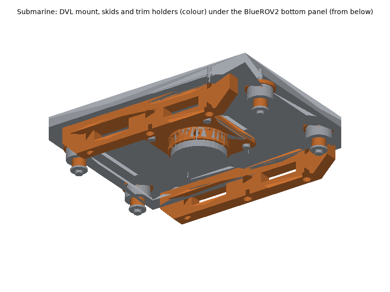
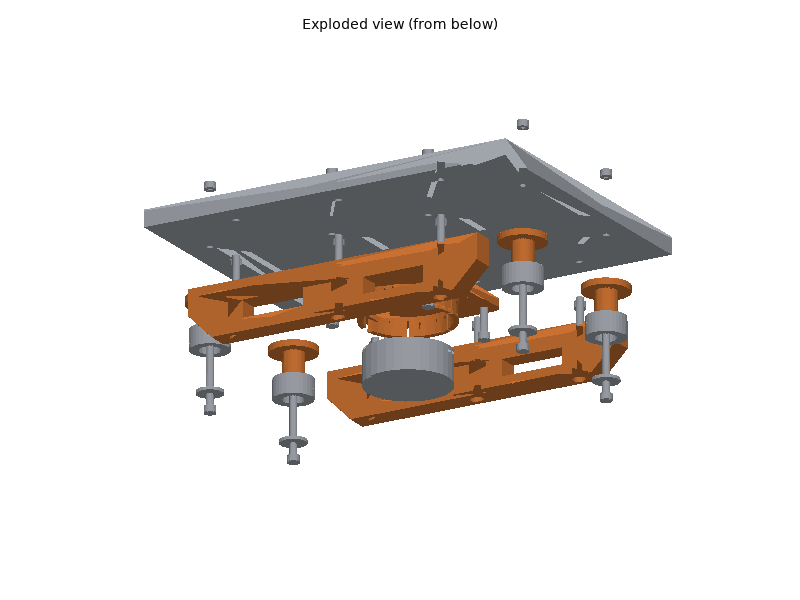
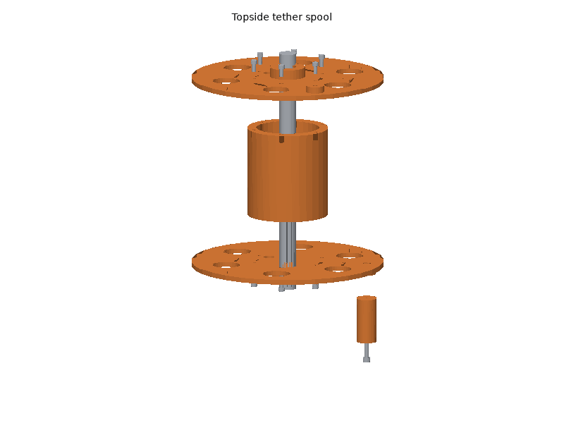

# Submarine printed parts

The submarine is a purchased Blue Robotics BlueROV2; its enclosures, end
caps, domes, penetrators and seals, frame, thrusters and electronics stay
as Blue Robotics makes them (see the bill of materials,
[hardware/submarine.md](../../submarine.md), for why). Nothing printed is
part of a pressure boundary or a seal. Printed are: a collar that holds the
Water Linked DVL A50 under the bottom panel, two skids that keep the DVL
off the deck and the seabed, four holders for stainless trim washers, all
solid ASA bolted through holes drilled with the parts as templates, and a
topside hand spool for the tether.

## Printing

All parts print on a Bambu Lab P1S with Bambu Studio's P1S system
profiles; set only what the plate tables list. The STLs are in
[`stl/`](stl/), already in their print orientation.

### Plates

<!-- BEGIN GENERATED: plates (tools/build_printable_parts.py) -->
#### Plate A: ASA, 0.20 mm layers

Filament **Bambu ASA**, **Textured PEI Plate**, process **0.20mm Standard**. Estimated 3 h 51 min and 129 g of filament (estimates; slice for real numbers).

| Part | Qty | Per-object settings | Orientation | File |
|---|---|---|---|---|
| `spool_flange` | 1 | 4 wall loops, 5/4 top/bottom shells, 25% gyroid, supports: none, brim: auto | inner face (against the drum) on the plate, hub and crank boss up | [stl](stl/spool_flange.stl) |

#### Plate B: ASA, 0.20 mm layers

Filament **Bambu ASA**, **Textured PEI Plate**, process **0.20mm Standard**. Estimated 3 h 51 min and 129 g of filament (estimates; slice for real numbers).

| Part | Qty | Per-object settings | Orientation | File |
|---|---|---|---|---|
| `spool_flange` | 1 | 4 wall loops, 5/4 top/bottom shells, 25% gyroid, supports: none, brim: auto | inner face (against the drum) on the plate, hub and crank boss up | [stl](stl/spool_flange.stl) |

#### Plate C: ASA, 0.20 mm layers

Filament **Bambu ASA**, **Textured PEI Plate**, process **0.20mm Standard**. Estimated 16 h 45 min and 545 g of filament (estimates; slice for real numbers).

| Part | Qty | Per-object settings | Orientation | File |
|---|---|---|---|---|
| `dvl_mount` | 1 | 5 wall loops, 5/5 top/bottom shells, 100% gyroid, supports: none, brim: auto | upside down: the flange's panel face on the plate, collar up | [stl](stl/dvl_mount.stl) |
| `spool_drum` | 1 | 4 wall loops, 5/4 top/bottom shells, 25% gyroid, supports: none, brim: auto | upright: one end on the plate | [stl](stl/spool_drum.stl) |
| `skid` | 2 | 5 wall loops, 5/5 top/bottom shells, 100% gyroid, supports: none, brim: auto | on its side: one 240 x 40 mm face on the plate (layers along the rail) | [stl](stl/skid.stl) |
| `trim_weight_holder` | 4 | 5 wall loops, 5/5 top/bottom shells, 100% gyroid, supports: none, brim: auto | flange (panel face) on the plate, spigot up | [stl](stl/trim_weight_holder.stl) |
| `spool_handle` | 1 | 4 wall loops, 5/4 top/bottom shells, 30% gyroid, supports: none, brim: auto | upright on one end | [stl](stl/spool_handle.stl) |
<!-- END GENERATED: plates -->

Times and filament are estimates (see [`stl/manifest.md`](stl/manifest.md));
Bambu Studio's slice is the real number.

### Material and printer notes

- **ASA, solid, for everything that goes under water** (`dvl_mount`,
  `skid`, `trim_weight_holder`): 100 % infill as the plate tables say. A
  sparse infill traps air that floods slowly or is crushed at depth, so
  the trim drifts during a dive. ASA is used because it is nearly neutral
  in sea water (1.05-1.07 against 1.025 g/cm3) where PETG (1.25-1.27)
  sinks; the assembly check gives both. Door closed and lid on; dry the
  spool (8 h at 80 C) first: wet ASA prints porous.
- **ASA for the spool** too (sun and spray on deck), normal infill.
- Water uptake: Bambu lists 0.45 % saturated moisture uptake (25 C,
  55 % RH) for ASA; soaked parts take a little more, a few grams in all
  (assembly check): retrim after the first long dive.
- No carbon-filled filament is needed.

### Post-processing

1. **Fit-test parts first**:
   - `dvl_mount`: the DVL A50 in the collar (66 mm housing, 0.3 mm
     clearance), and its cable in the wide slot (where the cable leaves
     the housing is not dimensioned by Water Linked).
   - `dvl_mount` and `skid`: lay them on the bottom panel where the layout
     puts them (collar at the centre, skids 100 mm either side of the
     centre line) and check they clear the ballast weights and anything
     else under the panel: Blue Robotics does not publish the panel's
     outline.
2. **Supports**: none.
3. **Heat-set inserts**: `spool_drum` only (topside), 12 x M4 x 8.1, six
   in each end, soldering iron at **245-260 C**. No inserts in the parts
   that go under water: they take 316 screws and nyloc nuts.
4. **Drill templates**: the collar's four 5.5 mm holes, the skids' three
   and the trim holders' centre hole are the templates for the holes in
   the 1/2 in HDPE bottom panel (5.5 mm drill, square to the panel).
5. **Seal nothing**: the parts flood on purpose; there are no hollow
   spaces in a solid print, and the collar has a drain hole over the DVL's
   back plate.

### Bambu Studio project files

Not provided: Bambu Studio's per-object settings (here: 100 % infill for
the wet parts) live in its own 3MF metadata, which cannot be checked
without Bambu Studio. Import the STLs (already oriented) and set the
per-object values from the plate tables; check the 100 % infill before
slicing the wet parts.

## Assembly

### Tools and consumables

- Hex keys 2.5 mm (M3), 3 mm (M4), 4 mm (M5), 8 mm wrench (M5 nyloc),
  flat screwdriver or 7 mm driver for the hose clamp.
- Drill with a 5.5 mm bit, clamps, a square.
- Soldering iron with an M4 heat-set insert tip (spool only).
- Silicone grease for O-rings (Blue Robotics' service kit), anti-seize
  or dielectric grease for stainless threads, fresh water for rinsing.

### Fasteners

Every screw, nut, washer and clamp with its quantity is in the generated
fastener table of the BOM:
[hardware/submarine.md, "Fasteners"](../../submarine.md#fasteners). M5 into
HDPE: firm, until the washer just starts to press into the panel; the
nyloc nut does the locking.

### Steps

ROV directions: **x forward, y left, z up**; the origin is the centre of
the bottom panel's underside. Do the DVL's electrical integration first
(Ethernet switch, penetrator, BlueOS extension) as Water Linked and Blue
Robotics describe it, and vacuum-test the enclosure after fitting the
penetrator.

1. **Drill.** Turn the ROV over. Clamp the `dvl_mount` at the panel centre,
   cable slot aft, and drill its four 5.5 mm holes through the panel; then
   each `skid` (100 mm either side of the centre line, ramps fore and aft)
   and each `trim_weight_holder` position (130 mm fore and aft, 60 mm
   either side) with their holes as templates.
   *Check:* no hole through a thruster, enclosure or ballast-weight hole.
2. **DVL collar.** Bolt the `dvl_mount` under the panel with four
   M5 x 30, washers both sides and nyloc nuts on top. Slide the DVL into
   the collar from below, back plate against the flange, cable out through
   the wide slot (aft); fit the hose clamp in the groove and tighten until
   the DVL cannot turn by hand.
   *Check:* the transducer face is parallel to the panel; the cable leaves
   without a sharp bend.
3. **Skids.** Bolt each `skid` with three M5 x 35 from below (heads in the
   counterbores), washers and nyloc nuts on top.
   *Check:* the ROV stands on its skids on a flat floor with the DVL
   clear of the floor.
4. **Trim holders.** Fit each `trim_weight_holder` with an M5 x 55 through
   its centre, the M16 trim washers on the spigot (fill the rest with
   spacers so the stack is clamped), a 20 mm fender washer under the
   screw head, and a washer and nyloc nut on top of the panel.
5. **DVL cable.** Route the cable up the rear of the frame to its
   penetrator with cable ties every 100 mm, clear of the thrusters' ducts.
6. **Tether spool.** Press the inserts into the `spool_drum`; screw a
   `spool_flange` onto each end with six M4 x 10 each (inner faces against
   the drum, the two tether holes on the same side); fit the
   `spool_handle` on one flange's crank boss with the M5 x 70, washers,
   and the nyloc in the flange's inner pocket. Pass the tether's topside
   end in through the drum slot and out through the flange's tether hole,
   then wind it on, the 20 mm axle through both hubs.

7. **Trim and buoyancy** (Checks), then **Wiring**.

### Wiring

- The DVL's cable enters the electronics enclosure through its own
  M10-7.5mm-HC WetLink penetrator; inside, its Ethernet goes to the
  Ethernet switch (stacked on the tether interface board) and its power
  to the battery bus, as Blue Robotics' DVL guide shows.
- Nothing else changes in the BlueROV2's wiring; the Pi 5 takes the Pi 4's
  place under the Navigator with the same cables (Pi 5: Ethernet and USB
  positions are swapped compared with the Pi 4, so re-route the tether
  interface's Ethernet lead without strain).
- Outside, every cable is tied to the frame clear of the thruster intakes
  and of the DVL's beams (nothing below the collar).

### Checks

Before the first dive, then the steps in
[hardware/submarine.md, "Recommended assembly order"](../../submarine.md#recommended-assembly-order)
and [systems/submarine/README.md](../../../systems/submarine/README.md).

<!-- BEGIN GENERATED: assembly (tools/build_printable_parts.py) -->
Generated by the assembly check (`assembly.py`), from the CAD and datasheet masses:

- Bodies in the check: 79
- Interference between parts (screws modelled through their holes): none
- dvl_beams_clear: yes (cone of 26.7 deg half-angle from the DVL face)
- skid_clearance_mm: 2.5 between the skid line and the lowest other part; DVL face 9 mm above it (the A50 needs 5 cm: no lock while sitting on the bottom)
- added_weight_in_sea_water_g: 218 (DVL 105, printed parts 15, stainless screws and nuts 98), before trim washers
- ballast_to_remove: 2 of the 200 g ballast weights (174 g each in sea water): -131 g, then about 13 trim washers (10.0 g each in sea water, up to 9 per holder) restore the original trim
- printed_parts_petg_instead_g: 82 in sea water for the same parts in PETG, against 15 in ASA
- water_uptake_g: under 3.2 (about 0.45 % at 55 % RH per the filament data sheets, assumed doubled when soaked)
- spool_capacity_m: 57 of standard (7.6 mm) or 207 of slim (4.0 mm) tether, 10 mm inside the rims
- All assembly checks passed: yes
<!-- END GENERATED: assembly -->

- **Vacuum test** the electronics enclosure after fitting the DVL
  penetrator (Blue Robotics' pump and procedure), before any power-up in
  water.
- **Buoyancy and trim** in a tank: the assembly check above estimates
  how much ballast to remove; in the water the ROV must float just
  positive (it rises slowly with the thrusters off) and level. Add or
  remove M16 washers on the holders: front holders for nose-down trim,
  rear ones for tail-down, one side for roll.
- **DVL**: in the Water Linked BlueOS extension, set the mounting rotation
  for the cable slot facing aft and check the velocity lock in at least
  0.5 m of water.
- **After every salt-water dive**: rinse the ROV, the printed parts and
  all stainless hardware in fresh water; check the M5 nuts and the hose
  clamp.
