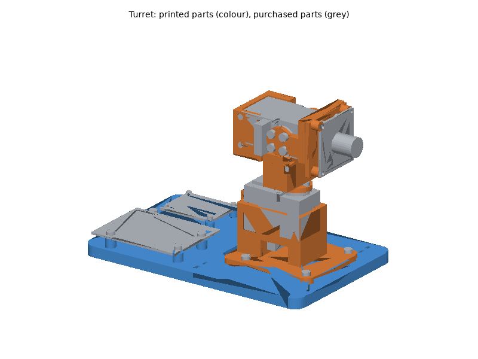
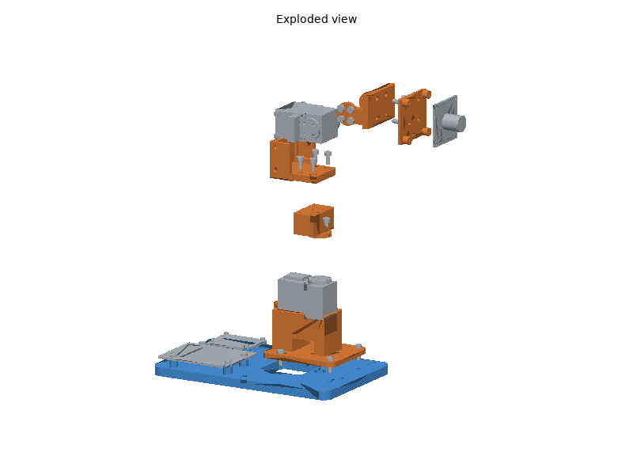
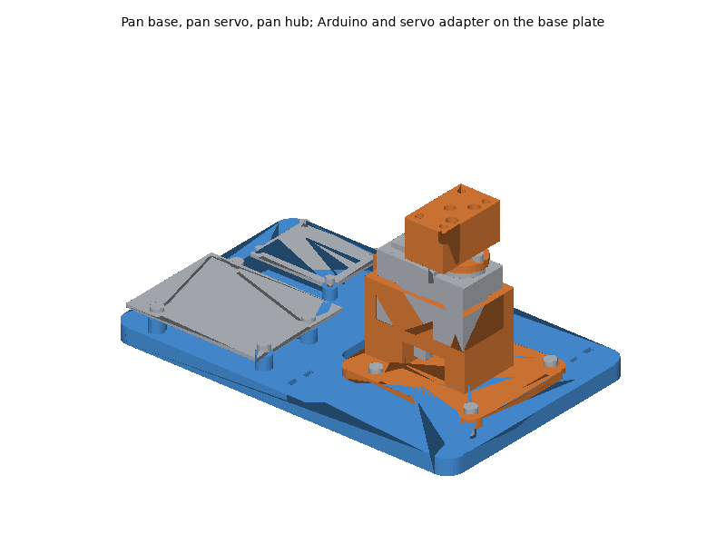
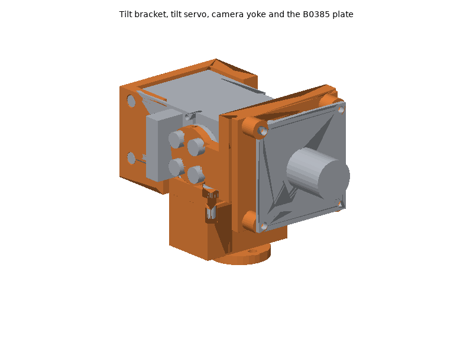
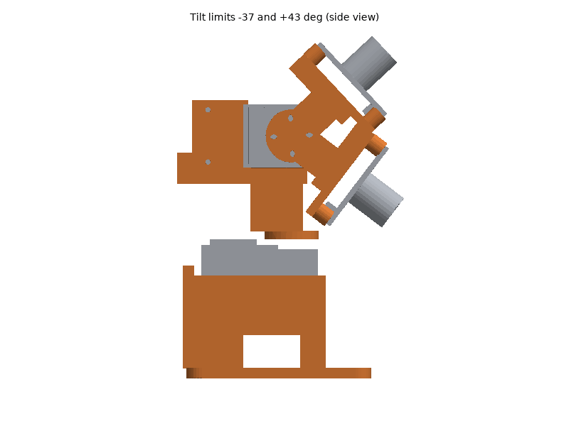

# Turret printed parts

The turret's whole mechanism is printed: the pan base that holds the pan
servo, the pan hub and tilt bracket that turn on it and hold the tilt
servo, the camera yoke on the tilt servo's two horns, two camera plates
(Arducam B0385 board, or any camera with a 1/4"-20 thread) and, for the
standalone turret, a base plate that carries the controller boards and
screws onto a tripod. The two Waveshare ST3215 servos with their metal
horns, the camera, the controller, the bus servo adapter, the power supply,
the emergency stop, wiring and fasteners are bought (see the bill of
materials, [hardware/turret.md](../../turret.md)). The pan base, pan hub,
tilt bracket, yoke and B0385 plate are also the RACECAR Turret's
([racecar_turret/README.md](../racecar_turret/README.md)).

The kinematics are those of the RACECAR Turret's URDF
(`systems/racecar_turret/urdf/racecar_turret.urdf.xacro`): pan first, then
tilt, the tilt axis 95 mm above the surface the pan base stands on (0.045 +
0.055 m above `turret/base_link`, the underside of a 5 mm plate) and the
camera on the tilt axis, about 35 mm in front of it. The upstream
`pan_tilt_ros` mechanism (`applications/pantiltros/pantiltros/urdf`) tilts
first and pans on top; its meshes (Apache-2.0, with the package) are not
used here.

## Printing

All parts print on a Bambu Lab P1S (256 mm bed) with Bambu Studio's P1S
system profiles; set only what the plate tables list. The STLs are in
[`stl/`](stl/), already in their print orientation: import them, keep the
orientation, and arrange.

### Plates

<!-- BEGIN GENERATED: plates (tools/build_printable_parts.py) -->
#### Plate A: ASA, 0.20 mm layers

Filament **Bambu ASA**, **Textured PEI Plate**, process **0.20mm Standard**. Estimated 3 h 09 min and 89 g of filament (estimates; slice for real numbers).

| Part | Qty | Per-object settings | Orientation | File |
|---|---|---|---|---|
| `pan_base` | 1 | 4 wall loops, 5/4 top/bottom shells, 40% gyroid, supports: none, brim: auto | flange down on the plate, pocket up | [stl](stl/pan_base.stl) |
| `tilt_bracket` | 1 | 4 wall loops, 5/4 top/bottom shells, 40% gyroid, supports: none, brim: auto | floor on the plate, walls up | [stl](stl/tilt_bracket.stl) |
| `camera_plate_b0385` | 1 | 3 wall loops, 5/4 top/bottom shells, 40% gyroid, supports: none, brim: auto | flat: the plate on the build plate, standoffs up | [stl](stl/camera_plate_b0385.stl) |
| `camera_yoke` | 1 | 4 wall loops, 5/4 top/bottom shells, 40% gyroid, supports: none, brim: auto | standing on the crossbar's front face, hubs up | [stl](stl/camera_yoke.stl) |
| `camera_plate_tripod` | 1 | 4 wall loops, 5/4 top/bottom shells, 40% gyroid, supports: none, brim: auto | upright: the shelf's underside on the plate | [stl](stl/camera_plate_tripod.stl) |
| `pan_hub` | 1 | 4 wall loops, 5/4 top/bottom shells, 50% gyroid, supports: none, brim: auto | upside down: the column's top face on the plate, horn disc up | [stl](stl/pan_hub.stl) |

#### Plate B: PETG, 0.20 mm layers

Filament **Bambu PETG Basic**, **Textured PEI Plate**, process **0.20mm Standard**. Estimated 2 h 32 min and 88 g of filament (estimates; slice for real numbers).

| Part | Qty | Per-object settings | Orientation | File |
|---|---|---|---|---|
| `base_plate` | 1 | 3 wall loops, 5/4 top/bottom shells, 25% gyroid, supports: none, brim: outer brim only, 5 mm | flat: underside on the plate, bosses up | [stl](stl/base_plate.stl) |
<!-- END GENERATED: plates -->

Times and filament are estimates from each part's volume (see
[`stl/manifest.md`](stl/manifest.md)); Bambu Studio's slice is the real
number. Print only the camera plate you need, and the base plate only for
the standalone turret.

### Material and printer notes

- **ASA** (pan base, pan hub, tilt bracket, yoke, camera plates): the
  servos run warm under load and the RACECAR Turret works in the sun. Door
  closed and lid on for the whole print, Textured PEI plate; dry the spool
  (8 h at 80 C) if it crackles.
- **PETG** (base plate): a large flat part for a bench or tripod indoors;
  Textured PEI plate, the 5 mm outer brim keeps its corners down. Print it
  in ASA instead if the turret stands outdoors.
- **No carbon-filled filament is needed.**

### Post-processing

1. **Print the fit-test parts first** and check them against the real
   servos before printing the rest. These are the parts with dimensions not
   stated in the cited drawings (they were scaled from them):
   - `pan_base`: the pan servo's bus plugs under it (the cavity and side
     windows), and how deep its M2 x 10 screws go into the case.
   - `pan_hub`: the horn's thread (M3 on Feetech's horn drawing; Waveshare's
     drawing does not state it).
   - `tilt_bracket`: the raised label cover on the servo's output face (the
     relief in the +y wall) and the bus plugs on its idler face (the -y wall
     stops behind them).
   - `camera_yoke`: the plugs' position again (the idler hub is smaller
     behind the axis to clear them).
2. **Supports**: none of the parts need them.
3. **Heat-set inserts** (CNC Kitchen type; see the fastener table):
   soldering iron with an insert tip at **245-260 C for ASA**, 230-245 C for
   PETG. Press straight down, stop when the insert is flush.
   - `pan_hub`: 4 x M3 x 5.7 in the column's top face.
   - `camera_yoke`: 4 x M3 x 3 (short) in the crossbar, from the front,
     through holes pressed flush.
   - `camera_plate_b0385`: 4 x M2 in the standoffs.
   - `base_plate`: 4 x M3 x 5.7 (pan base), 4 x M3 x 3 (Arduino standoffs),
     4 x M2 (adapter standoffs), all from the top.
4. **Holes**: clean the 3.4 mm horn screw holes and the key shafts in the
   pan hub so a 2.5 mm hex key reaches the screw heads.

### Bambu Studio project files

Not provided. A Bambu Studio 3MF carries per-plate filament, process and
object settings in Bambu's own project metadata, which can only be checked
by opening it in Bambu Studio; a plain 3MF would drop those settings.
Import the STLs instead (they are already oriented) and set the per-object
values from the plate tables.

## Assembly

### Tools and consumables

- Hex keys: 1.5 mm (M2), 2.0 mm, 2.5 mm (M3), a long 2.5 mm key (60 mm or
  more) for the pan hub screws, 5/32 in for the 1/4"-20 button head.
- Soldering iron with a heat-set insert tip.
- Medium (blue) thread locker for the horn screws (into metal) only.
- Zip ties (2.5 mm), 10 mm spiral wrap for the cable loop.
- The servo IDs and centring tool: a PC with the bus servo adapter's USB
  (jumper on B) and Feetech's FD software or `SCServo_Linux` examples, or the
  turret firmware's own commands (hardware/turret.md).

### Fasteners

Every screw, insert and nut with its quantity and use is in the generated
fastener table of the BOM:
[hardware/turret.md, "Fasteners"](../../turret.md#fasteners). Torque:
"snug" for every screw into an insert or into the servo case; the horn
screws (M3 x 5) go into the aluminium horns: firm, with blue thread locker.
Do not use longer horn screws: by the drawings the horns' flanges sit only
about 0.1 mm above the servo cases, so a longer screw scrapes the case as
the horn turns.

### Steps

Turret directions: **x forward (the camera's view at pan 0), y left, z up**,
from the pan axis on the surface the pan base stands on.

1. **Servo set-up.** Before assembly, set the IDs (pan 12, tilt 13, as
   `applications/pantiltros/pantiltros/config/ctrl_config.yaml` and the
   firmware) and move each servo to its centre, step 2048
   (hardware/turret.md). Keep the horns off for now.
2. **Inserts.** Press all heat-set inserts (Post-processing, step 3).
3. **Pan servo.** Put the pan servo in the `pan_base` pocket, output shaft
   up and toward the front (the short end of the pocket), and screw it in
   with two M2 x 10 from below through the pocket's far-end block. Both bus
   cables plug into the servo's underside before it goes in and leave
   through the side windows.
4. **Base.** Standalone turret: drop the 1/4"-20 nut into the hex shaft at
   the centre of the `base_plate`, then bolt the pan base onto the plate
   with four M3 x 10 (the pan base keeps the nut captive). RACECAR Turret:
   bolt it to the turret plate instead (its README).
5. **Pan horn and hub.** With the pan servo at step 2048, press the output
   horn onto the spline with one hole pair pointing forward, and fix the
   horn's centre screw. Put the `pan_hub` on the horn, the column's long
   side toward the rear, and fix it with four M3 x 5 (three of them down
   the key shafts with the long key), blue thread locker.
   *Check:* the hub turns with the horn over +-90 deg without touching the
   pan base or the servo case.

6. **Tilt bracket.** Screw the `tilt_bracket` onto the pan hub with four
   M3 x 8, heads in the floor's counterbores.
7. **Tilt servo.** Plug its bus cable in, then lay the tilt servo in the
   bracket without horns: output face on the +y (left) side, shaft at the
   front, far end against the rear stop. Fix it with two M2 x 8 through the
   thicker +y wall and two M2 x 6 through the -y wall (heads in the
   counterbores).
8. **Tilt horns and yoke.** With the tilt servo at step 2048, press both
   horns on with a hole pair at 45 deg (the idler horn onto the idler hub
   with its PA3.0 screw), fit the `camera_yoke` crossbar forward and fix it
   with eight M3 x 5 (blue thread locker).
   *Check:* by hand, the yoke tilts from fully down (-37 deg) to fully up
   (+43 deg) touching nothing; the idler-side hub clears the bus plugs.
9. **Camera.** Arducam B0385: screw the board onto the
   `camera_plate_b0385`'s standoffs with four M2 x 5, its connector toward
   the bottom edge, then the plate onto the yoke's crossbar with four M3 x 6.
   A camera with a 1/4"-20 thread: the `camera_plate_tripod` with four M3 x 6
   (heads in the counterbores), the camera's back against it, its 1/4"-20 x
   3/8" from below through the shelf's slot.
10. **Controller** (standalone turret): the Arduino UNO R4 WiFi or UNO Q on
    the base plate's rear standoffs (four M3 x 5), its USB-C at the rear
    edge, and the Bus Servo Adapter (A) on its four standoffs (four M2 x 5).
11. **Wiring** as below, then the **Checks**.

### Wiring

- **Servo bus:** adapter servo port -> pan servo (under it, through a side
  window of the pan base) -> tilt servo (daisy chain, the servo's second
  connector). The tilt servo's cable crosses the pan joint: tie it at the pan
  base's rear hook and at the tilt bracket's rear hook, with a loose loop
  between them (the assembly check below gives its length), in spiral wrap
  together with the camera cable.
- **Camera:** the B0385's cable leaves the connector downward, under the
  crossbar: tie it through the camera plate's bottom slot with a small loop
  for the tilt, then along the same loop over the pan joint.
- **Controller:** UNO R4 WiFi or UNO Q `D1` (TX) and `D0` (RX) to the
  adapter's UART header (TX to TX, RX to RX as Waveshare's wiki says), GND
  to GND, jumper on A (UART). Direct from a Linux host: the adapter's USB-C
  (jumper on B) or the host's UART; leave the Arduino standoffs empty
  (hardware/turret.md, "Direct from a Linux host").
- **Power:** the 12 V servo supply into the adapter's DC jack or screw
  terminal **through the emergency stop**; never from the Arduino. Common
  ground between the supply, the adapter and the controller.

### Checks

Then follow the bring-up in [hardware/turret.md](../../turret.md) (servo
IDs, zero offsets, directions, limits, the e-stop release) and
[applications/pantiltros/README.md](../../../applications/pantiltros/README.md).

<!-- BEGIN GENERATED: assembly (tools/build_printable_parts.py) -->
Generated by the assembly check (`assembly.py`), from the CAD and datasheet masses:

- Bodies in the check: 54
- Interference between parts (screws modelled through their holes): none
- Intended press fits: 0
- tilt_sweep_b0385: clear from -37.2 to 43.0 deg; smallest gap 0.6 mm (yoke_screw_1_-5_-5 / tilt_servo_case at -37 deg)
- tilt_sweep_d435i: clear from -37.2 to 43.0 deg; smallest gap 0.6 mm (yoke_screw_1_-5_-5 / tilt_servo_case at -37 deg)
- pan_sweep: clear over +-90 deg; smallest gap 0.6 mm (hub_screw_0_7 / pan_servo_case at -90 deg)
- Camera view clear: yes (B0385 70 x 46 deg + 2 deg margin, at both tilt limits and level)
- tilt_axis_mm: 95 above the mounting surface (100 above turret/base_link with a 5 mm plate; URDF 0.045 + 0.055 m)
- camera_mm: B0385 sensor 33.2, lens front 49.7 ahead of the tilt axis, on its height; URDF turret/camera_link 35
- cable_loop_mm: hook to hook 45-74 mm over the pan range: leave 120 mm of cable between the two ties
- moving_mass_g: tilt stage 30, pan stage 112
- tilt_load: about 0.009 N m with the B0385 (2.94 N m stall); 0.037 N m with a D435i
- All assembly checks passed: yes
<!-- END GENERATED: assembly -->

- **Range by hand.** Servos unpowered (torque off): turn the pan over
  +-90 deg and the tilt between -37 and +43 deg with the cables connected:
  nothing touches and no cable pulls tight.
- **Zero and direction.** Command 0 rad on both joints: the camera looks
  straight ahead and level. If not, set the zero offsets (step at 0 rad,
  `src/turret_config.h` or the bridge's `*_zero_steps`). A positive pan
  command turns the camera right and a positive tilt command up; if one is
  reversed, flip its `direction`.
- **E-stop.** With the servos holding a pose, pressing the e-stop must make
  both go limp at once.
