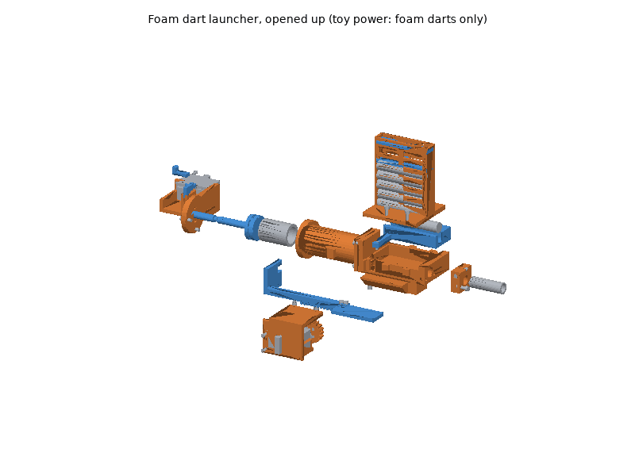

# Turret printed parts

The turret's whole mechanism is printed: the pan base that holds the pan
servo, the pan hub and tilt bracket that turn on it and hold the tilt
servo, the camera yoke on the tilt servo's two horns, two camera plates
(Arducam B0385 board, or any camera with a 1/4"-20 thread), the foam dart
launcher on the yoke (the `launcher_*` parts) and, for the standalone
turret, a base plate that carries the controller boards and screws onto a
tripod. The four Waveshare ST3215 servos with their metal horns, the
camera, the controller, the bus servo adapter, the power supply, the
emergency stop, the launcher's barrel, springs and O-rings, wiring and
fasteners are bought (see the bill of materials,
[hardware/turret.md](../../turret.md)). The pan base, pan hub, tilt
bracket, yoke, B0385 plate and the launcher are also the RACECAR Turret's
([racecar_turret/README.md](../racecar_turret/README.md)).

The kinematics are those of the turret's URDF macro
(`systems/racecar_turret/urdf/turret.urdf.xacro`, used by the RACECAR
Turret's URDF and by `turret_printed.urdf.xacro`, the standalone turret on
its base plate): pan first, then
tilt, the tilt axis 95 mm above the surface the pan base stands on (0.045 +
0.055 m above `turret/base_link`, the underside of a 5 mm plate) and the
camera on the tilt axis, about 35 mm in front of it. The upstream
`pan_tilt_ros` mechanism (`applications/pantiltros/pantiltros/urdf`) tilts
first and pans on top; its meshes (Apache-2.0, with the package) are not
used here.

The **foam dart launcher** (`systems/racecar_turret/interfaces.md`, "Foam
dart launcher") is a spring-plunger launcher for Elite-size foam darts on
the tilt stage, above the camera: its bore is parallel to the camera's
optical axis, 48 mm above it, on its centre line. Its core is parametric
(`_launcher.py`), so other vehicles can reuse it; the `launcher_*` modules
place it on the camera yoke. From the rear:

- the sear housing and rear cap (`launcher_cap`, with the trigger servo's
  cradle at its left), the sear (`launcher_sear`) and the safety catch
  (`launcher_safety`);
- the plunger tube (`launcher_tube`, 32 mm bore) with the plunger
  (`launcher_plunger`: head with an O-ring, and the rod that guides the
  spring and carries the sear's groove and the rack's collar);
- the breech (`launcher_breech`, on the yoke's pad), its sliding breech
  block (`launcher_shuttle`) and the clip of six darts on it
  (`launcher_clip`, with `launcher_follower` and `launcher_clip_cap`);
- the brass barrel in `launcher_barrel_clamp`, and `launcher_muzzle_cap`.

The third ST3215 (ID 14) hangs at the right in `launcher_servo_mount`; its
pinion (`launcher_pinion`, module 1.5, 13.5 mm pitch radius) drives the
priming rack (`launcher_rack`, with `launcher_cam` under its front). Pulling
back 38 mm (161 deg of the servo, 1833 steps), the rack's hook draws the
plunger 35 mm until the sear drops into the rod's groove (from 34.25 mm on),
and the cam moves the shuttle 17 mm to the left, under the clip, where one
dart drops into its trough; forward again, the plunger stays on the sear
(drawn 31.25 mm) and the shuttle comes back onto the bore. The fourth ST3215
(ID 15) turns `launcher_trigger_arm`, whose pin lifts the sear 5.4 mm at
0.6 rad (4.45 mm releases it): the shot. In the URDF: `actuator_joint`
(prismatic, 0 forward, 0.038 m primed), `trigger_joint` (0 safe, 0.6 rad
fires) and `turret/muzzle` at (0.133, 0, 0.048) m in `turret/tilt_link`.

**Toy power, foam darts only:** the 1.5 N/mm spring stores 1.1 J at the
sear, about 21-28 m/s with a 1.0 g dart, at most about 30 m/s; confirm it
with a chronograph at bring-up (Checks). Eye protection for everyone in
range; no stronger spring; the safety on and the muzzle cap fitted for
transport and maintenance ([hardware/turret.md](../../turret.md)).

## Printing

All parts print on a Bambu Lab P1S (256 mm bed) with Bambu Studio's P1S
system profiles; set only what the plate tables list. The STLs are in
[`stl/`](stl/), already in their print orientation: import them, keep the
orientation, and arrange.

### Plates

<!-- BEGIN GENERATED: plates (tools/build_printable_parts.py) -->
#### Plate A: ASA, 0.20 mm layers

Filament **Bambu ASA**, **Textured PEI Plate**, process **0.20mm Standard**. Estimated 10 h 08 min and 293 g of filament (estimates; slice for real numbers).

| Part | Qty | Per-object settings | Orientation | File |
|---|---|---|---|---|
| `launcher_breech` | 1 | 4 wall loops, 5/4 top/bottom shells, 25% gyroid, supports: none, brim: auto | upright: the pedestal's underside on the plate, channel open upward | [stl](stl/launcher_breech.stl) |
| `launcher_clip` | 1 | 3 wall loops, 5/4 top/bottom shells, 20% gyroid, supports: none, brim: auto | roof down: the cover's underside on the plate, clip up | [stl](stl/launcher_clip.stl) |
| `pan_base` | 1 | 4 wall loops, 5/4 top/bottom shells, 40% gyroid, supports: none, brim: auto | flange down on the plate, pocket up | [stl](stl/pan_base.stl) |
| `launcher_cap` | 1 | 4 wall loops, 5/4 top/bottom shells, 25% gyroid, supports: none, brim: auto | the cap's front face on the plate, housing and cradle up | [stl](stl/launcher_cap.stl) |
| `launcher_servo_mount` | 1 | 4 wall loops, 5/4 top/bottom shells, 25% gyroid, supports: none, brim: auto | on its side: the outer wall on the plate | [stl](stl/launcher_servo_mount.stl) |
| `launcher_tube` | 1 | 6 wall loops, 5/4 top/bottom shells, 40% gyroid, supports: tree(auto), on build plate only, brim: auto | standing on the rear flange, bore vertical (round); tree supports under the front flange | [stl](stl/launcher_tube.stl) |
| `tilt_bracket` | 1 | 4 wall loops, 5/4 top/bottom shells, 40% gyroid, supports: none, brim: auto | floor on the plate, walls up | [stl](stl/tilt_bracket.stl) |
| `camera_plate_b0385` | 1 | 3 wall loops, 5/4 top/bottom shells, 40% gyroid, supports: none, brim: auto | flat: the plate on the build plate, standoffs up | [stl](stl/camera_plate_b0385.stl) |
| `camera_yoke` | 1 | 4 wall loops, 5/4 top/bottom shells, 40% gyroid, supports: none, brim: auto | standing on the crossbar's front face, hubs up | [stl](stl/camera_yoke.stl) |
| `camera_plate_tripod` | 1 | 4 wall loops, 5/4 top/bottom shells, 40% gyroid, supports: none, brim: auto | upright: the shelf's underside on the plate | [stl](stl/camera_plate_tripod.stl) |
| `pan_hub` | 1 | 4 wall loops, 5/4 top/bottom shells, 50% gyroid, supports: none, brim: auto | upside down: the column's top face on the plate, horn disc up | [stl](stl/pan_hub.stl) |
| `launcher_pinion` | 1 | 4 wall loops, 5/4 top/bottom shells, 100% gyroid, supports: none, brim: auto | flat: the horn face on the plate, counterbores up | [stl](stl/launcher_pinion.stl) |
| `launcher_barrel_clamp` | 1 | 4 wall loops, 5/4 top/bottom shells, 60% gyroid, supports: none, brim: auto | the rear face on the plate | [stl](stl/launcher_barrel_clamp.stl) |
| `launcher_trigger_arm` | 1 | 4 wall loops, 5/4 top/bottom shells, 100% gyroid, supports: none, brim: auto | flat: the hub on the plate, pin up | [stl](stl/launcher_trigger_arm.stl) |

#### Plate B: PETG, 0.20 mm layers

Filament **Bambu PETG Basic**, **Textured PEI Plate**, process **0.20mm Standard**. Estimated 5 h 03 min and 160 g of filament (estimates; slice for real numbers).

| Part | Qty | Per-object settings | Orientation | File |
|---|---|---|---|---|
| `base_plate` | 1 | 3 wall loops, 5/4 top/bottom shells, 25% gyroid, supports: none, brim: outer brim only, 5 mm | flat: underside on the plate, bosses up | [stl](stl/base_plate.stl) |
| `launcher_shuttle` | 1 | 4 wall loops, 5/4 top/bottom shells, 40% gyroid, supports: none, brim: auto | upright: the underside on the plate, trough up | [stl](stl/launcher_shuttle.stl) |
| `launcher_rack` | 1 | 4 wall loops, 5/4 top/bottom shells, 60% gyroid, supports: none, brim: auto | on its side: the tooth profile on the plate | [stl](stl/launcher_rack.stl) |
| `launcher_cam` | 1 | 4 wall loops, 5/4 top/bottom shells, 60% gyroid, supports: none, brim: auto | flat | [stl](stl/launcher_cam.stl) |
| `launcher_clip_cap` | 1 | 3 wall loops, 5/4 top/bottom shells, 40% gyroid, supports: none, brim: auto | flat, spring boss up | [stl](stl/launcher_clip_cap.stl) |
| `launcher_follower` | 1 | 3 wall loops, 5/4 top/bottom shells, 40% gyroid, supports: none, brim: auto | flat, spring boss up | [stl](stl/launcher_follower.stl) |
| `launcher_plunger` | 1 | 4 wall loops, 5/4 top/bottom shells, 100% gyroid, supports: none, brim: auto | head down, rod vertical | [stl](stl/launcher_plunger.stl) |
| `launcher_sear` | 1 | 4 wall loops, 5/4 top/bottom shells, 100% gyroid, supports: none, brim: auto | flat: the plate on the build plate | [stl](stl/launcher_sear.stl) |
| `launcher_collar` | 1 | 4 wall loops, 5/4 top/bottom shells, 100% gyroid, supports: none, brim: auto | flat | [stl](stl/launcher_collar.stl) |
| `launcher_safety` | 1 | 4 wall loops, 5/4 top/bottom shells, 100% gyroid, supports: none, brim: auto | flat, grip up | [stl](stl/launcher_safety.stl) |

#### Plate C: TPU95A, 0.20 mm layers

Filament **Bambu TPU 95A HF (or Bambu TPU 95A)**, **Textured PEI Plate**, process **0.20mm Standard**. Estimated 14 min and 2 g of filament (estimates; slice for real numbers).

| Part | Qty | Per-object settings | Orientation | File |
|---|---|---|---|---|
| `launcher_muzzle_cap` | 1 | 3 wall loops, 5/4 top/bottom shells, 40% gyroid, supports: none, brim: auto | closed end on the plate | [stl](stl/launcher_muzzle_cap.stl) |
<!-- END GENERATED: plates -->

Times and filament are estimates from each part's volume (see
[`stl/manifest.md`](stl/manifest.md)); Bambu Studio's slice is the real
number. Print only the camera plate you need, and the base plate only for
the standalone turret.

### Material and printer notes

- **ASA** (pan base, pan hub, tilt bracket, yoke, camera plates, and the
  launcher's breech, clip, tube, cap, servo mount, pinion, trigger arm and
  barrel clamp): the servos run warm under load and the RACECAR Turret
  works in the sun. Door closed and lid on for the whole print, Textured
  PEI plate; dry the spool (8 h at 80 C) if it crackles. The pinion prints
  solid (100 % infill) for its teeth; the plunger tube with six walls so
  that its 2.4 mm wall is solid (airtight).
- **PETG** (base plate, and the launcher's sliding and loaded parts:
  shuttle, rack, cam, plunger, sear, safety, follower, clip cap): the base
  plate is a large flat part for a bench or tripod indoors; Textured PEI
  plate, the 5 mm outer brim keeps its corners down. Print it in ASA instead
  if the turret stands outdoors. PETG slides on ASA with less wear than ASA
  on ASA; the rack prints on its side so its teeth are drawn in the layer
  plane, the plunger head down, solid.
- **TPU 95A** (muzzle cap): grips the barrel.
- **No carbon-filled filament is needed.**

### Post-processing

1. **Print the fit-test parts first** and check them against the real
   servos before printing the rest. These are the parts with dimensions not
   stated in the cited drawings (they were scaled from them):
   - `pan_base`: the pan servo's bus plugs under it (the cavity and side
     windows), and how deep its M2 x 10 screws go into the case.
   - `pan_hub`: the horn's thread (M3 on Feetech's horn drawing; Waveshare's
     drawing does not state it).
   - `tilt_bracket`: the raised label cover on the servo's output face (the
     relief in the +y wall) and the bus plugs on its idler face (the -y wall
     stops behind them).
   - `camera_yoke`: the plugs' position again (the idler hub is smaller
     behind the axis to clear them).
   - `launcher_servo_mount`, `launcher_cap`: the launcher servos' plugs
     (windows in their walls).
   - `launcher_pinion`, `launcher_trigger_arm`: the horn's thread again.
   - `launcher_breech`, `launcher_shuttle`, `launcher_clip`: the shuttle's
     sliding fit under the clip, and the darts' fit (darts vary: 70-73.5 mm,
     12.7 mm); `launcher_tube`, `launcher_plunger`: the O-rings' squeeze.
     Print these and check the mechanism by hand (Checks) before the rest.
2. **Supports**: only `launcher_tube`, tree supports on the build plate
   under its front flange (it prints standing on its rear flange so its
   bore is round); none for the other parts.
3. **Heat-set inserts** (CNC Kitchen type; see the fastener table):
   soldering iron with an insert tip at **245-260 C for ASA**, 230-245 C for
   PETG. Press straight down, stop when the insert is flush.
   - `pan_hub`: 4 x M3 x 5.7 in the column's top face.
   - `camera_yoke`: 4 x M3 x 3 (short) in the crossbar, from the front,
     through holes pressed flush.
   - `launcher_breech`: 2 x M3 x 5.7 and 2 x M3 x 3 in the rear plate (the
     tube's flange), 4 x M3 x 5.7 in the wall bosses (clip), 2 x M3 x 5.7
     in the front wall (barrel clamp), 2 x M3 x 5.7 in the pedestal's
     underside (yoke pad).
   - `launcher_tube`: 3 x M3 x 5.7 in the rear flange, 2 x M3 x 5.7 in the
     lugs, from below.
   - `launcher_cam`: 2 x M3 x 3, through holes pressed flush (PETG:
     230-245 C).
   - `camera_plate_b0385`: 4 x M2 in the standoffs.
   - `base_plate`: 4 x M3 x 5.7 (pan base), 4 x M3 x 3 (Arduino standoffs),
     4 x M2 (adapter standoffs), all from the top.
4. **Holes**: clean the 3.4 mm horn screw holes and the key shafts in the
   pan hub so a 2.5 mm hex key reaches the screw heads.
5. **Launcher**: smooth the tube's bore with fine wet sandpaper (P600 to
   P1000) on a dowel, until the greased plunger slides without catching;
   clean the breech's channel and the shuttle of stringing (the shuttle must
   slide 17 mm with the clip screwed on); press the 3 x 10 mm dowel pin into
   the shuttle's tab, flush on top; cut the brass tube to 45 mm square and
   deburr it inside and out.

### Bambu Studio project files

Not provided. A Bambu Studio 3MF carries per-plate filament, process and
object settings in Bambu's own project metadata, which can only be checked
by opening it in Bambu Studio; a plain 3MF would drop those settings.
Import the STLs instead (they are already oriented) and set the per-object
values from the plate tables.

## Assembly

### Tools and consumables

- Hex keys: 1.5 mm (M2), 2.0 mm, 2.5 mm (M3), a long 2.5 mm key (60 mm or
  more) for the pan hub screws, 5/32 in for the 1/4"-20 button head.
- Soldering iron with a heat-set insert tip.
- Medium (blue) thread locker for the horn screws (into metal) only.
- Dry PTFE spray for the rack and pinion; silicone grease for the O-rings,
  the tube's bore and the shuttle's faces; no oil on ASA.
- A tube cutter and a deburring tool for the brass barrel; safety glasses
  for the launcher's checks and for everyone in range when it is armed; a
  chronograph.
- Zip ties (2.5 mm), 10 mm spiral wrap for the cable loop.
- The servo IDs and centring tool: a PC with the bus servo adapter's USB
  (jumper on B) and Feetech's FD software or `SCServo_Linux` examples, or the
  turret firmware's own commands (hardware/turret.md).

### Fasteners

Every screw, insert and nut with its quantity and use is in the generated
fastener table of the BOM:
[hardware/turret.md, "Fasteners"](../../turret.md#fasteners). Torque:
"snug" for every screw into an insert or into the servo case; the horn
screws (M3 x 5) go into the aluminium horns: firm, with blue thread locker.
Do not use longer horn screws: by the drawings the horns' flanges sit only
about 0.1 mm above the servo cases, so a longer screw scrapes the case as
the horn turns.

### Steps

Turret directions: **x forward (the camera's view at pan 0), y left, z up**,
from the pan axis on the surface the pan base stands on.

1. **Servo set-up.** Before assembly, set the IDs (pan 12, tilt 13, as
   `applications/pantiltros/pantiltros/config/ctrl_config.yaml` and the
   firmware, and the launcher's actuator 14 and trigger 15) and move each
   servo to its
   centre, step 2048 (hardware/turret.md). Keep the horns off for now.
2. **Inserts.** Press all heat-set inserts (Post-processing, step 3).
3. **Pan servo.** Put the pan servo in the `pan_base` pocket, output shaft
   up and toward the front (the short end of the pocket), and screw it in
   with two M2 x 10 from below through the pocket's far-end block. Both bus
   cables plug into the servo's underside before it goes in and leave
   through the side windows.
4. **Base.** Standalone turret: drop the 1/4"-20 nut into the hex shaft at
   the centre of the `base_plate`, then bolt the pan base onto the plate
   with four M3 x 10 (the pan base keeps the nut captive). RACECAR Turret:
   bolt it to the turret plate instead (its README).
5. **Pan horn and hub.** With the pan servo at step 2048, press the output
   horn onto the spline with one hole pair pointing forward, and fix the
   horn's centre screw. Put the `pan_hub` on the horn, the column's long
   side toward the rear, and fix it with four M3 x 5 (three of them down
   the key shafts with the long key), blue thread locker.
   *Check:* the hub turns with the horn over +-90 deg without touching the
   pan base or the servo case.

6. **Tilt bracket.** Screw the `tilt_bracket` onto the pan hub with four
   M3 x 8, heads in the floor's counterbores.
7. **Tilt servo.** Plug its bus cable in, then lay the tilt servo in the
   bracket without horns: output face on the +y (left) side, shaft at the
   front, far end against the rear stop. Fix it with two M2 x 8 through the
   thicker +y wall and two M2 x 6 through the -y wall (heads in the
   counterbores).
8. **Tilt horns and yoke.** With the tilt servo at step 2048, press both
   horns on with a hole pair at 45 deg (the idler horn onto the idler hub
   with its PA3.0 screw), fit the `camera_yoke` crossbar forward and fix it
   with eight M3 x 5 (blue thread locker).
   *Check:* by hand, the yoke tilts from fully down (-37 deg) to fully up
   (+43 deg) touching nothing; the idler-side hub clears the bus plugs.
9. **Camera.** Arducam B0385: screw the board onto the
   `camera_plate_b0385`'s standoffs with four M2 x 5, its connector toward
   the bottom edge, then the plate onto the yoke's crossbar with four M3 x 6.
   A camera with a 1/4"-20 thread: the `camera_plate_tripod` with four M3 x 6
   (heads in the counterbores), the camera's back against it, its 1/4"-20 x
   3/8" from below through the shelf's slot.

The launcher is built on the bench, with the safety on and no darts, and
mounted on the yoke last. Wear safety glasses from step 13 on.

10. **Breech, clip and barrel.** Press the dowel pin into the
    `launcher_shuttle`'s tab, grease its top and end faces lightly, and drop
    it into the `launcher_breech`'s channel, trough up, the tab out through
    the slot in the breech's right (-y) wall. Screw the `launcher_clip` (the
    breech's cover with the clip on it) on with four M3 x 10. *Check:* the
    shuttle slides its 17 mm with no play and no tight spot. The clip loads
    from the top: up to six darts, the `launcher_follower`, the clip spring
    and the `launcher_clip_cap`, held by two M3 x 25 pins (nyloc nuts). Push the brass
    barrel into the front wall's seat until its rear face is flush with the
    chamber's front face (a straight edge across the chamber), slide the
    `launcher_barrel_clamp` over it and screw it to the front wall with two
    M3 x 14, then tighten its M3 x 25 pinch screw (nyloc nut). Fit the
    `launcher_muzzle_cap`.
11. **Plunger tube.** Fit the 10 x 2 O-ring on the `launcher_tube`'s outlet
    spigot and the 27 x 2.5 O-ring on the `launcher_plunger`'s head, both
    greased, and slide the plunger into the tube from the rear, head first.
    Put the spring over the rod. Put the `launcher_sear` (its small spring on
    its peg) into the slot of the `launcher_cap` from below, push the cap
    over the rod against the spring (the rod lifts the sear), and screw the
    cap to the tube's rear flange with three M3 x 12. Screw the
    `launcher_collar` onto the rod's tail with an M3 x 8. Slide the
    `launcher_safety` into its slot in the housing, pushed in (SAFE).
    *Check:* pulled by the collar, the plunger draws smoothly against the
    spring and returns; the sear rides on the rod.
12. **Tube onto the breech.** Push the tube's spigot into the breech's
    rear socket and screw the tube's front flange on with two M3 x 10 (lower)
    and two M3 x 8 (upper).
13. **Priming drive.** Screw the `launcher_cam` under the front of the
    `launcher_rack` with two M3 x 6 into its inserts. Set the actuator servo
    (ID 14) to step 2048, plug its cable in, fit its output horn, and screw
    it into the `launcher_servo_mount` with two M2 x 6 (far end against the
    rear stop, output face toward the rack). Screw the mount under the
    tube's two lugs with two M3 x 10. Lay the rack in from the front: the
    cam plate on the breech's shelf, the dowel pin in the cam's slot (the
    shuttle at its firing position, toward -y), the hook behind the sear
    housing, the rod through the hook's slot in front of the collar, the
    teeth under the mount's shoe. With the rack forward against its front
    position, slide the `launcher_pinion` onto the horn into mesh at the
    nearest tooth and fix it with four M3 x 5 (blue thread locker).
    Priming turns the horn clockwise, seen from the pinion's side.
14. **Trigger.** Screw the `launcher_trigger_arm` onto the trigger servo's
    (ID 15) output horn with four M3 x 5, the arm pointing forward with the
    servo at step 2048, and the servo into the cap's cradle with two M2 x 6.
    *Check:* the arm's pin sits about 2.5 mm under the sear's lug.
15. **On the yoke.** Set the launcher's pedestal on the `camera_yoke`'s pad
    and screw it on from below with two M3 x 10 (a long 2.5 mm key between
    the crossbar and the tilt servo). Route the two launcher servos' cables
    (Wiring). *Check:* by hand, the tilt runs from -37 to +43 deg and the
    pan over +-90 deg, touching nothing; the launcher is heavy (about
    425 g): support it while the servos are unpowered.
16. **Controller** (standalone turret): the Arduino UNO R4 WiFi or UNO Q on
    the base plate's rear standoffs (four M3 x 5), its USB-C at the rear
    edge, and the Bus Servo Adapter (A) on its four standoffs (four M2 x 5).
17. **Wiring** as below, then the **Checks**.

### Wiring

- **Servo bus:** adapter servo port -> pan servo (under it, through a side
  window of the pan base) -> tilt servo -> launcher actuator servo ->
  trigger servo (daisy chain, each servo's second connector). The tilt
  servo's cable crosses the pan joint: tie it at the pan base's rear hook and
  at the tilt bracket's rear hook, with a loose loop between them (the
  assembly check below gives its length), in spiral wrap together with the
  camera cable. The actuator servo's cable (about 25 cm) crosses the tilt
  joint: from the tilt servo's second connector up to the actuator servo's
  plugs, with a loop at the tilt axis for the 80 deg of tilt, tied at the
  actuator mount; from there about 25 cm along the tube to the trigger
  servo, tied at the cap's cradle.
- **Camera:** the B0385's cable leaves the connector downward, under the
  crossbar: tie it through the camera plate's bottom slot with a small loop
  for the tilt, then along the same loop over the pan joint.
- **Controller:** UNO R4 WiFi or UNO Q `D1` (TX) and `D0` (RX) to the
  adapter's UART header (TX to TX, RX to RX as Waveshare's wiki says), GND
  to GND, jumper on A (UART). Direct from a Linux host: the adapter's USB-C
  (jumper on B) or the host's UART; leave the Arduino standoffs empty
  (hardware/turret.md, "Direct from a Linux host").
- **Power:** the 12 V servo supply into the adapter's DC jack or screw
  terminal **through the emergency stop**; never from the Arduino. Common
  ground between the supply, the adapter and the controller. Four servos
  stalled draw 10.8 A at 12 V: size the supply, fuse and stop as
  hardware/turret.md says.

### Checks

Then follow the bring-up in [hardware/turret.md](../../turret.md) (servo
IDs, zero offsets, directions, limits, the e-stop release) and
[applications/pantiltros/README.md](../../../applications/pantiltros/README.md).

<!-- BEGIN GENERATED: assembly (tools/build_printable_parts.py) -->
Generated by the assembly check (`assembly.py`), from the CAD and datasheet masses:

- Bodies in the check: 119
- Interference between parts (screws modelled through their holes): none (shot, cocked, primed, firing, safe)
- Intended press fits: 1
- tilt_sweep_b0385: clear from -37.2 to 43.0 deg, launcher cocked and primed; smallest gap 0.6 mm (yoke_screw_1_-5_-5 / tilt_servo_case at -37 deg, cocked)
- tilt_sweep_d435i: clear from -37.2 to 43.0 deg, launcher cocked and primed; smallest gap 0.6 mm (yoke_screw_1_-5_-5 / tilt_servo_case at -37 deg, cocked)
- pan_sweep: clear over +-90 deg at both tilt limits and level, launcher cocked and primed; smallest gap 0.6 mm (hub_screw_0_7 / pan_servo_case at -90 deg, tilt -37, cocked)
- Camera view clear: yes (B0385 70 x 46 deg; D435i colour 69 x 42 deg on the tripod plate; each + 2 deg margin, at both tilt limits and level, launcher cocked and primed, clip full)
- d435i_depth_view: the D435i's 87 x 58 deg depth view sees launcher_barrel
- tilt_axis_mm: 95 above the mounting surface (100 above turret/base_link with a 5 mm plate; URDF 0.045 + 0.055 m)
- camera_mm: B0385 sensor 33.2, lens front 49.7 ahead of the tilt axis, on its height; URDF turret/camera_link 35
- launcher: bore 48 mm above the camera's axis, parallel, on its centre line; muzzle (turret/muzzle) (133, 0, 48) mm in turret/tilt_link; actuator_joint 0..0.038 m (sear catches from 34.25 mm), origin (-103.5, 0, 58); trigger_joint 0 safe, 0.6 rad fires, axis at (-109, 21.375, 59); spring 1.5 N/mm, 1.11 J at the sear; 25.1 cm3 plunger for 15.2 cm3 of bore; 21-28 m/s at 20-35 % efficiency (chronograph at bring-up)
- line_of_fire: a dart's path (14 mm, 2 m from the muzzle) clears the turret's base at every pan and tilt; closest 81 mm (dart_path / base_plate at pan -60, tilt -37)
- cable_loop_mm: hook to hook 45-74 mm over the pan range: leave 120 mm of cable between the two ties
- launcher_mass_g: 428 with a full clip (printed 275, two servos 110, spring 16, barrel 7.5, hardware 14, darts 6); centre of mass -37 mm along the bore from the chamber's rear face, +2 mm toward the plunger tube, -1 mm sideways
- moving_mass_g: tilt stage 459 with the launcher and a full clip (31 without), pan stage 541
- tilt_load: worst static torque over the tilt range, full clip, against the tilt servo's 2.94 N m stall: B0385, cocked: 0.214 N m (14x margin); B0385, primed: 0.221 N m (13x margin); D435i, cocked: 0.194 N m (15x margin); D435i, primed: 0.201 N m (15x margin); centre of mass (-22, 47) mm from the tilt axis with the B0385 (without the launcher 0.008 N m)
- All assembly checks passed: yes
<!-- END GENERATED: assembly -->

- **Range by hand.** Servos unpowered (torque off), no darts, safety on,
  muzzle cap on: turn the pan over +-90 deg and the tilt between -37 and
  +43 deg with the cables connected: nothing touches and no cable pulls
  tight.
- **Launcher servos: zero and direction.** With the actuator's torque limit
  low (about 20 %), step the rack forward until its hook touches the sear
  housing: 0.5 mm (24 steps) back from there is 0 m. Put that step in
  `actuator_zero_steps` (the bridge's
  `applications/pantiltros/config/arduino_bridge.yaml`, the firmware's
  `turret_config.h`) and set `actuator_direction` so that a positive command
  draws the rack back; 38 mm (prime) is 1833 steps from 0. The trigger's 0
  is its arm level with the pin about 2.5 mm under the sear's lug; set its
  zero step and direction so that a positive angle lifts. Then set the
  working torque limits: actuator about 55 %, trigger about 30 %.
- **Dry cycle** (no darts, safety glasses on, nobody in front): prime to
  38 mm: the shuttle goes left under the clip and the sear clicks into the
  rod's groove from 34.25 mm on; back to 0: the plunger stays drawn, the
  shuttle comes back. Safety on: the trigger at 0.6 rad stalls against it
  and nothing moves. Safety off: the trigger releases the plunger. The
  plunger must not go forward on its own at any point, and with the safety
  on a cocked launcher must stay cocked when the e-stop drops the servos.
- **Feed.** Load six darts (foam Elite-size only); each prime-and-return
  cycle chambers one dart and the clip's next one stays above the shuttle.
- **Muzzle velocity: chronograph** (everyone in range in eye protection,
  foam darts only): ten shots through the chronograph. The mean and every
  shot must be under 30 m/s (100 fps); the design expects about 21-28 m/s.
  Over 30 m/s: a softer spring, never anything stronger.
- **Zero and direction.** Command 0 rad on both joints: the camera looks
  straight ahead and level. If not, set the zero offsets (step at 0 rad,
  `src/turret_config.h` or the bridge's `*_zero_steps`). A positive pan
  command turns the camera right and a positive tilt command up; if one is
  reversed, flip its `direction`.
- **E-stop.** With the servos holding a pose, pressing the e-stop must make
  all four go limp at once (a cocked plunger stays on the sear: put the
  safety on).
